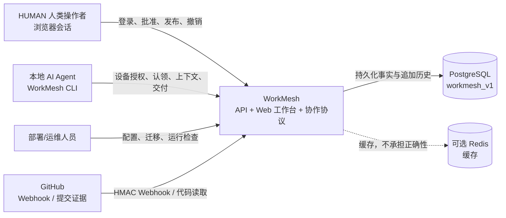
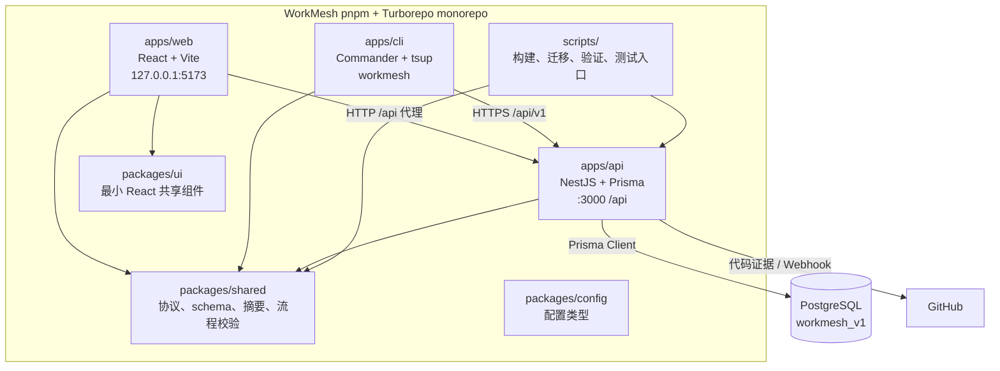
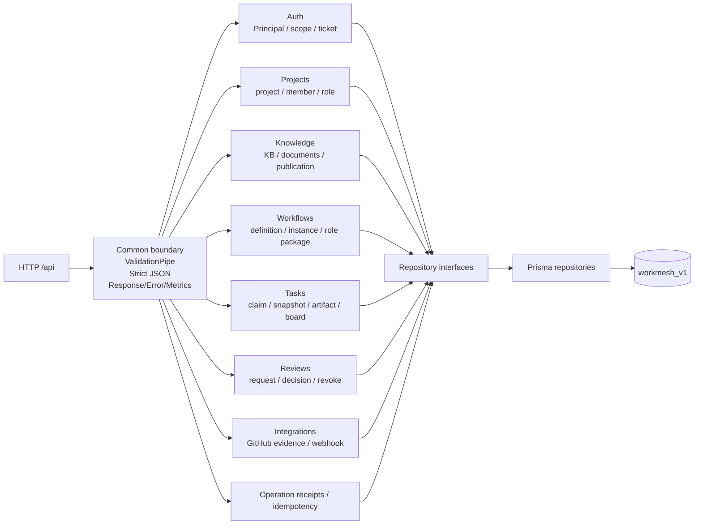
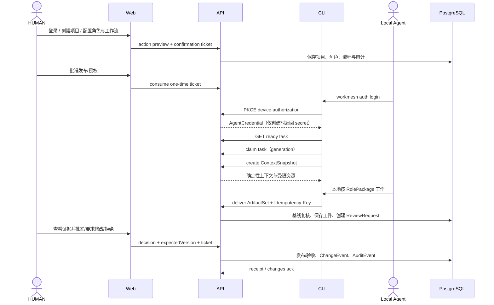
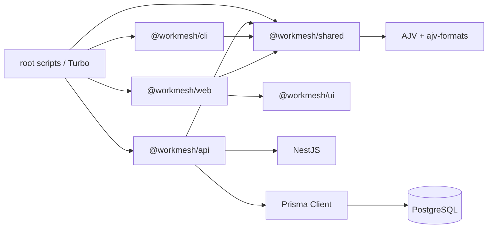
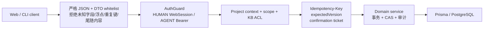
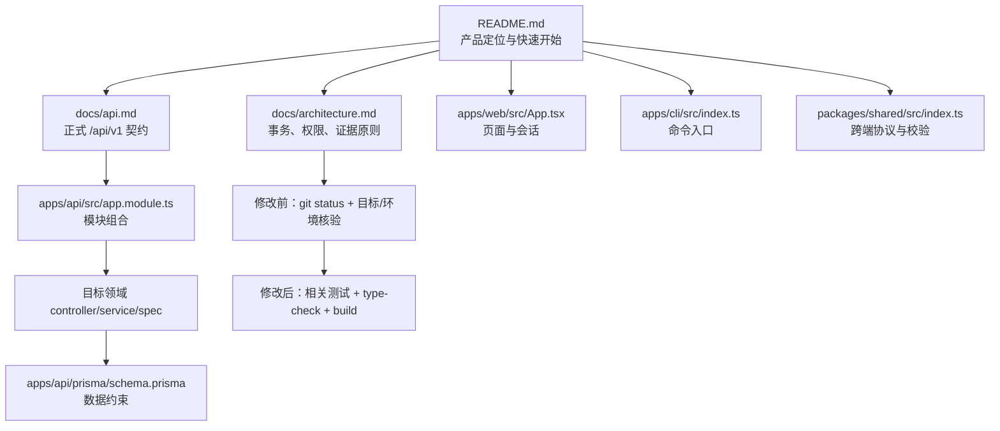
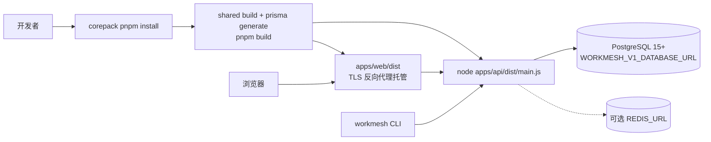

# WorkMesh Code Wiki：架构图册

## Architecture Diagrams

> 图例基于当前工作树的源码、package manifests、Prisma schema、运行脚本和 `docs/*.md`。每张图都说明置信度；真实 PostgreSQL、浏览器和 GitHub live 链路尚未由本次分析执行。

## 1. 系统上下文图

**目的**：说明使用者、WorkMesh 和外部系统的边界。

**置信度**：高。边界由 README、部署文档、AppModule、Vite 配置、Prisma datasource 和 integrations 模块直接支持。

**边证据**：`README.md` 明确三个产品面；`docs/deployment.md` 明确 PostgreSQL 与可选 Redis；`docs/api.md` 和 `apps/api/src/integrations/` 明确 GitHub 集成。

## 2. 容器与运行时图

**目的**：展示 monorepo 中可独立运行或构建的单元。

**置信度**：高。

**边证据**：各 package.json 的 workspace 依赖；`apps/web/vite.config.ts` 的 `/api` proxy；`apps/api/src/app.module.ts`；`schema.prisma` datasource；`scripts/*.sh`。

## 3. API 模块图

**目的**：定位后端领域模块和公共边界。

**置信度**：高；模块注册来自 `apps/api/src/app.module.ts`，领域职责来自目录、controller、service、repository 和 API 文档。

**边证据**：`AppModule` imports、各 `*.module.ts`、`v1-*.service.ts` 与 `v1-*.prisma-repository.ts` 的命名/导入关系。图中“Common boundary”也包含全局 middleware/interceptor/filter。

## 4. Agent 交付与人类评审时序图

**目的**：展示 WorkMesh 最核心的业务闭环。

**置信度**：高（控制步骤来自 `docs/api.md`、CLI 命令和领域服务；真实部署未执行）。

**省略**：GitHub 证据准备和 Webhook 是可插入的集成支路；图中没有把它们画成每次交付都必经。

## 5. 依赖方向图

**目的**：明确 workspace 包和运行时依赖，避免把共享包当作反向依赖 API。

**置信度**：高，来自各 `package.json` 和源码 imports。

## 6. 边界与契约图

**目的**：展示验证、身份和写入保护所在的边界。

**置信度**：高，来自 `docs/api.md`、`main.ts`、`v1-auth*`、`v1-confirmation*`、`common` 和 shared 包。

**关键约束**：客户端不能自报身份、角色、版本、审批槽或 system gate；确认票据绑定主体、会话、动作、目标、版本和 payload 摘要，只消费一次。

## 7. AI Agent 导航图

**目的**：给未来 Agent 一个最短安全阅读路径。

**置信度**：高；路径均为当前工作树文件。

## 8. 部署/运行图

**目的**：区分构建、API 进程、Web 托管和外部数据库。

**置信度**：高（部署文件和文档支持）；实际反向代理配置不在仓库中。

**运行前门禁**：`scripts/db-check.sh` 检查当前数据库；`scripts/db-plan.sh` 输出迁移计划；确认目标和回滚方式后才运行 `prisma migrate deploy`。`scripts/test-integration.sh` 默认不迁移，需显式 `--apply-migrations`。

## 9. 图册假设与遗漏

- 没有画出后台队列、定时 worker 或消息总线，因为当前源码和脚本没有足够证据证明存在这些运行单元。
- Redis 以虚线表示可选缓存；`docs/deployment.md` 明确未设置时直通且不影响正确性。
- Web 页面与 API resource 的细粒度映射只在页面和 `src/api/resources.ts` 中分散体现，未做浏览器 E2E，因此图中保持容器级关系。
- GitHub live runner 当前明确未实现，不能从适配器存在推断线上 GitHub 已验证。
