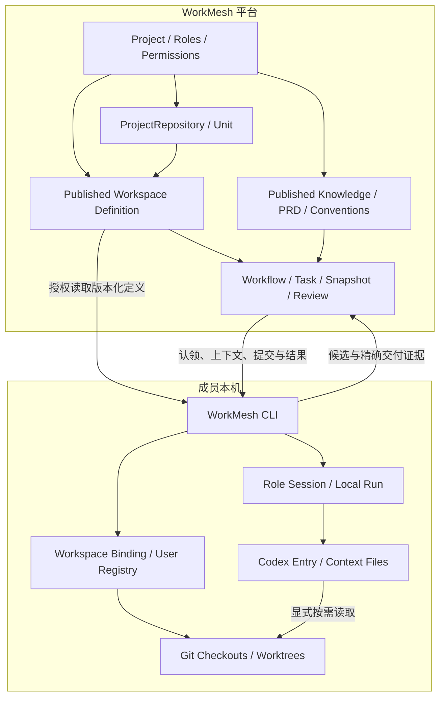
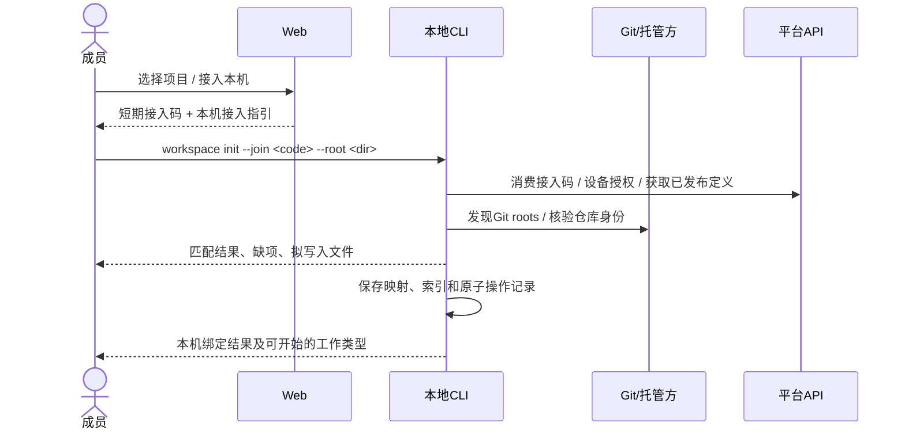
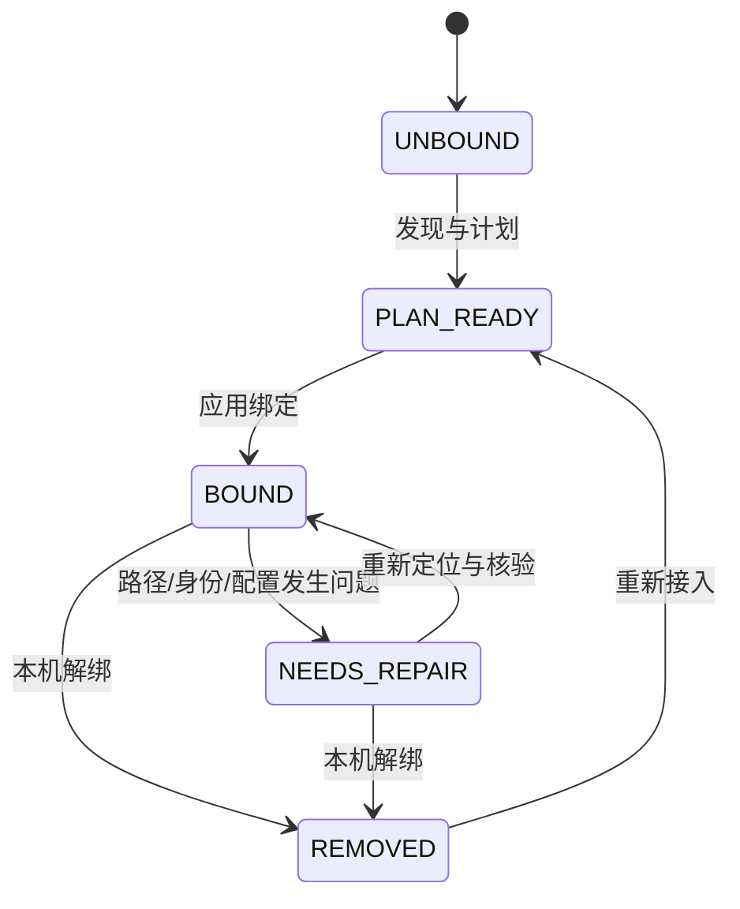

# 项目接入、本地工作区与任务上下文设计

> 版本：v1.3 · 日期：2026-11-05 · 状态：待评审设计方案，尚未实施（v1.3 为 v1.2 的契约返修，未开始编码与迁移）。  
> 通用设计：适用于单仓库、多仓库、monorepo，以及没有代码 checkout 的产品/业务工作区。易番番（yifanfan）只作为触发问题的验证案例，不是产品模型或实现前提。  
> 代码核对基线：本次修订读取的工作树 HEAD `6a65a8d`（`566b002` 的后续提交），工作树含其他任务并行未提交改动；本次只修改本文件，未改代码、未执行迁移，不将设计项描述为已实现能力。  
> 使用边界：以下新增命令、接口、配置和状态均为拟议契约；现有命令明确标注“复用”。运行实例中的任何项目、仓库登记、权限与托管厂商均需接入时核验。
> 修订说明（v1.2）：本版只修订设计文档与实施契约，不产生代码、迁移或补丁。新增/重写契约：§7.4（身份字段与数据库约束）、§8.2.1（v2 配置字段与存储边界）、§9.4（离线 bind 缓存）、§13.3（权限/确认/幂等矩阵）、§13.4（版本与 CAS）、§13.5（接入码端到端）、§14.3（命令 × 配置状态与迁移归属）、§16.4（迁移失败恢复）、§17.1（补充失败场景）、§18.1（P0a/P0b 范围修正）、§19.2.1（P0a 新增必过用例）、§21.1（决策与默认）、§24（实施任务与依赖）、§25（P0a 验收闭环）、§26（修订记录）。与 §18/§19 的旧表述冲突时，以 §18.1/§19.2.1/§24/§25 为准。所有结论区分“静态审查认为可行”与“已通过迁移/运行验证”。
> 返修说明（v1.3）：收敛 v1.2 剩余的五处契约矛盾——同 canonical locator 的复用与 `LOCATOR_ALREADY_BOUND` 边界、接入码必须以已发布定义为前提、发布递增 `definitionVersion` 使旧草稿失效、双配置状态模型、P0a 不核验 provider 的统一口径与 `T8 → T6` 正式依赖。详见 §26。

## 1. 决策摘要

### 1.1 要解决的问题

用户已经在平台选择一个项目，进入 Codex 后仍要重新告诉工具项目身份、代码位置、知识入口和下一步操作。团队成员的路径不同，仓库拓扑和角色切换进一步增加重复配置与误操作的可能。易番番暴露了这一断点，但解决方案必须覆盖任意项目拓扑。

本方案交付的能力是：**负责人准备一次共享项目信息；成员在每个本机工作区关联一次；后续从目录或任务恢复项目身份，按当前角色与任务取得正确上下文。**

团队共享项目、仓库及正式知识的身份和版本。绝对目录属于本机；目录名称不能证明仓库身份。平台知识库可独立于代码目录存在，但必须说明归属、有效版本与来源。

### 1.2 核心决策

| 编号 | 决策                                                                              | 理由                                                    |
| ---- | --------------------------------------------------------------------------------- | ------------------------------------------------------- |
| D01  | 平台发布版本化工作区定义，成员维护本机绑定                                        | 共享“项目由什么组成”，允许不同机器使用不同路径          |
| D02  | 继续使用 `Project / ProjectRepository / KnowledgeBase / Unit`，不新增平行项目目录 | 保持身份、权限、交付证据的一致来源                      |
| D03  | 工作区绑定与角色会话分离                                                          | 同一工作区可供同一成员以不同授权角色使用，不必重绑代码  |
| D04  | 按任务准备所需仓库和知识，不要求所有成员拉齐所有仓库                              | 产品探索与代码实施的准备条件不同                        |
| D05  | 本机诊断与服务端业务门禁分别判断                                                  | 平台不能把客户端自报的目录和 HEAD 当成可信交付证据      |
| D06  | 精确记录每次任务使用的知识修订和代码依据                                          | 默认分支与“最新文档”不能替代本次任务基线                |
| D07  | 第一版采用 Web 指引 + CLI 接入 + Agent 文件入口                                   | 不依赖浏览器读磁盘、常驻本地服务或未经验证的 Codex 深链 |
| D08  | 接入和正式知识初始化分别实施、明确衔接                                            | 绑定目录不代表已理解业务，生成草稿不代表正式发布        |

### 1.2.1 本版新增决策（v1.2–v1.3）

| 编号 | 决策 | 理由 |
| ---- | ---- | ---- |
| D09 | 仓库身份字段与展示字段分离：`identityMode=DECLARED|PROVIDER`；PROVIDER 必须有 `adapter+externalId`，DECLARED 两者必须为 NULL；`owner/name` 仅为展示字段 | 防止用 URL、`owner/name` 或空串冒充稳定厂商 ID；数据库 CHECK 与声明 locator 约束见 §7.4 |
| D10 | 版本命名统一：`Project.version`（projectVersion）、`ProjectWorkspaceDefinition.version`（definitionVersion）、`ProjectWorkspaceDefinitionRevision.revisionNo`；API 字段为 `expectedProjectVersion` / `expectedDefinitionVersion` | 避免"expectedVersion"在不同接口指不同资源；发布同时校验两个版本 + payload digest（§13.4） |
| D11 | v1→v2 迁移归入 P0a（窄范围，只迁移 8 个既有字段到 workspace + 用户索引），P0b 只做 session/run 与自动恢复 | `workspace init --join` 只写 v2；若 P0a 同时保留旧命令写 v1，会产生双份配置分叉（§14.3） |
| D12 | P0a **冻结为不做真实 provider 核验**：`verify` 可不暴露，或仅返回 `UNAVAILABLE/PROVIDER_UNSUPPORTED` 诊断占位；**不调用 provider API、不写 `PROVIDER_VERIFIED`/`lastVerified*`**；真实核验属 P1/P2 adapter 范围 | GitHub adapter 当前未接线、无生产 provider 配置；不能把 DECLARED_MATCH 说成 provider 验证。扩大 P0a 范围需走变更请求，不是开放待决项 |
| D13 | 接入码只存哈希、不可回放明文；同一 Idempotency-Key 重试返回 `ENROLLMENT_CODE_NOT_REPLAYABLE`，由用户重签并使旧码作废 | 只有哈希才能保证泄露面最小；回放明文需要额外加密存储，P0a 不引入 |
| D14 | 离线 `bind` 仅在"摘要校验通过的 revision 缓存 + 精确 canonical locator 匹配"时允许；否则拒绝，不按目录名/仓库名猜测 | 离线无法在线核验身份，宽松匹配会制造假绑定（§9.4） |
| D15 | 接入码只对**已发布定义**签发：未配置项目不能签发/消费；无代码项目先发布 `layout.kind=NONE`。`GET workspace-definition` 仍保留 `NOT_CONFIGURED` 作为只读状态 | 避免"签发禁止、消费/初始化又允许 null revision"两套互斥语义（§13.5） |
| D16 | 定义发布成功时 `definitionVersion + 1` 并返回新版本。发布前打开、仍持有旧 `expectedDefinitionVersion` 的编辑器，**若使用新的写请求/新的 `Idempotency-Key`** 保存草稿 → 409 `DEFINITION_VERSION_CONFLICT`；相同旧 key + 相同摘要的幂等重放仍返回首次成功响应 | 既让旧编辑器不能覆盖新基线，又不把合法的幂等重放误判为版本冲突（§13.4） |
| D17 | 本机配置区分 `V1_ONLY / V2_ONLY / MIGRATED / DUAL_ACTIVE / NONE` 五态；`MIGRATED` 的 v1 备份（`config.v1.<ts>.json.bak`）不是活动配置；`DUAL_ACTIVE` 是硬冲突 | "迁移后保留的备份"与"两份同时活动"必须区分，否则适配层和命令行为会分叉（§14.3） |

### 1.3 范围与完成口径

本方案覆盖共享配置、本机目录映射、仓库识别、工作区发现、角色会话、Codex 入口、上下文、知识来源、接口、迁移、异常恢复、实施顺序及验收。

平台继续负责正式事实、权限、流程、证据和决定；本地 CLI/Agent 负责读本机目录、准备工作区和生成草稿。正式批准继续使用 HUMAN Web 会话和现有确认机制。

第一版不包含云端执行器、常驻桌面守护进程、远程文件系统控制、全仓库源码上传、跨成员文件同步、自动执行业务环境安装脚本，也不承诺一键启动所有历史系统。

## 2. 用户、目标与使用痛点

| 用户            | 期望结果                           | 当前摩擦                              | 设计响应                             |
| --------------- | ---------------------------------- | ------------------------------------- | ------------------------------------ |
| 项目负责人      | 建好项目后能邀请成员开始工作       | 项目、仓库、知识、流程准备程度不清楚  | 项目接入概览与可修复缺项             |
| 产品人员        | 输入需求，Agent 理解现状并整理材料 | 先学习目录、UUID、CLI 才能提需求      | 产品资料工作区；业务名称与任务入口   |
| 开发人员        | 复用已有 checkout，按规范完成任务  | 多仓路径、角色配置、上下文重复准备    | 自动匹配候选仓库、一次绑定、任务预检 |
| 测试人员        | 取得与本次交付对应的验收资料       | “最新知识”与被测交付可能不一致        | 精确修订、交付提交与测试目标关联     |
| 新成员          | 在任意本机目录接入同一项目         | 需要问同事要目录布局、仓库和资料      | 共享定义、按需取得代码、接入报告     |
| 多机/多任务成员 | 切换电脑或 checkout 后恢复工作     | 一个 project 被误等同于一个路径或角色 | 多 workspace、多 session、本机索引   |

验收目标是减少用户需要记住和重复输入的技术信息，同时提高可解释性。不能通过隐藏错误、默认猜测项目或放宽服务端证据来减少步骤。

## 3. 事实基线与待核验项

### 3.1 当前代码已具备

| 能力                                 | 代码依据                                         | 本方案用法                         |
| ------------------------------------ | ------------------------------------------------ | ---------------------------------- |
| 项目、默认角色、默认产品知识库创建   | `apps/api/src/projects/projects.service.ts`      | 复用，区分“空库已建”与“知识可用”   |
| `KnowledgeBase.projectId` 与发布修订 | `apps/api/prisma/schema.prisma`                  | 复用项目归属、权限和发布机制       |
| 远端仓库稳定身份 `ProjectRepository` | 同上；`apps/api/src/projects/dto.ts`             | 复用，补身份核验结果与来源能力     |
| `Unit.repositoryId / repoPath`       | 同上；`apps/api/src/projects/units.service.ts`   | 复用仓库内单元路径，不当成本机路径 |
| 流程实例的仓库范围                   | `apps/api/src/workflows/v1-workflow.service.ts`  | 作为任务所需仓库的上界之一         |
| 角色包安装、设备授权、工作区配置     | `apps/cli/src/setup.ts`、`roles.ts`、`config.ts` | 兼容现有凭据和角色资源             |
| 上下文快照、候选、交付、评审         | `apps/cli/src/index.ts`；API 对应服务            | 复用，不另建批准通道               |
| GIT_REF 精确仓库/提交/路径引用       | `apps/cli/src/deliver.ts`                        | 继续作为代码工件的定位要求         |

### 3.2 当前缺口

1. 工作区配置只有一个可空 `repositoryId`，没有多仓本机路径映射。
2. 配置把 `roleKey` 固定在工作区层，限制同目录角色切换。
3. CLI 当前从 `--dir` 或 cwd 直接读取配置，未实现向上发现及明确的多仓桥接。
4. `setup` 不校验本机 Git root、remote 与平台仓库身份；复用旧配置时还需统一校验平台、项目、角色的一致性。
5. 常规项目页面尚无完整仓库维护和本机接入流程。
6. 项目仓库登记 DTO 当前只接受 `github`；不能假定任意项目或代码托管厂商都已被支持。若要在无 adapter 时支持通用本机绑定，需要显式增加带审计的 HUMAN 来源声明模型。
7. 平台创建知识库、发布文档，不等于当前 Codex 会话已经加载相关资料。
8. 历史项目扫描、知识草稿提炼与持续更新已有讨论，未形成完整产品能力。

历史设计曾提出工作区发现和 onboarding，见 [本地工作流设计](../superpowers/plans/workmesh-technical-v1/03-local-workflows-clients.md)、[易番番接入讨论（案例）](../yff-workmesh-discussion-context-2026-11-03.md)、[使用体验改进方案](../usage-optimization-solutions-2026-11-04.md)。本文统一相关问题的目标契约，已有讨论中的拟议命令不视为实施依赖；易番番专属数据只用于验证通用性。

### 3.3 实施前的事实核验

必须查询所选项目的真实 ID、当前知识库和发布资料、仓库 remote/托管厂商、成员权限、现有绑定以及实际可运行的验证方式。展示结果时区分“已核验”“用户声明”“待核验”。不得根据文件夹名、演示数据或示例 URL 自动建立正式身份。

### 3.4 本次修订的事实修正（代码核对 HEAD `6a65a8d`）

以下为重读当前工作树后对 v1.1 事实描述的修正。这些是**静态审查事实**，不是迁移或运行验证结论：

1. **v1 配置不是 5 个字段**：`apps/cli/src/config.ts:13-22` 实际为 8 个字段——`schemaVersion / profile / platform / projectId / roleKey / repositoryId / host / workflowDefinitionRevisionId`；未知字段与 token 类字段会被拒绝（config.ts:24-44、108-153）。§14.1 已按此修正。
2. **仓库接口存在，但不满足本仓库自身的写路径规范**：`GET/POST/DELETE /api/v1/projects/:projectId/repositories` 存在（projects.controller.ts:93-142），但创建/归档没有审计、没有幂等、没有版本 CAS，也不检查归档项目（projects.service.ts:601-675）；`ProjectRepository.adapter/externalId` 均 NOT NULL（schema.prisma:1171-1172）。P0a 必须先补齐这些，不能直接在旧接口上叠加声明端点。
3. **GitHub adapter 未接线**：`GithubCodeHostAdapter` 仅在其 spec 中被实例化，`integrations.module.ts` 只导入 evidence 模块；当前没有 `verify` 路由，也没有生产 provider 配置。因此 P0a 的 `verify` 只能返回 `UNAVAILABLE/PROVIDER_UNSUPPORTED`，或按产品决定整体推迟（§18.1）。
4. **现有 Web 存在与设计冲突的兜底**：`WorkflowInstanceDialog.tsx:497-502` 在未填 GitHub 仓库 ID 时把 `externalId` 写成 `owner/name`（提示见 :861-874），这正是设计禁止的"自报 ID 冒充稳定身份"；同一文件 :821/:837 以及 `Projects.tsx:213`、`resources.ts:482` 还使用 `yesgoo/yifanfan/YFF` 等案例占位。P0a T2 必须改为走声明端点，新代码不得引入这些名称。
5. **设计缺少接入码消费 API 与 CLI 初始化步骤**：§13.2 只有生成接口；`workspace init --join` 的消费、设备授权、取定义、写本机配置的顺序未定义。本版补 §13.5，并在 §24 增加 CLI 初始化任务 T6。
6. **迁移原子性不能假定**：仓库现有 15 个迁移（0001–0015）全部为手写 SQL，文件内**没有任何 `BEGIN/COMMIT`**；安装的 Prisma 为 5.22.0。不能假设"单个 migration 文件失败会自动整份回滚"，恢复流程见 §16.4。
7. **基线已更新**：文档原基线 `566b002` 是当前 HEAD 的祖先；本次以 `6a65a8d` 读取，且工作树含其他任务未提交改动。实施前必须重新盘点工作区并保护全部未提交文件（§24 前置）。
8. **GIT_REF 与 workflow 仓库范围的能力边界**：`deliver.ts:189-222` 只是校验 manifest 中 `projectRepositoryId/commitSha/repoPath/sha256/byteLength` 的登记契约，CLI 不调用 git、不能自行证明真实仓库/提交；workflow 的仓库范围只存在于创建实例时的 `stepBindings` JSON（`WorkflowInstance.bindings`），不在 definition/revision，也不能直接当 task-level 必需集合。P0a 复用为 `allowedRepositoryIds`（§13.6），不新增证明力。

## 4. 对象模型与不变量

### 4.1 五类对象

| 对象                | 主键/定位                                 | 归属与责任           | 生命周期               |
| ------------------- | ----------------------------------------- | -------------------- | ---------------------- |
| 平台项目            | 平台 origin + apiBasePath + projectId     | 团队共享             | 创建、维护、归档       |
| 项目仓库            | projectRepositoryId；厂商稳定身份         | 团队共享，管理员维护 | 登记、核验、改名、归档 |
| 工作区定义          | definitionId + revisionId + digest        | 平台发布，共享拓扑   | 草稿、发布、取代       |
| 本机工作区          | workspaceId + root + local bindings       | 当前操作系统用户所有 | 绑定、核验、移动、解绑 |
| 工作会话/任务上下文 | sessionId、localRunId、taskId、snapshotId | 当前角色与任务       | 准备、执行、交付、结束 |

业务单元 `Unit` 是仓库内的逻辑范围；不新增“每个目录就是一个 Unit”的隐式规则。工作区可以包含一个、多个人工关联的仓库，也可以只有产品草稿而没有代码。

### 4.2 必须始终成立的约束

1. 本机绝对路径不进入团队共享定义，不作为平台项目身份。
2. 仓库名称、目录名称和分支名称都不能单独证明仓库身份。
3. 正式绑定只能指向该项目已登记、当前可用的仓库；未知仓库只能成为待登记建议。
4. 一个工作区属于一个平台项目。同项目可有多个工作区；同仓库可有多个 checkout/worktree，但一个工作会话必须选择唯一 checkout。
5. 角色切换不改项目/仓库映射；角色权限由服务端校验。
6. 工作区定义的默认分支只帮助取得代码；源代码依据与交付结果分别记录具体提交。
7. 客户端报告的路径、dirty、HEAD、remote 都是本机观测，不能替代服务端工件验证和代码评审证据。
8. 旧知识修订与任务快照不会被新资料静默替换。
9. 本机解绑、目录移动不删除平台项目、知识、需求和历史交付。
10. 所有“已准备”状态具有检查对象、检查时间、依据版本和失效条件。

## 5. 总体架构与职责



- Web：项目准备、成员邀请、仓库登记、配置发布、正式评审；不直接读取本机目录。
- CLI：发现目录、识别 Git、保存本机映射、角色会话、上下文物化、恢复与交付。
- Codex：依据入口和上下文进行分析、澄清、生产；不假定所有子仓库指引已加载。
- Git/代码托管：保存代码与提交，提供仓库身份、提交和代码评审证据。
- 平台不托管本地完整目录树，不通过一个本机“绿色报告”代替正式事实。

## 6. 平台工作区定义

### 6.1 唯一来源与版本

平台已发布的工作区定义是共享拓扑的唯一权威来源。可导出为 YAML，供团队检视或放入版本控制；导入 YAML 会创建草稿，只有有权限的人发布后才改变平台当前定义。不会自动双向同步。

发布生成不可变 revision 和规范化 JSON 摘要，复用 `packages/shared` 的严格 JSON/摘要约定。草稿编辑使用乐观版本控制；发布需绑定草稿版本和 payload 摘要。回退通过发布引用旧内容的新 revision 表达，不改写历史。

下面为说明性示例，UUID 为占位符，不可直接执行：

```yaml
schemaVersion: '1.0'
projectId: '<平台项目UUID>'
layout:
  kind: MULTI_ROOT
repositories:
  - key: web-client
    projectRepositoryId: '<web-client仓库UUID>'
    suggestedPath: apps/web-client
    defaultRef: '<负责人确认的默认引用>'
    description: '用户界面'
  - key: api-service
    projectRepositoryId: '<api-service仓库UUID>'
    suggestedPath: services/api
roleHints:
  product:
    recommendedRepositoryKeys: []
  frontend-developer:
    recommendedRepositoryKeys: [web-client, api-service]
contextPolicy:
  requiredDocumentIds: []
  roleDocumentIds: {}
  repositoryDocuments: []
```

示例只展示字段形状；任何默认分支都必须由项目负责人确认。首次接入后确认仓库职责和基线；空资料列表也不代表现有项目没有知识。`layout.kind` 只有三种值：`SINGLE_ROOT` 表示一个平台仓库，其本机根路径固定为 `.`，既适用于普通单仓，也适用于内部含多个 Unit/子目录的 monorepo；`MULTI_ROOT` 表示两个或更多独立平台仓库位于工作区容器下各自的相对路径；`NONE` 表示项目当前没有代码仓库且 `repositories` 必须为空。负责人必须显式选择一种，空数组不能代替 `NONE`。

### 6.2 字段语义

| 字段                  | 约束                                                                                                                       |
| --------------------- | -------------------------------------------------------------------------------------------------------------------------- |
| `layout.kind`         | 必填；`SINGLE_ROOT` 恰有一个仓库且路径为 `.`，`MULTI_ROOT` 至少两个独立仓库根，`NONE` 没有仓库；路径嵌套需另有显式关系声明 |
| `key`                 | 项目定义内唯一、小写稳定逻辑键；弃用后不复用给别的仓库                                                                     |
| `projectRepositoryId` | 必须属于该项目；一个 revision 不重复登记同一仓库                                                                           |
| `suggestedPath`       | 建议的相对目录；`SINGLE_ROOT` 使用 `.`，其他情况禁止绝对路径、盘符、`..` 和空值；嵌套路径只有在显式关系声明中允许          |
| `relations`           | 可选的 `SUBMODULE_OF`/`NESTED_IN` 关系；两端仓库必须在同一 revision 中出现，关系由负责人确认，不改变各自身份               |
| `defaultRef`          | 可选取得代码的默认引用；不等同于任务基线                                                                                   |
| `roleHints`           | 推荐准备范围；不授予角色、内容或仓库权限                                                                                   |
| `requiredDocumentIds` | 所有相关工作必需的已发布规范；服务端按访问权限和任务类型装配                                                               |
| `roleDocumentIds`     | 角色需要的文档；角色绑定 ID 应解析为项目真实角色，不靠字符串授权                                                           |
| `repositoryDocuments` | 仓库与规范/说明文档的关系；内容仍存原知识库                                                                                |

每条 `relations` 包含 `type`、`repositoryKey` 和 `parentRepositoryKey`，仅适用于 `MULTI_ROOT`。`SUBMODULE_OF` 表示父仓库在对应基线中将该路径记录为 Git submodule；`NESTED_IN` 表示独立 Git root 被有权限的 HUMAN 明确声明为嵌套 checkout。子路径必须位于父仓的 `suggestedPath` 之下。两种关系都只描述拓扑，不合并仓库身份、权限或提交证据；不具备父仓证据时只能使用 `NESTED_IN` 并标成 HUMAN 声明。未声明关系的重叠路径、引用缺失的 key 和循环关系均为定义校验错误。

manifest 不携带凭据、本机路径、shell 命令、自动安装钩子或完整业务知识正文。工具链说明引用已发布文档，执行动作由用户任务授权与本地受支持操作分别控制。

### 6.3 变更影响

- 新增可选仓库、修改描述、调整建议目录：不使正在执行的任务自动失效，新绑定采用新 revision。
- 调整必需规范或任务所需范围：经现有变更机制判断受影响任务；新任务取新定义，旧任务有明确升级/保留结果。
- 仓库归档、权限撤销或身份冲突：即使旧定义引用它，新的在线读取/交付也必须按当前权限和门禁重新检查。
- 一次绑定引用一个明确 revision。更新映射先生成差异，不移动成员代码，不静默切分支。

## 7. 仓库身份与托管厂商

### 7.1 识别步骤

1. 在用户给定根目录内有限深度发现 `.git` 目录或 `.git` 文件，调用 Git 获得真实 top-level 与 common-dir。
2. 获取 remote 的 fetch/push 定位信息，先脱敏，再进行受支持的 URL 规范化。
3. 根据托管域名、SSH host 显式别名映射和 adapter 判断候选；通过厂商接口取得稳定外部 ID。
4. 与平台登记的 `adapter + providerOrigin + externalId` 比较。owner/name 用于展示与定位，不能替代稳定 ID。
5. 保存结果、证据类型、检查时间、配置 revision 与当前 Git root。匹配失败提供原因，不按同名目录自动认领。

SSH 与 HTTPS 仅在能够证明对应同一厂商实例和仓库时归一。自建 GitHub/不同域名、不同端口、SSH host alias 不跨域猜测。fork、mirror 只有经平台声明并批准的关系才可作为任务允许的代码来源；不能把 fork 的 ID 当成上游 ID。

### 7.2 统一身份状态与变化规则

所有页面、CLI 和 API 使用同一 `repositoryIdentityStatus` 枚举：

| 状态                | 如何产生                                                                       | 可用范围                                                                                                                                                             |
| ------------------- | ------------------------------------------------------------------------------ | -------------------------------------------------------------------------------------------------------------------------------------------------------------------- |
| `LOCAL_ONLY`        | 仅本机发现 Git root/remote；尚未绑定平台仓库                                   | 只读本机分析、生成登记建议                                                                                                                                           |
| `DECLARED_MATCH`    | 有项目管理权限的 HUMAN 将受控 locator 声明为该项目仓库；有审计记录             | 跨机按共享 WorkMesh `repositoryId` 关联本地仓库；显示未由托管方核验；不能满足要求强代码托管证据的交付门禁                                                            |
| `PROVIDER_VERIFIED` | 受支持 adapter 在线返回 provider instance + stable external ID，匹配已登记仓库 | 按任务范围使用；精确提交与评审证据仍须独立验证                                                                                                                       |
| `MISMATCH`          | adapter 明确解析到另一个 stable external ID，或已验证 identity 改变            | 阻断新绑定和正式交付；保留历史与诊断                                                                                                                                 |
| `UNAVAILABLE`       | 对 provider 模式仓库需要复核时，adapter 不支持、网络超时、服务不可用或鉴权缺失 | 可本机只读/草稿；保留 `lastVerifiedStatus` 与 `lastVerifiedAt`。若最后已知为 `MISMATCH`，仍阻断依赖可信仓库身份的操作；已有有效 HUMAN 声明不因 provider 不可用而降级 |

状态细分原因使用 `reasonCode`，例如 `PROVIDER_UNSUPPORTED`、`NETWORK_TIMEOUT`、`AUTH_REQUIRED`、`REMOTE_NOT_FOUND`、`IDENTITY_CHANGED`。网络失败不能伪装成 mismatch，human declaration 也不能伪装成 provider verification。

状态更新规则：只有首次发现且尚未绑定的平台仓库候选从 `LOCAL_ONLY` 开始。已有绑定始终保留目标 `projectRepositoryId`；重复 `status`/rescan 更新观测结果，不清空绑定。有效 HUMAN 声明保持 `DECLARED_MATCH`；provider 模式成功核验后为 `PROVIDER_VERIFIED`；明确身份不符为 `MISMATCH`；核验暂不可用时为 `UNAVAILABLE`，并保留 `lastVerifiedStatus / lastVerifiedAt / lastVerifiedDigest`。若 `UNAVAILABLE` 的最后已知身份为 `MISMATCH`，UI 同时展示两者，本机可继续普通只读分析，但所有依赖仓库身份的正式操作按 `MISMATCH` 阻断。网络恢复本身不能清除 `MISMATCH`；只有 provider 再次证明 ID 匹配，才能恢复 `PROVIDER_VERIFIED`。如需改绑到另一平台仓库，必须通过显式解绑/重绑并保留审计记录。改名和 HTTPS/SSH locator 更新只追加来源别名，不改变稳定 repository ID。

通用项目必须能记录由 HUMAN 负责的代码来源声明，即使当前没有相应 provider adapter。保守规范化 locator 后按 `(projectId, canonicalLocator)` 去重：同一项目的第二次相同声明返回现有 `ProjectRepository`，不创建第二个仓库 ID；不同项目可分别关联同一来源，各自拥有项目范围内的 `ProjectRepository` ID。规范化只去除凭据并规范 host 大小写和明确的默认端口；保留仓库路径大小写、`.git` 后缀、协议和 SSH host alias。HTTPS/SSH 形式、自建实例、fork、mirror 或不同路径不会猜测等价；HUMAN 可显式将额外 locator 加为同一仓库的已审计别名。同一项目已有**活跃** locator 时按稳定身份复用现有 `ProjectRepository`（与 `Idempotency-Key` 是否相同无关）；只有显式请求把该 locator 加为**另一仓库**的别名、且它已绑定到另一仓库时，才返回可解释的 409 `LOCATOR_ALREADY_BOUND`，由有权限的 HUMAN 选择撤销/改绑或显式合并，不静默改写。

建议为 `ProjectRepository` 增加显式 `identityMode=DECLARED|PROVIDER` 与独立的 `ProjectRepositoryLocator`（规范化 locator、来源类型、声明/核验人和时间、有效/撤销状态），并追加身份事件审计。`PROVIDER` 行必须有受支持的 `adapter + externalId`；`DECLARED` 行不伪造该身份，provider 字段为空，带有人审 locator 和显示名。数据库约束为 provider 身份按 `(projectId, adapter, externalId)` 唯一、同项目有效 locator 按 `(projectId, canonicalLocator)` 唯一；revoked locator 保留历史但不占用活跃唯一键。声明接受时创建或复用稳定 `ProjectRepository` 行；后续 adapter 能验证该来源时，在同一行上升级 `identityMode` 并写入 provider `externalId`，保留原 ID、交付引用与声明历史。若该 provider 身份已属于同项目另一条仓库记录，禁止自动合并，返回冲突并由 HUMAN 发起可审计的显式合并/引用迁移；locator 撤销或改绑也不删除仓库行/历史。**不把 URL 填进现有 externalId 冒充稳定厂商 ID。** 这些约束需要 API/schema 迁移与审计，不是纯 UI 小功能。

当前仓库登记 DTO 只接受 GitHub。首个兼容阶段可先提供 human-declared locator，用于工作区映射与本地代码阅读；严格代码评审的可用性仍由现有 evidence adapter 决定。后续按开源用户需求加入 GitHub、GitLab、自建实例等 adapter。未适配来源可接入与协作，但不能声称完成平台验证的代码签字闭环。

### 7.3 特殊情况

- 仓库改名：稳定外部 ID 不变时更新定位/别名，保留历史，不重建仓库 ID。
- remote 变化：重新检查；URL 字符串变化不直接判错，身份变化不直接放行。
- 多 remote：按工作区绑定中选择的 remote 与平台允许关系校验，不默认第一个 remote。
- bare 仓库：不作为编辑工作区；允许作为只读证据源的能力另行声明。
- Git worktree：`.git` 文件有效，使用 Git 命令解析，不能要求 `.git` 必须是目录。
- submodule/嵌套仓：独立识别，只有定义中的 `relations` 显式声明后才进入映射，不沿父仓自动继承身份；未声明的嵌套路径即使存在 `.git` 也只生成候选。
- 新仓尚无提交：可准备本地草稿，不能产生精确提交型代码交付。

### 7.4 身份字段与数据库约束（v1.2 冻结；v1.3 补充 locator 复用）

**字段语义**

- `identityMode`：`DECLARED | PROVIDER`，必填。`PROVIDER` 表示身份来自受支持 adapter 的稳定外部 ID；`DECLARED` 表示由有权限的 HUMAN 声明的来源 locator。
- `adapter` / `externalId`：**仅 PROVIDER 可非空**。DECLARED 行必须为 `NULL`，不得用 URL、`owner/name`、空串或任意哈希填充。数据库级 CHECK：
  ```sql
  ALTER TABLE "workmesh_v1"."ProjectRepository"
    ADD CONSTRAINT "ProjectRepository_identity_mode_ck" CHECK (
      ("identityMode" = 'PROVIDER' AND "adapter" IS NOT NULL AND "externalId" IS NOT NULL)
      OR ("identityMode" = 'DECLARED' AND "adapter" IS NULL AND "externalId" IS NULL)
    ) NOT VALID;
  ```
  "DECLARED 行必须至少有一条未撤销 locator"是跨表约束，无法用 CHECK 表达，由声明/升级事务在应用层保证。
- `owner` / `name`：**展示字段，不是身份字段**。DECLARED 行的 `owner/name` 默认由 canonical locator 推导；允许有权限的 HUMAN 覆盖展示名。覆盖值仅作展示，不参与身份判定、locator 匹配或唯一键，也不改变 `canonicalLocator`、`repositoryId`、`locatorId` 或 `identityMode`。PROVIDER 行的 `owner/name` 由 adapter 返回值维护。存量行保持原值，均仅作为展示字段。
- 不新增 `ProjectRepository.version`：所有仓库/定义写操作统一使用 `Project.version` 做 CAS（§13.4），避免两套版本号。

**活跃 locator 唯一**

locator 撤销后保留历史，但不得占用活跃唯一键，因此使用部分唯一索引（Prisma schema 无法表达，必须手写 SQL）：

```sql
CREATE UNIQUE INDEX "ProjectRepositoryLocator_active_key"
  ON "workmesh_v1"."ProjectRepositoryLocator" ("projectId", "canonicalLocator")
  WHERE "revokedAt" IS NULL;
```

同一 `(projectId, canonicalLocator)` 的重复声明**按稳定身份复用**，与 `Idempotency-Key` 是否相同无关：

- 已有**活跃** locator：返回该 locator 当前的 `ProjectRepository`（200 + `reused:true`），不创建新仓库、不新增 locator；不同 key 重放同一来源也不返回冲突。
- 只有**已撤销**的历史 locator：复用同一 `ProjectRepository` ID，新增一条活跃 locator 并写审计（撤销历史保留）。
- 显式请求把某个 locator 加为**别名**（携带 `targetRepositoryId`，且该仓库属于本项目）：locator 空闲则新增别名；已绑定到目标仓库则幂等返回；**已绑定到另一仓库才返回 409 `LOCATOR_ALREADY_BOUND`**（details 含 `canonicalLocator`、`boundRepositoryId`），由 HUMAN 决定撤销/改绑或显式合并，不静默改写。
- `LOCATOR_ALREADY_BOUND` 不用于"简单重复声明"，也不用于"不同 key 的同一来源"；后两者都走复用。

不同项目可分别关联同一来源，各自拥有项目范围内的 `ProjectRepository` ID。HTTPS/SSH、自建实例、fork、mirror 不做自动等价，只能由 HUMAN 显式加为同一仓库的已审计别名（同一 repositoryId 的第二条 locator）。

**兼容与升级**

- 存量 `ProjectRepository` 全部满足 PROVIDER 条件（历史只有 GitHub 登记路径），迁移时以 DEFAULT `PROVIDER` 回填，不回填 locator。
- DECLARED → PROVIDER 在同一行原地升级，保留 id、交付引用、locator 历史与审计；provider 身份若已属于同项目另一行，返回冲突并由 HUMAN 显式合并，禁止自动合并。
- 现有 Web 的 `externalId = owner/name` 兜底视为缺陷，P0a 必须移除；新代码统一通过声明端点创建 DECLARED 仓库。

## 8. 本机工作区与角色会话

### 8.1 文件布局

```text
<workspace-root>/
  .workmesh\
    workspace.json                 本机绑定，不含凭据
    definitions\<revision>.json    授权取得的定义缓存及摘要
    context\<snapshotId>\          现有上下文物化目录
    local\runs\<localRunId>.json   会话/任务检查点
    local\events.jsonl             本机变更与恢复事件
    product\                      复用现有产品草稿状态
  apps\web-client\
    AGENTS.md                      原有指引 + 可选托管入口块
  services\api\

~/.workmesh/
  credentials/                     复用现有受保护凭据存储
  workspaces/index.json            本操作系统用户的 workspaceId → 绝对根目录
  sessions/<sessionId>.json        角色/凭据引用/工作区关联
```

容器父目录若不是 Git 仓，父级 `.workmesh/` 天然位于仓库外。单仓/monorepo 内的私有配置通过用户索引或 Git per-worktree exclude 排除；不要求把机密/本机映射 commit。成员从子仓运行时，CLI 先识别 Git root，再用用户索引中该 real Git root 到 workspaceId 的精确映射回到父工作区，不越过 root 搜索任意父目录配置。团队静态 `AGENTS.md` 入口可正常进入版本控制；不得为了隐藏本机入口而忽略整个文件。

### 8.2 本机绑定示例（最小）

完整字段、`defaults` 与存储边界见 §8.2.1。

```json
{
  "schemaVersion": "2.0",
  "workspaceId": "<本机工作区UUID>",
  "platform": {
    "origin": "https://<实际平台域名>",
    "apiBasePath": "/api/v1"
  },
  "projectId": "<平台项目UUID>",
  "definition": {
    "revisionId": "<已发布定义修订UUID>",
    "sha256": "<规范化定义摘要>"
  },
  "repositories": [
    {
      "key": "web-client",
      "projectRepositoryId": "<web-client仓库UUID>",
      "path": "apps/web-client",
      "remote": "origin"
    }
  ]
}
```

根目录由文件所在位置和用户索引解析；配置中不保存可随意漂移的第二份 root。仓库 `path` 默认相对根目录，规范化后必须在根内且互不冲突。

已有 checkout 位于根外时，使用本机用户索引的 `externalLocationRef` 显式关联；绝对路径只保存在该用户索引中。定义导出器不得输出外部绝对路径，默认绑定命令不跟随符号链接越出授权根。

#### 8.2.1 v2 配置字段与存储边界（v1.2；v1.3 补充备份/冲突区分）

工作区文件 `<root>/.workmesh/workspace.json` 在 §8.2 示例基础上补齐为：

```json
{
  "schemaVersion": "2.0",
  "workspaceId": "<本机工作区UUID>",
  "platform": { "origin": "https://<实际平台域名>", "apiBasePath": "/api/v1" },
  "projectId": "<平台项目UUID>",
  "definition": { "revisionId": "<已发布定义修订UUID>", "sha256": "<规范化定义摘要>" },
  "layout": { "kind": "MULTI_ROOT" },
  "repositories": [
    {
      "key": "web-client",
      "projectRepositoryId": "<仓库UUID>",
      "path": "apps/web-client",
      "remote": "origin"
    }
  ],
  "defaults": { "profile": "default", "host": "codex", "roleKey": null }
}
```

- `workspace.json` **不保存绝对 root、不保存凭据、不保存 run 状态**；root 由文件位置与用户索引解析（§8.2 既有规则）。
- 本机观测（HEAD、dirty、最后检查时间、identity 状态）写入 `.workmesh/local/state.json`，可随时重建，不属于共享事实。
- 定义缓存写入 `.workmesh/definitions/<revisionId>.json`，内容为 `{ revisionId, digest, fetchedAt, payload, repositories[].locators[] }`（见 §9.4）。
- 用户索引 `~/.workmesh/workspaces/index.json` 保存 `workspaceId → { root, projectId, platform, updatedAt }` 与 `gitRoots` 精确映射；索引按现有 private-fs 规则写 0700/0600（当前 `saveWorkspace` 对 config.json 写 0644，是待修的既有不一致）。
- 迁移完成后 v1 只以 `config.v1.<ts>.json.bak` 存在，**不是活动配置**；配置适配层与任何命令都不读取 `*.bak`。`workspace.json` 与 `config.json` 同时可解析属于 `DUAL_ACTIVE` 冲突，不是正常状态（§14.3）。
- 凭据仍只存 `~/.workmesh/credentials/`；`defaults` 只是偏好提示，不是授权来源；P0a 不写 session 文件。

### 8.3 会话与多角色

会话保存 `sessionId / workspaceId / roleKey / credentialRef / localRunId / activeRepositoryKeys`。凭据只存在现有受保护存储，引用不包含 secret。

- 同工作区可建立 product、frontend 等不同会话，前提是成员具有对应授权。
- 脚本/Agent 使用显式 `--session`；交互默认角色只是一项本机偏好，存在歧义时不能自动选择更高权限角色。
- 多个 Agent 同时工作不能通过一个全局 `current-role` 互相切换权限。
- 本机目录和仓库绑定可复用，任务快照与产品问答状态按 run 隔离。
- 同一 checkout 的并发写入风险由本机 run 锁提示；执行并行代码修改应使用独立 worktree/checkout。平台不把该锁视为提交正确性的证据。

### 8.4 产品资料工作区

没有代码的产品人员可以选择任意草稿目录建立工作区，`repositories: []` 合法。可读取有权访问的已发布知识，进行探索、理解、PRD 草稿与候选提交。

涉及“当前实现如何”的问题，如果没有相应代码或已发布可靠资料，应标记来源缺口，不能编造结论。是否阻断正式候选由需求本身的未决问题和现有发布门禁判断，不能仅凭角色名称判定。

## 9. 工作区发现与路径解析

### 9.1 发现优先级

1. 显式 `--workspace <workspaceId>`：从本机索引定位；同时给出的 `--dir` 必须属于该绑定，否则报错。
2. 从 `--dir` 或 cwd 开始，查找最近的有效 v2 配置或 v1 配置。
3. 向上查找不越过当前 Git root。到 root 时，可通过本机用户索引中精确匹配的仓库映射进入所属多根工作区。
4. 当前 Git root 没有本地 `.workmesh/` 时，可用本机索引中“精确匹配该 real Git root”的映射定位；不能仅以字符串前缀跨仓继承。
5. 当前目录不在 Git 仓中，可以向父目录查找，但止于文件系统根或显式搜索边界。
6. 没有配置时返回可执行接入建议；不扫描整块磁盘、不回退默认项目或 localhost。

发现最近配置但配置损坏、平台不符或桥接不可信时立即报错，不跳过它采用更远的配置。

### 9.2 多根工作区与单仓/monorepo 规则

工作区根可以是一个 Git 仓（单仓/monorepo），也可以是非 Git 的容器目录，内含多个 sibling Git roots。平台定义必须明确拓扑类型和每个仓库根；不能仅从目录树推断“项目仓库”。进入任一子仓时，CLI 将当前 real Git root 精确匹配到本机索引，不需要把父目录路径写入子仓或远端。若用户索引丢失，系统展示本机发现结果并要求重新绑定；不从仓库名或附近目录名恢复身份。

项目内提交的 Agent 指引只触发 CLI 做状态发现，不能提供授权或设置项目身份。workspaceId、平台和路径信任来自本机索引与在线服务端；仓库中的任意 manifest/链接本身不能授予跨根访问。

### 9.3 平台与路径冲突

- 同一真实 Git root 同时注册到多个项目/工作区时，返回候选并要求显式选择，不猜测最近使用项目。
- 使用 `realpath`、卷/平台语义与 Git top-level 检查；Windows 大小写等价、UNC、空格和中文路径需要单独测试。
- `repoPath` 是仓库内路径，统一使用 `/`，拒绝绝对路径和越界；`localPath` 遵从本机系统规则，两者不可混用。
- 符号链接默认只记录不递归。显式外部仓库映射在本机索引里记录，不通过 `..` 绕过边界。
- 发现出的平台 origin/apiBasePath 与显式 `--api` 不符时保留现有拒绝语义，要求针对目标平台重新接入和授权。

### 9.4 离线 bind 与 locator 缓存契约（v1.2）

`bind` 的默认行为是**在线**：读取当前已发布定义并由服务端确认仓库与 locator。`--offline` 只有在下列条件全部满足时才允许，禁止用目录名、仓库名或 basename 猜测：

1. 本机已有目标 revision 的缓存 `.workmesh/definitions/<revisionId>.json`，且缓存 `digest` 与服务端定义摘要一致；
2. 缓存中的 `revisionId` 等于 `workspace.json` 的 `definition.revisionId`；
3. 本地 Git remote 经本机规范化后，与缓存中该 `projectRepositoryId` 的某条未撤销 canonical locator **精确相等**（不做 HTTPS/SSH、路径大小写、`.git` 后缀的猜测归一）；
4. 缓存中该仓库未标记 `archived`，且本机没有该仓库的 `MISMATCH` 历史；
5. 显式给出 `--offline`，输出必须带 `checkedAt` 与 `source: CACHED_DEFINITION`。

任一条件不满足：`bind` 拒绝并返回 `WORKSPACE_OFFLINE_UNVERIFIED`（退出码 6），提示联网或重新下载定义。缓存不提供 locator（例如服务端未返回）时，离线 bind 不可用。

**缓存来源**：`GET /projects/:id/workspace-definition` 的响应必须包含每个仓库的 `locators[]`（canonical、source、revokedAt）与 PROVIDER 行的 `provider { adapter, externalId }`；CLI 在 `init --join`、`bind`（在线）、`status --online` 成功且摘要校验通过时写入缓存。缓存是"某 revision 的只读副本"，不随本地扫描更新。

**P0a 默认**：`bind` 在线；`--offline` 为显式选项。若产品认为向普通成员返回 locator 不可接受，可将 `--offline` 整体移出 P0a（见 §21.1），不得以"宽松匹配"替代。

## 10. 用户流程与页面设计

### 10.1 信息架构

| 入口                    | 展示与主操作                                 | 权限/信息边界                    |
| ----------------------- | -------------------------------------------- | -------------------------------- |
| 项目概览                | 共享资料、仓库与流程准备度；“接入本机”       | 成员可见；编辑受项目管理权限控制 |
| 项目 → 仓库与工作区定义 | 仓库身份、逻辑键、职责、定义修订与差异       | 管理员维护；发布使用 HUMAN 会话  |
| 项目 → 知识             | 文档、有效修订、来源、缺口、候选             | 现有知识库 ACL                   |
| 项目 → 接入指引         | 现有代码/取得代码/产品资料三种路径；生成命令 | 生成指引不包含 token             |
| 本地 CLI/Codex 状态     | 本机目录、仓库映射、角色会话、检查时间       | 当前机器本地可见                 |
| 任务 → 上下文           | 实际使用的 PRD、验收、规范、仓库范围与快照   | 任务与内容权限分别校验           |

浏览器未连接本地桥接能力时，只显示“在本机完成接入后运行状态检查”，不能伪造实时本机健康状态。团队看板最多展示用户自愿上报的脱敏摘要、观察时间和“客户端报告”标记，不显示同事磁盘路径。

页面复用现有 [UI 规范](ui.md) 与 [公共基础](ui-foundations.md) 的状态、表单、反馈组件。

### 10.2 负责人首次准备

1. 创建/选择项目；创建项目成功后，展示默认知识库为空、仓库未配置等真实信息。
2. 登记并核验仓库，或接收成员扫描产生的登记建议；未经负责人接受不成为正式仓库。
3. 编制工作区定义，指定逻辑键、建议布局、角色资料；验证并发布首个 revision。若项目不需要代码，负责人可以显式发布 `layout.kind: NONE`、`repositories: []`，而不是遗留空白造成误解。
4. 导入已有规范与关键知识的候选，经现有评审发布。允许分批准备，展示哪些工作能力已具备。
5. 准备工作流、分配角色和内容权限，邀请成员。
6. 项目已发布定义后，接入页为已登录成员签发一次性短期接入码；CLI 使用此码解析项目和签发时的已发布 revision，用户不必抄写 UUID。此码只负责定位/初始化，不授予成员角色、知识权限或 Agent 凭据。

不使用一条固定线性状态要求所有项目必须先拉代码、再补全部知识才能开始产品讨论。

新项目起初没有已发布工作区定义时，页面与 `GET workspace-definition` 明确显示 `PROJECT_UNCONFIGURED`，不得把“空 JSON/空仓库列表”缓存成有效 published revision。此时**不能签发接入码，也不能执行 `workspace init --join`**；产品人员仍可在 Web 的既有知识/PRD ACL 下工作。开发任务需要代码范围、或产品人员需要本机资料工作区时，必须等负责人发布定义：有代码项目发布真实拓扑，无代码项目发布 `layout.kind: NONE`。发布后状态才是“已配置”，接入码与 CLI 初始化才可用。

### 10.3 成员复用已有代码



用户在 CLI 明确执行 `--apply` 表达对本机路径/配置写入的授权；不需要再回 Web 批准本机写文件。远端候选成为共享项目仓库声明仍需有权限的 HUMAN 在平台确认。仅当目标项目有歧义、仓库身份冲突或需要业务选择时提问。

### 10.4 新成员取得代码

Web 中先选项目并生成一次性接入码 → 本机选择工作根目录 → CLI 兑换接入码并取得定义 → 选择当前角色/任务需要的仓库 → 展示 clone 计划 → 用户明确选择取得已有/新代码 → 校验仓库 → 保存绑定。

已有目录不覆盖；部分取得失败逐仓记录并可续跑。已有脏工作区不自动 reset/stash/切分支。定义中的任意字符串不能变成 shell 命令；依赖安装和启动按单独的明确操作执行。

### 10.5 产品人员开始需求

1. 从项目入口进入本地工作区；无代码时建立资料工作区。
2. CLI/Codex 显示当前项目和角色，列出已取得的相关资料与缺口。
3. 输入需求原话，复用现有 `product start/update/answer/confirm/draft` 协议；BRAINSTORM 与正式 REQUIREMENT 的创建行为明确展示。
4. 所有问答落到该 run 的状态；发现实现相关缺口时，读取已关联代码或请求对应资料。
5. 提交 Understanding 候选 → 人工评审发布 → 基于发布理解提交 PRD 候选；复用现有自动创建评审请求的行为。
6. Web 正式批准后，按现有工作流进入开发。产品本地确认不等于平台发布。

### 10.6 开发日常流程

任务卡/需求编号 → 解析任务与角色 → 读取服务端任务范围 → 本机预检 → 复用有效 claim 或认领 → 创建并物化快照 → 生成 run 清单 → 实施与验证 → 精确交付 → 人工/代码托管证据评审。

再次进入时从 run 恢复，只补做已失效的检查，不重新执行完整 onboarding。获取新上下文不会覆盖旧快照或未提交的草稿。

### 10.7 理想状态示例

以下为目标界面示意，不是本机当前状态报告：

```text
<项目名称> · 产品角色
本机工作区  <用户本机工作区根>

项目连接    已核验，检查于 <时间>
资料        已取得 <修订清单>；<缺口数量> 项待补充
代码        按项目拓扑逐仓显示结果；无代码角色可为空
当前工作    可以开始需求澄清

[开始需求]  [查看资料与来源]  [检查本机工作区]
```

## 11. 状态、门禁与可解释性

### 11.1 四类状态分别展示

| 维度           | 示例状态                                                                   | 权威来源                            |
| -------------- | -------------------------------------------------------------------------- | ----------------------------------- |
| 平台连接与授权 | `ONLINE / OFFLINE / AUTH_REQUIRED / FORBIDDEN / PROJECT_UNCONFIGURED`      | 当前服务端响应；缓存只显示上次观察  |
| 本机仓库映射   | `LOCAL_ONLY / DECLARED_MATCH / PROVIDER_VERIFIED / MISMATCH / UNAVAILABLE` | 本机检测 + 托管方核验               |
| 资料           | `MATERIALIZED / MISSING / FORBIDDEN / SNAPSHOT_INVALID`                    | 服务端权限与快照校验 + 本地字节校验 |
| 当前工作准备   | `READY / READY_WITH_NOTES / BLOCKED` + reasons                             | 服务端业务门禁与本机准备分别列出    |

这些状态维度不可混成一个枚举：例如 `PROJECT_UNCONFIGURED` 描述项目定义尚未发布，`LOCAL_ONLY` 描述本机 Git root 尚未关联平台仓库，`NEEDS_REPAIR` 描述本机绑定需要修复。

dirty、未推送提交、落后默认分支等是独立观察项。它们是否阻断取决于具体动作，例如浏览代码通常可继续，GIT_REF 正式交付必须能够验证具体提交。

本机绑定生命周期：



`BOUND` 只表示存在绑定，不等于在线、资料最新或任务可交付。

### 11.2 准备度计算

对当前动作，先由服务端确定业务资格和必需的仓库/资料集合，再由本机检查所需集合。无关仓库缺失不阻断。

```text
本机可以开始该工作 =
  当前平台/项目/角色一致
  AND 该动作所需授权状态有效
  AND 必需资料取得并通过摘要检查
  AND 必需本地仓库存在且身份符合要求
  AND 当前动作需要的基线检查通过
```

产品探索可以没有仓库要求；分析代码或代码任务按范围增加要求。平台的 ready/claim 判定仍是服务端业务门禁，不能因为客户端报告 READY 就放行权限，也不能把“成员没有上报本机状态”变成平台任务永远不可认领。

`task start` 在认领前做预检可以减少无效占用，但预检成功与 claim 之间仍需服务端版本检查。直接调用现有 claim 不代表通过本机验证；服务端不声称已证明成员磁盘状态。

### 11.3 标准原因格式

每项原因包含 `code / severity / scope / explanation / checkedAt / basisVersion / nextAction`。用户界面先显示中文原因与修复动作，技术编码在详情和 JSON 中提供。

## 12. Codex 接入与上下文装配

### 12.1 Agent 入口

平台知识发布后不会自动进入任何 Codex 对话。显式集成命令负责在工作区根和需要的独立 Git 根写入简短入口，使用可校验的托管块，保留已有文件块外字节。

`integrate --dry-run` 是默认第一步。目标为 Git 仓库内时，生成 `AGENTS.md` 会改动团队文件，因此输出逐仓差异并分别征得成员确认；项目级操作不能静默修改所有成员 checkout。用户确认应用后，生成的入口不含本机路径、角色令牌或个人 run，显示为普通 Git 改动，由团队决定是否提交。工作区位于非 Git 容器目录时，可写本机 `.workmesh/agent-entry.md`，但只有实际从该目录启动并读取它的 Agent 才会使用；不能假定 Codex 会越过独立 Git root 读取父目录指引。未提供 Codex 当前会话自动注入的受支持机制前，CLI 可给出“复制到 Codex”的项目/任务摘要入口，不宣称自动激活。

入口只包括：当前项目身份的本机发现方法、适用规范指针、工作会话/上下文的读取方法、正式决定边界。角色和 run 动态信息保存在本机状态，不在团队静态 `AGENTS.md` 写入个人凭据、绝对路径或固定当前角色。

```markdown
<!-- workmesh:begin v1 -->

使用 WorkMesh 开始项目工作前，运行 `workmesh workspace status --json`。
读取返回的项目入口与当前工作会话；按任务获取并读取物化上下文。
只使用实际命令返回的项目、任务和修订，不推测批准状态。
正式批准与发布由有权限的人在平台完成。
<!-- workmesh:end -->
```

该块仅是指引；CLI 命令执行和加载仍需实际发生。系统最多证明文件已生成、上下文已物化或 run 声明已读取，不能从文件存在推断模型必然理解全部内容。

首次 integrate 展示目标文件与差异。重复安装幂等；托管块损坏或被手工修改时停止覆盖并给出修复差异。已有跟踪文件的改动保持普通 Git 可见性，可将不含个人信息的静态入口作为团队代码改动审阅。

### 12.2 上下文装配来源

| 内容                   | 选择依据                                 | 是否能被本机自行升级           |
| ---------------------- | ---------------------------------------- | ------------------------------ |
| 已发布 PRD、理解、验收 | 当前需求与任务基线                       | 不能                           |
| 项目规范、角色资源     | 已发布策略、角色包锁定版本               | 不能静默升级                   |
| 相关知识               | 作用范围、权限、发布修订、任务需要       | 新取得须形成明确快照/准备记录  |
| 所需仓库               | 工作流实例范围 + 明确的任务/单元作用范围 | 本机不能扩展权威范围           |
| 本机路径               | workspace 映射                           | 可修复，但不能改变平台仓库身份 |
| 代码起点               | 本次工作选择并记录的 source commit       | 不能用默认分支名代替           |

非任务产品探索需要轻量“资料准备记录”，复用现有内容权限和修订读取服务，但不伪造 task/claim/snapshot。只有建立正式任务后才使用现有任务上下文快照。

### 12.3 代码依据与运行清单

每个 run 分开记录：

- `sourceCommits`：开始本次工作的各仓库具体提交；若是本机 dirty 观察则明确标注，不能冒充已提交代码事实。
- `snapshotId / documentRevisionIds / definitionRevisionId`：本次使用的需求、资料与共享配置版本。
- `outputCommits`：交付生成的提交，不要求等于 source commit。
- `localObservations`：检查时间、dirty、实际 HEAD、测试结果摘要；它们不是服务端认可的代码评审证据。

开始前核对实际 checkout 与选定 source commit；实施过程中允许 HEAD 和文件按工作需要变化。交付验证输出提交、代码证据和需求版本，不用“HEAD 必须始终等于开工提交”阻断正常开发。

### 12.4 失效策略

PRD/验收的正式变更沿现有 change 和 snapshot 规则处理；新知识发布或共享布局备注变化不自动宣布所有任务失效。权限撤销、必需仓库身份改变等强约束立即在下一次在线操作生效。

对需要升级的 run，保留旧快照和草稿，生成差异、受影响验收项与新的准备步骤。Agent 不能自行把旧批准搬到新基线。

## 13. 命令与 API 契约

### 13.1 CLI 命令草案

所有新命令都有 `--json`、稳定错误码、`requestId`；有远端写入的操作还必须支持 `--operation <uuid>` 重试。路径写操作展示将改动的本地文件；非交互自动化使用显式 `--yes`，但不能越过平台权限或高风险确认。

| 命令                                                     | 默认效果                  | 关键语义                                                              |
| -------------------------------------------------------- | ------------------------- | --------------------------------------------------------------------- |
| `workmesh workspace init --join <code> --root <dir>`     | 本地 dry-run              | 兑换 Web 生成的一次性接入码以解析项目；显示计划，`--apply` 才写入     |
| `workmesh workspace discover --root <dir>`               | 只读                      | 有限范围发现 Git roots、remotes、branch/SHA/dirty；不绑定、不上传源码 |
| `workmesh workspace bind --repository <id> --path <dir>` | 预览后确认本机写入        | 仅绑定平台列出的仓库；必须显示身份状态及证据                          |
| `workmesh workspace status [--online]`                   | 本地诊断；online 只读比对 | 分开展示项目、每仓、资料、角色 session、时间戳与修复动作              |
| `workmesh workspace migrate --dry-run`                   | 只读                      | 列出 v1 到 v2 迁移映射、歧义与备份位置                                |
| `workmesh workspace migrate --apply`                     | 本机可恢复写入            | 备份旧配置，原子写 v2；未知仓库不自动猜                               |
| `workmesh workspace session start --role <role>`         | 先做授权校验              | 选择项目工作区和角色授权；不改变仓库映射                              |
| `workmesh workspace preflight --task <key-or-id>`        | 只读                      | 比较服务端任务范围和本机准备状态；不认领任务                          |
| `workmesh workspace relocate --root <dir>`               | 预览后确认                | 重新发现、校验身份、更新本机索引；不移动代码                          |
| `workmesh workspace integrate --host codex --dry-run`    | 只读计划                  | 显示将维护的 `AGENTS.md`/桥接入口差异                                 |
| `workmesh workspace integrate --host codex --apply`      | 写受管理块                | 幂等、保留块外内容、拒绝覆盖冲突                                      |
| `workmesh project onboard scan --workspace <id>`         | 只读                      | 在获授权仓库内盘点说明/测试入口/配置元数据与来源                      |
| `workmesh project onboard draft --scan <id>`             | 本地草稿                  | 生成候选知识材料和引用，不提交平台、不发布                            |
| `workmesh project onboard submit --draft <path>`         | 远端追加候选              | 单文件/显式文件集、逐项预览、幂等提交，进入现有人工评审               |

命令名称为设计草案，实施前做 CLI 命名冲突核查。已有 `setup`、`roles install`、`product`、`candidate`、`context`、`claim`、`deliver` 继续兼容；不会要求用户一上来安装新驻留进程。`workspace init --join` 的参数、消费/授权/写入顺序与 dry-run 语义以 §13.5 为准（首次接入必须显式 `--api` 与 `--role`）。

接入码从 Web 项目页的“接入本机”操作取得，不把 UUID 作为产品用户的入口。码随机、短时、一次使用、存储摘要并绑定创建成员和签发时的已发布 revision；CLI 交互输入，不落盘/命令历史。消费码只解析项目与已发布 revision。CLI 随后仍使用现有设备授权，由服务器按实际 HUMAN membership、角色与 ACL 决定能否读取/执行。过期或已消费返回可恢复原因，用户从 Web 重新生成。

### 13.2 服务端 API 草案

> 注（v1.3）：本表为草案。本版以 §13.5 的契约为权威版本：补充 `POST /projects/:id/workspace-enrollments/consume`，明确接入码只对已发布定义签发/消费（`GET workspace-definition` 未配置时仍返回 200 + `NOT_CONFIGURED`，但该状态不能签发接入码）、响应包含 `locators[]`，并把 `verify` 的 P0a 范围冻结为"不做真实 provider 核验"。§13.3 规定权限/票据/幂等，§13.4 规定版本与 CAS。

| 路由                                                           | 权限                                                   | 用途与状态影响                                                                                                                             |
| -------------------------------------------------------------- | ------------------------------------------------------ | ------------------------------------------------------------------------------------------------------------------------------------------ |
| `GET /projects/:id/repositories`                               | 当前项目读取权                                         | 复用已有接口；补稳定 adapter 身份和 locator 状态                                                                                           |
| `POST /projects/:id/repositories`                              | HUMAN 项目管理权限 + 现有高风险/幂等规则               | 登记经适配器解析确认的仓库；不能靠客户端自由填外部 ID 建立代码证据身份                                                                     |
| `POST /projects/:id/repositories/declarations`                 | HUMAN 项目管理权限 + expectedProjectVersion + Idempotency-Key | 保守规范化 locator 后按稳定身份复用现有 `ProjectRepository` ID（与 key 是否相同无关）；仅"绑到另一仓库的别名冲突"返回 `LOCATOR_ALREADY_BOUND`；追加声明审计，不标记 provider-verified |
| `POST /projects/:id/repositories/:repoId/verify`               | HUMAN 项目读取权（P0a 也可不暴露）                     | **P0a 不执行真实核验**：不调用 provider API、不写 `PROVIDER_VERIFIED`/`lastVerified*`；若保留端点仅返回 `UNAVAILABLE/PROVIDER_UNSUPPORTED` 占位；真实核验属 P1/P2 adapter |
| `POST /projects/:id/workspace-enrollments`                     | 活动 HUMAN 项目成员 + 限流（不要求 OWNER/ADMIN）       | 仅在项目已发布定义时签发；码绑定签发时的 revision，不授予成员、知识、仓库或 Agent 权限                                                     |
| `GET /projects/:id/workspace-definition`                       | 项目读取权                                             | 返回当前已发布定义 revision、digest、仓库/资料引用                                                                                         |
| `PUT /projects/:id/workspace-definition/draft`                 | HUMAN 项目管理权限                                     | 以 `expectedDefinitionVersion + Idempotency-Key + payload digest` 保存草稿                                                                 |
| `POST /projects/:id/workspace-definition/validate`             | HUMAN 或只读工具身份                                   | 返回字段、引用、仓库归属、权限和路径规则诊断，不产生已发布定义                                                                             |
| `POST /projects/:id/workspace-definition/publish`              | HUMAN + 一次性确认票据                                 | 按预期版本/摘要发布不可变 revision，追加审计记录                                                                                           |
| `GET /projects/:id/workspace-definition/revisions/:revisionId` | 项目读取权                                             | 取得精确 revision；归档仓库/不可访问文档按权限返回清楚的 invalid/forbidden 原因                                                            |
| 现有 task/context/claim/candidate/deliver 路由                 | 现有身份与权限                                         | 继续作为任务和正式事实权威；不能把客户端 preflight 变成审批                                                                                |

实现建议新增一对 `ProjectWorkspaceDefinition` / `ProjectWorkspaceDefinitionRevision` 数据模型，项目最多一条当前定义，历史 revision 不可变；关联项目仓库、有效 Unit 和已发布文档 ID。也可基于评审后的领域模型用独立版本资源替代，但**不要把机器私有绑定塞进 Project 表、知识库正文或成员档案**。

接入码以**已发布定义**为前提：项目无 current published definition 时，签发返回 409 `PROJECT_UNCONFIGURED`，消费与 `workspace init --join` 不会出现 null revision / `NOT_CONFIGURED` 分支。无代码项目必须由负责人先发布 `layout.kind: NONE`（`repositories: []`）再签发接入码；在此之前产品人员只能在 Web 既有 ACL 下工作。`GET /workspace-definition` 仍保留只读的 `NOT_CONFIGURED` 200 响应，仅用于展示与引导发布，不代表可接入。代码绑定只能对照已登记 `ProjectRepository` 候选，开始依赖代码的正式任务仍按服务端任务范围和权限门禁执行。

推荐约束为：`UNIQUE(projectId)` 定义头；`UNIQUE(definitionId, revisionNo)` 历史 revision；当前指针必须指向同一 definition；revision 里所有 repository IDs、Unit IDs、document IDs 必须属于同 project。归档/越权文档不能通过发布校验。跨表引用的摘要由服务端重新规范化计算，不能信任客户端给的 `sha256`。发布在一个事务内更新当前 revision、version 和 append-only audit；重复 `Idempotency-Key` 回放原响应。

P0 不新增服务端成员机器目录表。若未来确有跨机运维健康视图需求，再做可撤销、可过期的匿名安装登记；只能存随机 install ID、项目、用户、最后核验时间和状态，不能存绝对路径或凭据。

### 13.3 权限、确认票据与幂等矩阵（v1.3）

写操作不得笼统使用同一套规则。以下为 P0a 冻结契约；"票据"指现有 `ConfirmationTicket`（`POST /auth/confirmation-tickets` 签发、`ActionBinding` 绑定、5 分钟、一次性），"key"指 UUID 形态的 `Idempotency-Key`。

| 操作 | 权限 | 确认票据 | Idempotency-Key | 同键重放 | 重复/冲突行为 |
|---|---|---|---|---|---|
| 仓库声明 `POST .../repositories/declarations` | HUMAN + 项目 OWNER/ADMIN | **需要**（action `REPOSITORY_DECLARE`） | **必须** | 同 key 返回原 repositoryId/locatorId，不再校验版本/票据 | 同 canonical locator 不同 key → **200 复用**已有 repository（`reused:true`）；仅当显式 alias 且 locator 已绑到**另一**仓库 → 409 `LOCATOR_ALREADY_BOUND`；不创建第二条仓库 |
| 仓库归档 `DELETE .../repositories/:id`（既有接口） | HUMAN + OWNER/ADMIN | **需要**（P0a 补齐；action `REPOSITORY_ARCHIVE`） | 必须 | 返回原归档结果 | 已归档 → 幂等返回；跨项目 → 404 |
| 定义草稿保存 `PUT .../workspace-definition/draft` | HUMAN + OWNER/ADMIN | 不需要 | 必须 | **同 key + 同 digest 先回放原响应**；即使当前 `definitionVersion` 已变化，也不改判为版本冲突 | 同 key 不同 digest → 409 `IDEMPOTENCY_DIGEST_CONFLICT`；**新 key** + 旧 `expectedDefinitionVersion` → 409 `DEFINITION_VERSION_CONFLICT` |
| 定义校验 `POST .../validate` | HUMAN + OWNER/ADMIN（P0a；AGENT 只读工具身份 P0b） | 不需要 | 不需要 | 天然只读，可重复 | 200 且 `valid:false` 返回 issues，不是 HTTP 错误 |
| 定义发布 `POST .../publish` | HUMAN + OWNER/ADMIN | **需要**（action `WORKSPACE_DEFINITION_PUBLISH`） | **必须** | 返回原 revisionId/revisionNo/digest/**definitionVersion**，先于 CAS 与票据消费 | 版本/摘要不符 → 409；票据无效 → 403；已消费 → 409 `CONFIRMATION_USED`；发布事务内 `definitionVersion+1`；旧编辑器**用新 key/新写请求** + 旧版本 → 409；同 key 同 digest 重放返回原响应 |
| 接入码签发 `POST .../workspace-enrollments` | **任意活动 HUMAN 项目成员 + 限流**（§21.1 已冻结；码本身不授权） | 不需要（码本身不授权） | **必须** | **不能回放明文码**：返回 409 `ENROLLMENT_CODE_NOT_REPLAYABLE` + enrollmentId；用户重签，旧码作废 | **无已发布定义 → 409 `PROJECT_UNCONFIGURED`**；项目归档 409；限流 429 |
| 接入码消费 `POST .../workspace-enrollments/consume` | 匿名 + 严格限流；码即凭证 | 不需要 | 不需要（码本身一次性） | 并发消费只有一个成功；其余 409 `ENROLLMENT_CONSUMED` 带 consumedAt | 过期 409 `ENROLLMENT_EXPIRED`；未知码 404 `ENROLLMENT_NOT_FOUND` |
| 仓库核验 `POST .../repositories/:repoId/verify` | HUMAN 项目读取权 | 不需要 | 不需要 | 天然可重复 | P0a 不暴露，或仅返回 200 + `UNAVAILABLE/PROVIDER_UNSUPPORTED` 占位；**不调用 provider API、不写核验状态**；不得把 DECLARED 显示为已验证 |
| GET 类 | 活动成员读取 | 不需要 | 不需要 | 天然幂等 | 非成员 404（沿用现有语义） |

**声明响应语义**：新建仓库 201；同项目活跃 locator 复用 200（`reused:true`，不创建第二身份）；同 key 重放 200（`replayed:true`）；显式 alias 成功 200（`alias:true`）；alias 目标冲突 409 `LOCATOR_ALREADY_BOUND`。响应含 `repositoryId/locatorId/identityMode/reused/replayed/alias/projectVersion`，不得返回伪造的 provider 身份。

**发布响应语义**：返回 `revisionId/revisionNo/digest/definitionVersion/projectVersion/publishedAt/replayed`；发布事务已递增 `definitionVersion`，客户端必须用响应值更新编辑器版本。旧编辑器使用**新的写请求/新的 `Idempotency-Key`** 再保存草稿会得到 409 `DEFINITION_VERSION_CONFLICT`；相同旧 key + 相同摘要的幂等重放仍返回首次成功响应。

**草稿幂等与 CAS 顺序**：处理顺序固定为 **幂等回放 → 摘要/版本 CAS → 写入**。相同 key 且 requestDigest 相同的重放直接返回首次成功响应，不再校验当前 `definitionVersion`，也不写草稿/审计；相同 key 不同摘要返回 409；只有非重放的新写请求才用 `expectedDefinitionVersion` 做 CAS。发布递增 `definitionVersion` 后，旧编辑器即使换新 key 保存也会 409；而旧 key 的原样重放仍返回原响应，两者不矛盾。"幂等回放成功"不等于"接受了一次新的旧版本写入"。

管理类写操作的权限判定顺序统一为：`V1AuthGuard` 认证 → `humanPrincipal()`（HUMAN 且存在 WebSession）→ `resolveProjectContext(principal, projectId, 'write')`（归档项目 409、撤权成员 404/403）→ `membership.role ∈ {OWNER, ADMIN}`（否则 403 `PROJECT_MANAGER_REQUIRED`）。该顺序**仅适用于**仓库声明、仓库归档、定义草稿保存、定义发布；**接入码签发不适用本顺序**，按 §21.1 冻结规则单独执行：只要求登录、活动 HUMAN 项目成员、项目未归档，并执行限流；不要求 OWNER/ADMIN；接入码不授予任何成员、仓库、知识或 Agent 权限；非成员、已撤权成员、归档项目、超过限流均拒绝。**不要使用 `membership(..., true)`**：它把 MEMBER 报成 404，且不检查归档项目。

幂等存储与回放沿用现有 `IdempotentOperation`：唯一键 `(projectScopeKey, principalScopeKey, key)`；`requestDigest` 排除 `confirmation` 等字段；回放发生在 CAS 与票据消费之前；`resultRefs` 只存 id/版本/digest，不存明文码与秘密。

### 13.4 版本与 CAS 契约（v1.3）

统一命名（正文、API 字段、数据库列一一对应，不再混用"版本/expectedVersion"）：

| 名称 | 数据库 | 含义 | 何时递增 |
|---|---|---|---|
| `projectVersion` | `Project.version` | 项目共享配置版本 | 仓库声明、仓库归档、定义发布、既有项目更新/归档、既有 workflow 发布 |
| `definitionVersion` | `ProjectWorkspaceDefinition.version` | 定义草稿代数，也是旧编辑器的失效令牌 | 每次成功保存草稿 +1；**每次成功发布也 +1**；首次创建为 1 |
| `revisionNo` | `ProjectWorkspaceDefinitionRevision.revisionNo` | 已发布定义序号（不可变） | 每次发布 +1；从 1 开始 |
| `payloadDigest` | Revision.digest / 草稿摘要 | 服务端规范化 payload 的 sha256 | 服务端计算；客户端值只用于声明 |

API 字段与校验：

| 接口 | 请求字段 | 校验对象 | 成功后的更新 |
|---|---|---|---|
| 仓库声明/归档 | `expectedProjectVersion` | `Project.version` | `Project.version + 1` |
| 保存草稿 | `expectedDefinitionVersion` + `payloadDigest` | `Definition.version`；digest 必须与规范化重算一致 | `Definition.version + 1`、更新 draft |
| 发布 | `expectedProjectVersion` + `expectedDefinitionVersion` + `payloadDigest` | 三者同时匹配；再校验 revision 内容 | 新建 revision（`revisionNo+1`）；更新 `currentRevisionId/currentRevisionNo`；`Project.version + 1`；**`definitionVersion + 1`**；清空 draft；响应返回新的 `definitionVersion` |

幂等回放优先于 CAS：相同 key + 相同摘要的重放返回首次成功响应，不按当前版本重新判定冲突；只有非重放请求才执行 `expectedDefinitionVersion` CAS。发布使旧草稿失效的规则：发布事务必须递增 `definitionVersion`；发布前打开、仍持有旧 `expectedDefinitionVersion` 的编辑器，**使用新的写请求/新的 `Idempotency-Key`** 保存草稿时得到 409 `DEFINITION_VERSION_CONFLICT`，必须重新读取定义/草稿后重载；相同旧 key + 相同摘要的幂等重放仍返回首次成功响应，不重复写入、不重复消费票据、不产生第二条审计。禁止以"payload 相同"为由静默接受旧版本的新写入。发布响应中的 `definitionVersion` 是客户端此后唯一可用的草稿版本基线。

冲突错误：`PROJECT_VERSION_CONFLICT`、`DEFINITION_VERSION_CONFLICT`、`DEFINITION_DIGEST_CONFLICT`（均 409，details 带 expected/current）。校验顺序：幂等回放 → 版本/摘要 → 票据 → 业务校验 → 事务写入。

### 13.5 接入码端到端（v1.3）

**服务端接口**

| 路由 | 请求 | 响应 | 错误 |
|---|---|---|---|
| `POST /projects/:id/workspace-enrollments` | `{ ttlSeconds? }` | 201 `{ enrollmentId, code（仅此一次）, projectId, definitionRevisionId, definitionDigest, expiresAt }` | 401/403；404；409 `PROJECT_UNCONFIGURED`/`PROJECT_ARCHIVED`；429 |
| `POST /workspace-enrollments/consume` | `{ code }`（匿名，限流） | 200 `{ projectId, projectName, definitionRevisionId, definitionDigest }` | 400/404 `ENROLLMENT_NOT_FOUND`；409 `ENROLLMENT_EXPIRED`/`ENROLLMENT_CONSUMED`；429 |

签发前置：项目必须存在 **current published definition**；否则 409 `PROJECT_UNCONFIGURED`，无代码项目须先发布 `layout.kind: NONE`。签发时服务端取当前发布 revision 写入 enrollment（客户端不能指定任意 revision），消费与 init 因此不存在 null revision / `NOT_CONFIGURED` 分支。

消费码只解析项目与 revision；**不授予成员、角色、知识、仓库或 Agent 权限**，不返回知识内容、仓库列表或凭据。码只存 sha256，不存明文；消费在单事务内 CAS `consumedAt`，并发只有一个成功。消费后读取定义、知识、仓库仍必须由既有 API 按成员/角色/ACL 逐次校验；接入码不产生任何凭据，也不会让 CLI 跳过设备授权。

`GET /projects/:id/workspace-definition` 补充契约：未配置时返回 **200** `{ definitionStatus: "NOT_CONFIGURED", projectId, revisionId: null, digest: null, repositories: [] }`，不制造空 revision；该响应只用于展示与引导发布，不代表可以签发接入码。已配置时返回 revision payload、digest、`repositories[].locators[]`（DECLARED）与 `repositories[].provider`（PROVIDER，可为空）。

**`workspace init --join` 的 CLI 工作（P0a 新增任务 T6）**

前置：目标根目录已存在且可写；`.workmesh/workspace.json` 不存在；若存在 v1 配置则要求先迁移（§14.3）。

1. 解析参数：`--join <code>`、`--api <base>`（首次接入没有配置，**必须显式给出**）、`--root <dir>`、`--role <roleKey>`（现有设备授权要求项目角色；浏览器批准时最终确认，CLI 只作请求提示）、可选 `--host`。
2. 本地前置检查：根目录、写权限、不越界、不是已有 v2 绑定、没有并发 init 锁；展示将写入的路径与命令摘要。此时**不消费码、不写文件**。
3. 用户确认后调用 `consume`（匿名、限流）。失败：码无效/过期/已消费 → 打印可恢复原因，**不写任何文件**，用户回 Web 重新生成。
4. 消费成功后立即进入现有设备授权 `deviceLogin`（浏览器批准）；凭据落入现有 `~/.workmesh/credentials/`，复用 0600/DACL 规则。凭据批准的项目必须等于 consume 返回的 projectId，否则中止（`PROJECT_MISMATCH`）。现有 CLI 认证要以 `roleKey` 写入可复用凭据（`auth.ts`）；若产品要求 init 不选角色，必须先改造认证契约（P0b），不能在本版假装支持。
5. 用凭据按 consume 返回的 `definitionRevisionId` 取**精确 revision**（`GET /projects/:id/workspace-definition/revisions/:revisionId`）；不得回退到"当前 revision"（管理员可能在消费后发布新版本）。校验响应 `revisionId` 与 consume 结果一致、服务端 digest 重算一致；revision 不可访问时按 404/410 中止并提示重新生成接入码。
6. 原子写：先写 `.workmesh/local/pending-init.json`（workspaceId/projectId/revisionId/digest/planDigest），再写 `workspace.json` temp+rename，再更新用户索引 temp+rename，最后删除 pending；任一步失败保留 pending 供诊断，**不产生半份 workspace.json**。
7. 失败与重试：接入码已消费但本机写入失败 → 码不可复用，用户必须重新签发；CLI 必须明确说明"码已使用，请重新生成"，不得静默重试消费。
8. 成功输出：workspaceId、projectId、definition revision/digest、平台、写入文件、下一步 `workspace discover/bind`。**不声称任何仓库已验证**。

§13.1 中 init 行的"本地 dry-run / `--apply` 才写入"以本节为准：接入码消费不可 dry-run；dry-run 只覆盖"本机前置检查 + 计划展示"。

### 13.6 任务所需仓库的确定性

所需仓库必须有唯一服务端解释，不能由本机 workspace 缩小或扩大：

1. 已发布工作流实例在该步骤绑定的 `repositoryIds` 是 `allowedRepositoryIds`，即 Agent 可以提交工件引用的集合。
2. P0a/v1 尚无 task-level 必需集合，定义 `effectiveRequiredRepositoryIds = allowedRepositoryIds`。因此旧版多仓步骤中的每个仓库在兼容期都按必需处理，负责人可调整步骤仓库范围；客户端不能自行猜测更窄子集。
3. P0b 增加服务端 task-level `requiredRepositoryIds`，任务实例化时从任务/Unit 或流程规则生成并固化，且必须满足 `requiredRepositoryIds ⊆ allowedRepositoryIds`。有该字段后，`effectiveRequiredRepositoryIds` 取该字段。
4. 本机已绑定仓库只与 `effectiveRequiredRepositoryIds` 做覆盖检查；缺少必需仓库时本机 preflight 为 `BLOCKED`，但用户仍可查看/修复任务；额外本地仓库不扩大 `allowedRepositoryIds`。
5. 服务端交付只接受 `allowedRepositoryIds` 中的仓库；required 是否满足由任务完成规则和工件契约判断，不能只靠本地预检。

当前 v1 工作流已有实例绑定仓库范围并校验属于项目。P0a 复用为 `allowedRepositoryIds`，同时依兼容规则把整组作为 `effectiveRequiredRepositoryIds`。P0b 上线 task-level 字段后，才允许必需集合成为 allowed 的子集；任何阶段都不在客户端用 `Unit` 猜更窄范围。

### 13.7 权限矩阵（角色 × 环境）

| 动作                                 | 成员 HUMAN                         | 项目管理员/Owner                   | Agent credential            | 本机离线                         |
| ------------------------------------ | ---------------------------------- | ---------------------------------- | --------------------------- | -------------------------------- |
| 查看项目/已发布定义                  | 按 membership/read ACL             | 是                                 | 按 credential/project scope | 只读已缓存版本，标记过期时间     |
| 本机 discover/bind/relocate          | 当前机器用户确认                   | 同左；不由 owner 远程改别人的磁盘  | 不作为平台授权动作          | 可做仅本机操作，身份未核验则明示 |
| 新增/归档 ProjectRepository          | 不允许                             | 按当前 HUMAN 写权限与确认票据      | 不允许                      | 不允许                           |
| 编辑/发布共享工作区定义              | 不允许或按现有 project policy      | HUMAN + 现有版本/确认策略          | 不允许                      | 不允许                           |
| 创建产品草稿/候选                    | 按知识库 ACL                       | 按 ACL                             | 按 credential scope + ACL   | 仅本地草稿，不可谎报已提交       |
| claim/context/deliver/review request | 仅按当前协议规定的身份             | 仅按当前协议规定的身份             | 按 task claim 与 scope      | 不允许写服务器                   |
| approve/revoke/publish               | HUMAN Web session + 一次性确认票据 | HUMAN Web session + 一次性确认票据 | 不允许                      | 不允许                           |

Owner 不能通过本机目录扫描替全体成员授予代码/知识权限；Agent 有项目 credential 也不因此获得共享配置的修改权。

## 14. 配置升级与兼容

### 14.1 v1 到 v2

当前 v1 `.workmesh/config.json` 实际含 8 个字段：`schemaVersion / profile / platform / projectId / roleKey / repositoryId / host / workflowDefinitionRevisionId`（`apps/cli/src/config.ts:13-22`）。v2 将项目工作区与角色会话分开。**v1→v2 迁移归入 P0a（窄范围）**：只迁移上述字段到 workspace + 用户索引，不迁移 session/run/definition 缓存；归属理由与命令行为见 §14.3。升级策略：

1. 新版 CLI 暂时可只读 v1；任何写命令提示迁移，不静默覆盖。
2. `migrate --dry-run` 显示项目、角色、仓库映射来源和冲突。
3. v1 `repositoryId != null` 转成一条“待重新核验”仓库映射；`null` 转为空集合，禁止用目录名猜仓。
4. v1 的 role/host 仅复制为用户默认 session 提示；权限仍由凭据和服务器确认。
5. apply 先创建权限受限备份 `config.v1.<ts>.json.bak`（0600）；写 v2（temp + rename）并校验成功后才移除原 `config.json`，状态变为 `MIGRATED`；任一步失败保留原 v1 并清理半成品 v2。
6. 同目录出现 `DUAL_ACTIVE`（v1 与 v2 同时活动）时中止，按 §14.3 由用户 `--inspect` 后显式 `--resolve keep-v2`；不做 last-writer-wins，不自动删任一份。
7. 凭据目录、凭据格式和权限不迁移、不复制、不显示。

兼容期长度由发布策略确定；至少跨一个稳定版本窗口。移除 v1 读取前，给出迁移统计和无损/歧义案例验证，不把一版文档里的日期当承诺。

### 14.2 状态与错误码统一

仓库身份枚举统一为 `LOCAL_ONLY / DECLARED_MATCH / PROVIDER_VERIFIED / MISMATCH / UNAVAILABLE`：

| 状态                | 意义                                              | 可用能力                                                              |
| ------------------- | ------------------------------------------------- | --------------------------------------------------------------------- |
| `LOCAL_ONLY`        | 检测到 Git root/remote，但尚未关联平台仓库        | 只读代码分析、生成待登记建议                                          |
| `DECLARED_MATCH`    | HUMAN 将来源声明为某项目仓库，provider 尚未核验   | 本机工作可用；交付按项目证据政策阻断或要求人工补充，不宣称已 verified |
| `PROVIDER_VERIFIED` | adapter 返回稳定 ID，匹配平台仓库                 | 正常按任务权限使用；仍需对提交做正式证据核验                          |
| `MISMATCH`          | adapter 明确解析到另一个稳定 ID                   | 阻断绑定和正式交付，需修正 remote/项目仓库声明                        |
| `UNAVAILABLE`       | provider 核验暂不可用；保留最后已知状态与核验时间 | 明确细分 reason；允许不涉及可信提交的本地草稿，不能声称核验成功       |

`UNAVAILABLE` 与 `MISMATCH` 不可合并。API 诊断项必须返回稳定 `code`，例如 `WORKSPACE_REPO_NOT_FOUND`、`WORKSPACE_REPO_MISMATCH`、`WORKSPACE_PROVIDER_UNSUPPORTED`、`WORKSPACE_AUTH_REQUIRED`、`WORKSPACE_PATH_CHANGED`、`WORKSPACE_CONTEXT_STALE`、`WORKSPACE_V1_MIGRATION_REQUIRED`。

### 14.3 本机配置五态、命令行为与迁移归属（v1.3）

**归属决定：v1→v2 迁移属于 P0a（窄范围），不属于 P0b。** 理由：`workspace init --join` 只写 v2；若 P0a 同时保留"旧命令继续写 v1、新命令写 v2"，会出现双份配置分叉，违反"一个工作区一份权威配置"。P0b 只负责自动发现/恢复、session/run 迁移与多 profile。

**本机配置五态（v1.3 冻结）**

| 状态 | 判定 | 含义 |
|---|---|---|
| `NONE` | 无 `config.json` 也无 `workspace.json` | 未接入 |
| `V1_ONLY` | 只有 `.workmesh/config.json`（schemaVersion 1.0） | 未迁移 |
| `V2_ONLY` | 只有 `.workmesh/workspace.json`（2.0），无 v1 `config.json` | 新接入或迁移完成且备份已移走 |
| `MIGRATED` | 有 `workspace.json`，且 v1 已归档为 `config.v1.<ts>.json.bak` | 迁移成功的正常状态；备份**不是活动配置**，任何命令都不读取 |
| `DUAL_ACTIVE` | `workspace.json` 与 `config.json` **同时存在且都可解析** | 硬冲突（手工复制、迁移中断等）；禁止任何自动选择 |

**命令 × 配置状态行为（v1.3 权威）**

| 命令 | `V1_ONLY` | `V2_ONLY` / `MIGRATED` | `DUAL_ACTIVE` | `NONE` |
|---|---|---|---|---|
| 旧数据命令 `claim/context/materialize/candidate/deliver/review/changes/product*` | 按 v1 读取（现有行为） | 通过配置适配层按 v2 读取（T5 范围）；忽略 `.bak` | **拒绝**：退出码 5，`WORKSPACE_DUAL_CONFIG`，details 列出两个活动路径与修复命令；不自动选 v2 | `CONFIG_NOT_FOUND`，提示 `workspace init` |
| `auth login/status/logout` | 现有行为（需要 v1） | 按 v2 的 platform/projectId/defaults.roleKey | 拒绝 `WORKSPACE_DUAL_CONFIG`（`auth status` 也不自动选） | `CONFIG_NOT_FOUND` |
| `setup` / `roles install` | 拒绝 `WORKSPACE_V1_MIGRATION_REQUIRED` | 写 v2 关联的包/Agent 入口 | 拒绝 `WORKSPACE_DUAL_CONFIG` | 需要显式 `--api/--project`（现有约束） |
| `workspace init --join` | 拒绝，提示先迁移 | 拒绝 `WORKSPACE_ALREADY_BOUND`（`--rebind` 留 P0b） | 拒绝 `WORKSPACE_DUAL_CONFIG` | 允许（§13.5，且项目须已发布定义） |
| `workspace status` | 只读：识别 v1，`v1Migration.required=true` | 只读：正常状态；`MIGRATED` 额外显示备份路径 | **只读诊断例外**：报告 `DUAL_ACTIVE` + 两个路径 + `nextAction`，退出码 5；不自动选权威 | 只读：给接入建议 |
| `workspace discover` | 只读发现 | 只读发现 | **拒绝**：退出码 5，`WORKSPACE_DUAL_CONFIG`；不得从冲突配置推导状态 | 只读：给接入建议 |
| `workspace bind` | 拒绝（需 v2 + 已发布定义） | 允许（在线；离线按 §9.4） | 拒绝 `WORKSPACE_DUAL_CONFIG` | 拒绝 `WORKSPACE_NOT_CONFIGURED` |
| `workspace migrate` | dry-run/apply 允许 | `dry-run` 显示"已迁移"；`apply` 返回 0 不写；`MIGRATED` 显示备份 | `--inspect` 只读诊断（不删除）；`--resolve keep-v2` 为用户显式触发的修复例外（仅 v2 校验通过 + journal 条件满足）；其他子命令拒绝 | `CONFIG_NOT_FOUND` |

**双配置处理规则**

1. `DUAL_ACTIVE` 不是"以 v2 为准"，而是**硬冲突**。**只读/修复例外仅限三个**：`workspace status`（只读诊断，退出码 5，报告两个路径与 `nextAction`）、`workspace migrate --inspect`（只读诊断，不写不删）、`workspace migrate --resolve keep-v2`（用户显式触发的修复，条件见第 4 条）。其他命令一律拒绝并返回退出码 5 / `WORKSPACE_DUAL_CONFIG`，包括 `workspace discover`（不得从冲突配置推导状态）、`auth *`、旧数据命令、`setup/roles install`、`workspace init`、`workspace bind`。
2. 迁移成功的正常状态是 `MIGRATED`：v1 已归档为 `config.v1.<ts>.json.bak`，适配层只读 v2；备份仅用于人工核对/回滚，**不是活动配置，任何命令都不读取**。
3. `migrate --inspect` 只读：报告迁移 journal 阶段、两个活动文件的存在性/摘要、项目与平台是否一致，并给出安全建议；**不修改、不删除任何文件**。
4. `migrate --resolve keep-v2` 是显式修复例外，必须同时满足：v2 可解析且通过 schema/digest 校验；v2 的 projectId/platform 与目标一致；journal 处于可收敛阶段（或明确标记迁移已完成）。满足时把活动 `config.json` **重命名归档**为 `.bak`（保留可恢复副本，不读取该 `.bak`），进入 `MIGRATED`。任一条件不满足：拒绝并输出人工恢复指引，**不得静默删除活动配置**。
5. `migrate --resolve keep-v1` 在 P0a **不自动执行破坏性选择**：CLI 不删除任何活动配置；用户需先自行备份并按诊断指引人工移除 v2 后才回到 `V1_ONLY`。
6. 迁移中断的恢复边界：若失败发生在 v2 成为活动配置之前（仅有临时文件，或 journal 明确在提交前），可安全回到 `V1_ONLY`——`--inspect` 只给出指引，由用户人工清理半成品 v2；若已出现两个可解析的活动配置，则进入 `DUAL_ACTIVE`，只能由用户显式执行满足第 4 条的 `keep-v2`，或按指引人工恢复。不得直接重跑 `apply`。
7. 任何状态都不做 last-writer-wins；适配层读取逻辑、discover 拒绝与 `--inspect` 零写入均写入 T5/T8 测试。

## 15. 历史项目知识初始化与持续维护

### 15.1 一次性盘点

把“工作区接通”和“项目知识准备”视为同一旅程中的两个可分别完成步骤。scan 默认只在已绑定、当前角色有权读取的 Git roots 中只读采集：仓库身份与 revision、文档清单、项目说明、依赖/脚本名称、测试入口、显式代码地图和引用位置。不得默认把全仓源码、环境文件、运行数据库或 secret 上传平台。

每个扫描报告记录 root 身份、commit SHA、工具版本、时间、排除规则及文件摘要。dirty tree 的报告带 dirty 标识，来源只能写成“本机未提交观察”，不得冒充正式仓库提交。

Agent 基于显式需求生成少量知识草稿，每项包含：知识类型、适用范围、原文结论、置信级别、来源 `repositoryId + repoPath + commitSha + line/range + sha256`、待人工确认项。源码推断与人类确认业务事实分开标识。敏感路径、凭据和无关内容提交前逐项预览。

流程：


不把整个 README 集合或代码树直接当知识库，不让扫描自动发布，不宣称“文件被 AI 读过就成为事实”。没有来源或无法从证据得出的结论标为待确认。

### 15.2 增量维护

知识条目保留来源仓库和提交。后续 scan 对比文件摘要/提交范围，输出“未变化 / 来源已变化 / 来源删除 / 可能矛盾”的报告；只对需复核项生成建议，不自动改写已发布文档。

PRD、实现提交、CI/QA 验收可触发“可复用新事实”草稿建议。候选通过现有知识评审流程，独立于 PRD 发布。代码换行导致行号漂移时通过上下文摘录/摘要辅助定位，并呈现来源过期，不静默重绑到别处。

### 15.3 知识是否可用的判定

文档可用于当前任务需同时满足：属于所选 Project；当前未归档且存在所需 published revision；当前人/角色有 READ 权限；该文档在项目定义、需求、任务或用户明确请求的范围中；正文 digest 核验通过。满足条件后明确列出 revision 和来源，形成资料准备记录或 task snapshot。仅有 `KnowledgeBase` 不足以宣称上下文已准备好。

## 16. 安全、隐私与恢复

### 16.1 本地写入规则

- `init/discover/status/preflight/integrate --dry-run/migrate --dry-run` 零写入。
- `bind/migrate --apply/relocate/integrate --apply/clone` 在展示目标、差异及副作用后取得一次明确用户确认；同一 operation 重试不重复写入。
- clone 目标非空时拒绝覆盖；不会自动删除、reset、stash、切换用户分支或执行 repo scripts。
- 解包/写文件限制在授权根目录；路径规范化后检查穿越、reparse point/symlink 和冲突。
- `AGENTS.md` 冲突支持 `integrate --repair --show-diff`；默认只修复 WorkMesh 托管区块，不能强行覆盖手改内容。`--force` 若实现，只能备份后精确替换用户明确选择的托管块，不得覆盖整个文件。
- URL 日志去除 userinfo/token/query secrets；本地 receipt 也要脱敏。

### 16.2 离线、撤权与过期

离线允许查看本机代码、已有草稿和缓存的定义/快照，但标明 `OFFLINE`、最后核验时间与缓存 revision。离线不能 claim、更新候选、deliver、approve、revoke 或宣称资料最新。恢复在线后先核对权限和当前状态，再允许平台写入。

成员撤权后下一次在线 API 请求立即按服务端权限拒绝；本机缓存按保留策略清理或锁住。解绑本机仅删除本机映射，先预览删除内容和保留草稿项；不触碰 Git 仓、凭据、平台历史事实。

### 16.3 本机报告与平台遥测

P0 诊断默认留在本机。若未来上报，单独 opt-in，字段 allowlist 为匿名 install ID、项目/仓库 ID、检查状态、时间和版本；禁止本机路径、remote 凭据、dirty 文件名、源码片段。用户可查看/删除上报登记；服务端将其标记为客户端观测，而非审批或交付证据。

### 16.4 数据库迁移原子性与失败恢复（v1.3）

**事实前提**：当前 15 个迁移（0001–0015）全部为手写 SQL，文件内**没有 `BEGIN/COMMIT`**；安装的 Prisma 为 5.22.0（`apps/api/package.json` 声明 `^5.21.1`，锁文件与已安装版本均为 5.22.0）。不得假设"单个 migration 文件失败会自动整份回滚"，也不得假设 `prisma migrate resolve --rolled-back` 会撤销已执行的 SQL——该命令只修改 `_prisma_migrations` 历史记录。

**执行前置**：P0a 的 0016–0019 必须逐文件小步、尽量可重入（`IF NOT EXISTS`、创建类型/约束前先查 catalog），并附"迁移前/后校验 SQL"。上线前必须在隔离库演练，禁止直接在生产首次执行。

**失败恢复流程（不得盲目重跑）**：

1. 立即停止应用写流量，记录时间与报错；对数据库做一次 `pg_dump --format=custom`（若尚未备份）。
2. 查 `_prisma_migrations` 中该 migration 行：`finished_at`、`rolled_back_at`、`logs`、`applied_steps_count`，确认 Prisma 认为它处于什么状态。
3. 查实际 catalog 判断"已执行到哪一步"：`to_regclass`、`information_schema.columns`、`pg_indexes`、`pg_constraint`、enum 是否存在（`pg_type`/`pg_enum`）。按迁移文件逐语句核对。
4. 分类处理：
   - 完全未执行：修复 SQL → `migrate resolve --rolled-back <name>`（仅清历史）→ 重新 `migrate deploy`。
   - 部分执行：先决定"补齐剩余语句并 `migrate resolve --applied`"或"手工撤销已执行语句并 `--rolled-back`"；两条路都必须先写清反向 SQL 并在备份副本验证。
   - 已全部执行但历史未标记：核对对象齐全 → `migrate resolve --applied <name>`，不重复执行。
   - 无法判断：把备份恢复到隔离库，重放到失败点定位；生产按备份恢复并在维护窗口重放。
5. 记录事故：迁移名、失败语句、实际执行对象、选择路径、验证 SQL 结果；补偿迁移单独编号，不修改已发布的迁移文件。
6. 恢复演练至少覆盖四种中间态：enum 已建但表未建、表已建但索引未建、部分唯一索引已建但 CHECK 未建、对象齐全但历史标记缺失。
7. 本节只针对数据库迁移；本机配置迁移（v1→v2）的恢复见 §14.3。两者不得互相删除文件：数据库恢复不触碰 `.workmesh/`，配置恢复不执行 SQL。

## 17. 失败场景与恢复行为

| 情况                              | 系统行为                                          | 用户可恢复方式                                   |
| --------------------------------- | ------------------------------------------------- | ------------------------------------------------ |
| 同名目录但 remote 身份不同        | `MISMATCH`，不绑定                                | 选择正确目录/remote，或让管理员核对仓库目录      |
| provider 不支持/网络不可用        | `UNAVAILABLE`，不冒充核验成功                     | 保持本地草稿能力；网络恢复/adapter 支持后重验    |
| 缺一个无关仓库                    | 报告缺项，不阻断当前任务                          | 继续；需要时再接入                               |
| 缺任务必需仓库                    | 本机执行 preflight 阻断并指出准确逻辑 key         | 映射已有目录或显式取得该仓库                     |
| 本机定义比平台新/摘要不符         | 不采用该定义，保留本机文件供比较                  | 重新下载已发布 revision 或检查管理员变更         |
| 项目或 role 不匹配                | 停止使用该 session，不试另一个凭据                | 显式选择正确项目/角色并由服务端授权              |
| 本机目录被移动                    | 旧绑定 `NEEDS_REPAIR`，不按相同 basename 自动重连 | `relocate` 后重新核验 realpath、Git root、remote |
| 多个候选 checkout 都命中同一 repo | 显示全部候选与各自 branch/SHA/dirty               | 为当前 session/run 显式选 checkout               |
| 父级绑定文件缺失但子仓有入口      | 只在用户索引确认入口后恢复；否则列候选            | 重新定位父 workspace 或重新 bind                 |
| 文件写入一半/磁盘错误             | 原子事务回滚或报告可恢复 operation                | 同一 operation 重试；保留原配置备份              |
| Windows / macOS 路径大小写差异    | 按平台规则规范化并保留展示路径                    | 用户确认歧义候选，不做跨盘猜测                   |
| 知识来源已删除/过期               | 保留已发布历史，提示来源过期                      | 重新 scan，生成修订候选并评审                    |
| context 快照/需求基线过期         | 显示旧快照和差异，阻止新交付                      | 按现有机制重新物化并明确接受新基线               |
| Agent 忘记读取上下文              | 入口命令/文件明确提示；不捏造“已加载”             | 显式读取和复述本次依据，留下 run 记录            |

### 17.1 迁移、双配置与接入码的补充恢复行为（v1.3）

| 情况 | 系统行为 | 用户可恢复方式 |
|---|---|---|
| 迁移部分执行 | 停止写流量；按 §16.4 先查 `_prisma_migrations` 与实际 catalog，再补齐/撤销/标记；不盲目重跑 | 按诊断结果选择重跑、补偿迁移或备份恢复 |
| `DUAL_ACTIVE`（v2 + 活动 v1） | 硬冲突：仅 `workspace status`（只读）、`migrate --inspect`（只读不删）、`migrate --resolve keep-v2`（显式修复）例外；`workspace discover` 及其他命令拒绝，退出码 5 `WORKSPACE_DUAL_CONFIG`；不自动选 v2 | 先 `--inspect` 诊断；v2 有效且 journal 满足时 `--resolve keep-v2`（归档 v1，不读 `.bak`）；v2 无效则按指引人工恢复，CLI 不删活动配置 |
| 迁移中断（v2 尚未成为活动配置） | `--inspect` 只报告 journal 阶段与临时文件；不写不删 | 用户人工清理半成品 v2 回到 `V1_ONLY`，或修复后重新走 apply；不得盲目重跑 |
| `MIGRATED` 的 `.bak` 被误当配置 | 适配层与所有命令忽略 `*.bak`；status 只展示备份路径 | 无需处理；恢复旧配置必须走显式迁移流程 |
| 接入码已消费但本机写入失败 | 码不可复用；保留 `pending-init.json` 供诊断，不产生半份 workspace.json | 回 Web 重新生成接入码，再执行一次 init |
| 同一 Idempotency-Key 重试签发接入码 | 返回 409 `ENROLLMENT_CODE_NOT_REPLAYABLE` + enrollmentId；旧码作废 | 用新 key 重新签发，页面提示"已重新生成" |
| 两个终端并发消费同一码 | 数据库 CAS 保证只有一个成功；另一个 409 `ENROLLMENT_CONSUMED` 带 consumedAt | 失败的终端改为重新生成码 |
| 离线 bind 但无有效 locator 缓存 | 拒绝 `WORKSPACE_OFFLINE_UNVERIFIED`；不按目录名/仓库名匹配 | 联网执行 bind，或先在线刷新定义缓存 |
| 两个管理员并发发布定义 | 一个成功；另一个 409 `PROJECT_VERSION_CONFLICT`/`DEFINITION_VERSION_CONFLICT` | 刷新草稿与项目版本后重试；不覆盖他人 revision |
| `verify`（P0a） | 端点可不暴露；若暴露只返回占位，且不调用 provider API、不写 `PROVIDER_VERIFIED`/`lastVerified*` | 保持 DECLARED 身份与本机只读；真实核验等待 P1/P2 adapter |
| 把 DECLARED_MATCH 当成 provider 验证 | 服务端/CLI/Web 均禁止；文案必须显示"未由托管方核验" | 无；属于缺陷，按 T2 修复 |

## 18. 渐进实施计划

> 注（v1.3）：本表为 v1.1 原始分期。P0a/P0b 的范围、接入码初始化与 v1 迁移归属已在 §18.1 修正；执行顺序以 §24 为准。

| 阶段                 | 内容                                                                                                                                       | 用户能得到的结果                                                 | 明确不宣称                                  |
| -------------------- | ------------------------------------------------------------------------------------------------------------------------------------------ | ---------------------------------------------------------------- | ------------------------------------------- |
| P0a：共享接入闭环    | 最小共享 definition revision、human-declared repository locator、接入码、仓库管理页、v2 本机绑定、discover/bind/status；含数据库迁移与回滚 | 成员在不同路径接入同一项目；无 provider 时可以显式声明和本机读取 | 未适配 provider 的自动身份验证/代码评审闭环 |
| P0b：可靠日常工作    | 自动工作区发现与恢复、session 分离、任务级 required repository、preflight、run/checkpoint、Codex 入口（v1→v2 迁移归 P0a，见 §18.1）     | 目录内恢复项目，多角色共用映射，按任务看缺项                     | 文件存在就代表 Agent 已读取                 |
| P1：历史知识闭环     | 有来源的 scan/draft/submit、有效知识引用校验、增量来源检查                                                                                 | 历史项目知识能经人工确认后逐步发布和更新                         | 自动把 AI 推断内容当事实                    |
| P1/P2：托管厂商适配  | adapter interface、按用户需求支持 GitHub/GitLab/自建实例的身份与代码证据                                                                   | 更多开源项目获得正式提交与评审证据闭环                           | 所有托管平台天然受支持                      |
| P2：可选设备健康视图 | opt-in、可撤销匿名登记                                                                                                                     | 管理员看到匿名状态与最后核验时间                                 | 看到成员路径、源码或秘密                    |

P0a 不能只拼本机命令：只要产品承诺团队共享逻辑仓库键、相对布局和定义 revision，就必须有平台版本资源和 HUMAN 发布；因此明确接受最小 API/schema 迁移成本。若项目尚无 current definition，页面与 `GET workspace-definition` 显示 `PROJECT_UNCONFIGURED`，且**不能签发接入码**；无代码项目由负责人先发布 `layout.kind: NONE` 后再接入。不生成空发布版。Human-declared generic locator 解决未适配托管平台的“同一来源映射”问题，但严格代码证据仍由 P1 adapters 提供。P0a 首个范围是完整的本地绑定与拓扑共享，不要求一次做完历史文档自动提炼。

每阶段有独立 release note 和功能状态标记；在该阶段验收之前，文档与 UI 不显示其为“已支持”。

### 18.1 P0a/P0b 范围修正（v1.3，权威）

§18 原表与实施契约有冲突，以本节为准：

| 阶段 | 范围（修正后） | 用户能得到的结果 | 明确不宣称 |
|---|---|---|---|
| P0a：共享接入闭环 | `identityMode/locator` 迁移；最小 definition revision；仓库列表/声明/归档补强；definition 草稿/校验/发布/读取；接入码签发（需已发布定义）+ 消费；CLI v2 配置、`init --join`、`discover/bind/status`、`migrate --dry-run/--apply`；Web 最小页面；数据库迁移与恢复演练 | 成员用接入码在任意路径接入同一项目；无 provider 时显式声明并可本机读取；v1 配置可安全迁移 | 不做真实 provider 核验；不宣称代码证据闭环；不做 session 切换/AGENTS.md |
| P0b：可靠日常工作 | session 分离与多角色；task-level `requiredRepositoryIds`；preflight；relocate/自动恢复；run/checkpoint；Codex 入口；clone | 目录内恢复项目，多角色共用映射，按任务看缺项 | 文件存在不等于 Agent 已读取 |
| P1：历史知识闭环 | scan/draft/submit、知识来源校验、增量检查 | 历史知识经人工确认发布 | 不把 AI 推断当事实 |
| P1/P2：托管厂商适配 | adapter 接线、GitLab/自建实例 | 更多 provider 的正式证据 | 不宣称所有平台天然支持 |
| P2：设备健康视图 | opt-in 匿名登记 | 管理员看匿名状态 | 不采集路径/源码/秘密 |

关于 `verify`：P0a **冻结为不做真实 provider 核验**（D12）。该端点可不暴露，或仅返回诊断占位（`UNAVAILABLE/PROVIDER_UNSUPPORTED`）；**不调用 provider API、不写 `PROVIDER_VERIFIED`/`lastVerified*`**，不得让 Web/CLI 把 `DECLARED_MATCH` 显示成"已验证"。把真实核验提前到 P0a 属于变更请求：需先完成 adapter 生产注入、token 与错误分类，并新增任务与验收；变更获批前不实现、不宣称。

## 19. 验收计划

### 19.1 拓扑兼容矩阵

| 场景                       | 接入结果                                 | 开工边界                            |
| -------------------------- | ---------------------------------------- | ----------------------------------- |
| 单一普通 Git 仓库          | 识别一个 Git root 并绑定唯一平台项目仓库 | 只按其服务端任务范围执行            |
| Monorepo                   | 一项仓库身份，Unit 以 repo 内路径表达    | 不把每个子目录误报成独立远端仓库    |
| 多个 sibling 仓库          | 显式工作区根和每仓绑定                   | 任意任务只需绑定所需集合            |
| Git submodule/nested repo  | 默认报告候选，不自动并入父仓身份         | 需定义明确声明并做独立身份检查      |
| 无代码产品工作区           | `repositories: []` 合法                  | 产品资料/PRD 能用；代码事实需有来源 |
| 额外已有 checkout/worktree | 可登记多候选 checkout                    | 每次会话选择唯一活动映射            |
| 不同操作系统/路径          | 共享定义可在本机解析                     | 平台和导出物不泄露本机盘符          |

### 19.2 必过用例

1. 同一个 project/repository 在两台机器使用完全不同绝对路径，稳定 ID 匹配且互不覆盖；导出的定义不含任一绝对路径。
2. 同名目录/同名仓库 remote 实际指向另一个外部 ID 时，明确 `MISMATCH` 并阻断正式绑定。
3. URL 协议从 HTTPS 改为 SSH，但 adapter 解析到相同稳定身份时允许继续；不同托管实例不被误合并。
4. 在有 repository adapter 的仓库、无 adapter 的未知域名、网络超时和撤销凭据下，状态分别明确区分，未知不得变 `PROVIDER_VERIFIED`。
5. 单仓库项目、monorepo、多 sibling Git roots 和无代码项目都能创建工作区定义并有不同正确结果。
6. 某个角色没有代码映射时仍能读取其授权的正式资料和形成相应草稿；不能把无来源的实现陈述标为事实。
7. 前端任务缺少声明的 required repo 时本机 preflight 阻断；缺少无关 repo 时继续；本机任何映射都不能让服务端接受超出 workflow repository scope 的交付。
8. 同一 workspace 切换获授权 role 时不重绑仓库；未授权角色即使有本机包也被服务端拒绝。
9. 移动 root 后旧状态报告路径变更；重新定位必须显式确认、复核 remote，并可审计。
10. product/backend/frontend 多会话互不覆盖 role/credential/run；同一 checkout 并发改动给出风险提示，独立 worktree 能选择清晰。
11. v1 配置 dry-run 显示准确映射；`repositoryId:null` 不猜测；apply 失败恢复原文件；回滚不删除新建草稿。
12. dry-run 全零写入；clone 非空目录拒绝；中断恢复不产生重复定义/候选；幂等 retry 返回原操作结果。
13. 源码扫描不上传源码文件/secret；知识候选逐条包含来源仓库、提交、路径和摘要；发布仍走人工评审。
14. 知识文档跨项目、已归档、权限不可读、无发布版本或摘要不符时不能进入本次“已准备”清单。
15. 缓存离线状态明确显示最后核验版本和时间；禁止 claim/candidate/deliver 等服务器写操作并不谎报成功。
16. Codex 入口 dry-run、生成、重复生成、托管块损坏、用户编辑块外和手改块内分别有可预测安全结果；不把未读取指引报告成已加载知识。
17. 对已绑定仓库重复执行 status/rescan 后，`projectRepositoryId` 不变；暂时不可用保留 last-known 状态；明确 mismatch 持续阻断依赖身份的正式操作。
18. 同项目重复声明相同 canonical locator 返回同一个仓库 ID；不同项目保持独立 ID；显式 HTTPS/SSH 别名可映射到同一 ID；provider 核验升级复用原 ID，身份冲突不得自动合并。
19. `SUBMODULE_OF` 关系必须与父仓基线一致，父子仍分别核验身份和提交；未声明的 nested Git root 不会被自动加入定义。

### 19.2.1 P0a 新增必过用例（v1.3）

20. 迁移恢复：模拟 0016 的四种中间态（enum 已建/表未建、表已建/索引未建、索引已建/CHECK 未建、对象齐全/历史未标记），按 §16.4 恢复成功且不丢数据；不得出现"未知状态直接重跑"。
21. v1→v2：dry-run 零写入；apply 成功后为 `MIGRATED`（v1 归档为 `config.v1.<ts>.json.bak`、适配层只读 v2、旧命令 `claim/context/deliver` 可用）；手工造出 v2 + 活动 `config.json` 时进入 `DUAL_ACTIVE`，仅 `workspace status`（只读）、`migrate --inspect`（只读不删）、满足 v2 校验 + journal 条件的 `--resolve keep-v2` 例外；`workspace discover` 及其他命令拒绝并给 `WORKSPACE_DUAL_CONFIG`；v2 无效时 keep-v2 拒绝且不删除活动配置；任何命令都不把 `.bak` 当活动配置。
22. `init --join`：项目未发布定义时签发接入码 409 `PROJECT_UNCONFIGURED`，CLI 不存在 `NOT_CONFIGURED` 初始化分支；发布后消费→设备授权→按 revisionId 取精确 revision→摘要校验→原子写；码已消费、过期、写入失败三条路径都不产生半份配置；接入码不授予任何额外权限。
23. 离线 bind（已冻结）：有摘要有效的 locator 缓存且精确匹配时成功；无缓存、摘要不符、同名但 canonical locator 不同时拒绝，不按目录名、仓库名或路径猜测。
24. 幂等/票据/声明：同一 key 重放声明/草稿/发布返回原结果；发布后同 key + 同 digest 的草稿重放仍返回原响应（不因版本变化改判冲突）；同 key 不同 digest 409；新 key + 旧 `expectedDefinitionVersion` 409；同 canonical locator 不同 key 返回 200 复用同一 repository（`reused:true`）；仅显式 alias 且 locator 已绑到**另一**仓库时 409 `LOCATOR_ALREADY_BOUND`；发布票据一次性；接入码重签 409 `ENROLLMENT_CODE_NOT_REPLAYABLE`。
25. 并发/版本：两个管理员并发发布只有一次成功；发布成功后 `definitionVersion` 递增，发布前打开的编辑器若**使用新的写请求/新 key** 再保存草稿得到 409 `DEFINITION_VERSION_CONFLICT` 且不覆盖新基线；**同 key + 同 digest 的重放仍返回首次成功响应，不因版本变化改判冲突**；两个终端并发消费同一个码只有一次成功；仓库声明与发布并发时 `Project.version` CAS 至少一方 409，且无半写。
26. 身份字段：DECLARED 行 `adapter/externalId` 必须为 NULL；PROVIDER 行两者必须非空；CHECK 拒绝非法组合；Web 不再出现 `externalId = owner/name`。
27. P0a 不宣称：无 provider 时 API/CLI/Web 都显示 `UNAVAILABLE`，任何字段与文案都不把 `DECLARED_MATCH` 写成"已验证"。
28. 接入码签发权限（已冻结）：任意活动 HUMAN 项目成员可签发；非成员、已撤权成员、归档项目、超限请求被拒绝；接入码不授予成员/仓库/知识/Agent 权限（用低权限凭据验证）。
29. 文档引用 payload（已冻结）：发布时对不存在/越权/已归档文档的引用校验失败；读取 revision 时返回 invalid/forbidden 原因；数据库**不新增文档关系表或 FK**。

### 19.3 端到端验收

以任一真实试点项目为样本，不把项目名称/仓库数量/厂商写进功能常量：

1. 管理员在项目页登记实际仓库、发布定义和资料入口。
2. 成员 A 在任意目录绑定已有 checkout；成员 B 在另一台设备用不同根目录取得所需仓库；两人都映射到同一个平台项目和仓库稳定 ID。
3. 产品角色在无代码要求下完成理解和 PRD 候选；资料缺失情况有事实依据提示。
4. 开发角色按任务取所需仓库和知识，平台上下文版本与本机 run 一致。
5. 交付绑定精确仓库 ID、output commit SHA、仓库内 path；现有 review/evidence/人类审批门禁保持有效。
6. 一次路径迁移、一种未知 provider、一次权限撤销、一次并发定义更新均能安全恢复/阻断。

易番番可作为此端到端矩阵中的一个多 sibling 仓库实例：将实际发现的仓库映射为逻辑键。其他项目使用完全相同的模型，不出现 yifanfan、`front/backend/base/service` 等业务专属常量或特判。

## 20. 度量与上线门槛

度量用以验证用户痛点是否改善：

| 指标               | 口径                                                      | 使用方式                       |
| ------------------ | --------------------------------------------------------- | ------------------------------ |
| 首次接入完成率     | 新工作区执行 init 至全部已选择仓库完成身份状态的比例      | 识别向导和 provider 的失败点   |
| 首次有效上下文时间 | 用户选择项目到成功得到本次可读资料准备清单的时长          | 验证项目入口是否消除重复查找   |
| 重复配置率         | 同一个本机路径反复输入 project/repository/role 信息的次数 | 验证自动发现与 session 分离    |
| 仓库误绑定率       | 接入后因身份不符撤销/修复的绑定数                         | 评估目录名猜测和匹配算法       |
| 预检可解释率       | 阻断项中有明确来源和下一步操作的比例                      | 检查“为什么不能开始”是否可回答 |
| 知识来源覆盖率     | 当前被装配的知识中带有效来源和修订的比例                  | 避免知识无上下文进入 Agent     |

本地路径不采集作产品分析指标。没有本机用户 opt-in 的匿名遥测时，指标通过测试、用户访谈或自愿诊断报告取得，不暗中上报。

### 发布门槛

- 定义 v1 配置和迁移契约 review 完成。
- 目标操作系统路径、Git worktree、多根和权限用例通过。
- CLI/API 的权限、幂等、审计与错误契约通过。
- 未支持托管方的行为和文案验证为不误导。
- 至少一个单仓或 monorepo 项目与一个多仓项目完成跨两机器端到端验证；另验一个无代码产品工作区。
- 数据库变更、兼容/回滚方案已单独验证；本设计文档的存在本身不算实现证据。

## 21. 关键开放问题

这些问题需在实现计划前核验/决策；不阻止先建设通用本机绑定原型：

| 问题                               | 默认建议                                                                                     | 决策责任             |
| ---------------------------------- | -------------------------------------------------------------------------------------------- | -------------------- |
| 首批托管厂商范围                   | 先实现当前已有 adapter，并明确其他 provider 为 `UNAVAILABLE/UNSUPPORTED`；按真实用户分布扩展 | 产品 + 集成负责人    |
| 无 provider API 时能否交付 GIT_REF | 只允许已有可验证证据机制接受的来源；否则明确限制，不用自报 ID 兜底                           | 安全/平台负责人      |
| 项目定义放平台还是 Git             | 平台 revision 是唯一权威；可导出 YAML 供审查，不双向同步                                     | 产品/架构负责人      |
| Codex 入口文件范围                 | 只写用户确认的最小托管块；是否为每个独立 Git root 单独写入待宿主发现实验                     | CLI/Agent 集成负责人 |
| 本机 run 与缓存保留期              | 可配置时长、明确清理和可恢复边界；不上传 run 过程                                            | 产品/隐私负责人      |
| Units 与工作区定义职责             | Unit 管系统边界，manifest 管 checkout 拓扑；引用可关联但不互相替代                           | 架构负责人           |
| 定义发布是否需要双签               | 按项目变更风险，默认复用项目管理权限和现有 HUMAN 确认，不无故扩大审批负担                    | 项目策略所有者       |

### 21.1 已冻结决策与默认（阶段 0.1）

以下三项已由产品于 2026-11-05 确认并**冻结**，不再作为未决项；T1/T4/T7 可直接按此实现。

| 已冻结决策 | 最终选择 | 影响任务 |
|---|---|---|
| 接入码签发权限 | **任意活动 HUMAN 项目成员可签发，必须限流**；接入码本身不授予成员、仓库、知识或 Agent 权限 | T4、T9（Web 入口） |
| 离线 bind | **P0a 保留**；仅“摘要有效的 revision 缓存 + 精确 canonical locator 匹配”允许；无缓存、摘要不符、locator 不精确匹配时拒绝，不按目录名、仓库名或路径猜测 | T7 |
| 定义文档引用 | **不建文档关系表或 FK**；definition payload 保存文档引用；发布时服务端校验、读取时复核 | T1（不建表）、T3（payload 校验/复核）、T9 |

以下默认继续有效，**不阻塞** T1/T2/T3：

- DECLARED 的 `owner/name`：允许用户覆盖展示名，但**仅作展示字段**，不参与身份判定、locator 匹配或唯一键；默认由 locator 推导。
- 草稿保存审计：**不为每次草稿保存写审计**；仓库声明、仓库归档、定义发布、接入码签发按设计记录审计。T3 按此范围实现并在测试中断言。

变更机制：未来如要改变上述已冻结选择，必须新增变更请求、任务与验收，并在本文档更新冻结记录；实现阶段不得自行切换方案或添加隐式兼容分支。

> 其他已冻结、不再列为待决：P0a 的真实 provider verify（D12/§18.1，P1/P2 范围）、本机配置五态与 `DUAL_ACTIVE` 处理（D17/§14.3）、接入码必须基于已发布定义（D15/§13.5）、发布递增 `definitionVersion`（D16/§13.4）、接入码同 key 重试与重签（D13/§13.3）、仓库声明/归档的确认票据与幂等（§13.3）。

## 22. 开源经验与采用边界

| 经验来源                                                                                                                                                                                    | 可借鉴机制                                                                           | 明确边界                                                                  |
| ------------------------------------------------------------------------------------------------------------------------------------------------------------------------------------------- | ------------------------------------------------------------------------------------ | ------------------------------------------------------------------------- |
| [Backstage Software Catalog](https://backstage.io/docs/features/software-catalog/) 与 [descriptor/annotations](https://backstage.io/docs/features/software-catalog/well-known-annotations/) | 软件实体、owner、代码与文档来源以可版本化元数据关联，不依赖每台电脑的路径            | 它是软件目录/文档发现系统，不替代 WorkMesh 的任务权限、版本评审和交付证据 |
| [VS Code 多根工作区](https://code.visualstudio.com/docs/editing/workspaces/multi-root-workspaces)                                                                                           | 一个逻辑工作区可容纳多个 root folders；相对路径更适合共享/移动，可提供可读别名       | 它组织编辑器多根视图，不验证项目权限、远端身份或代码提交                  |
| [Android repo manifest](https://gerrit.googlesource.com/git-repo/+/HEAD/docs/manifest-format.md)                                                                                            | 通过版本化 manifest 声明多个 Git project、remote、相对 checkout path 和默认 revision | 默认分支仅是同步起点；WorkMesh 交付必须绑定精确 commit 和既有评审证据     |
| [OpenAI Codex AGENTS.md 指引](https://developers.openai.com/codex/guides/agents-md/)                                                                                                        | Agent 指引按全局与项目目录层级发现，具体工作目录会影响适用规则                       | 打开父目录不保证独立子仓库规则已加载；文件存在不等于当前会话已读取        |
| [GitHub Dev Container 规范](https://containers.dev/implementors/json_reference/)                                                                                                            | 项目可声明可复现的开发容器与工具环境要求                                             | 运行环境声明不能替代每台机器的工作区定位，也不能自动获权执行安装命令      |

采用共同原则：**稳定身份放共享目录；可移动拓扑用相对路径表达；当前 checkout 和权限在本机核验；正式内容与交付按不可变版本审计。**

## 23. 案例回归：易番番暴露的问题如何验证通用设计

易番番只用作测试样本之一。已知本机目录 `G:\yesgoo\yff` 下含 `backend / base / front / service` 四个独立 Git 子目录；尚未核实运行平台中的项目 UUID、仓库厂商、external IDs、知识资料和正式成员绑定。

接入时由发现结果生成四个**候选** root，由负责人逐项确认逻辑 key、职责、remote 和平台稳定 ID；不把这四个名字写进程序默认值。成员 A 可在原路径绑定，成员 B 可使用任何其他根目录，定义相同、本机映射不同。产品人员可只建立文档工作区；需要查看实现或交开发任务时再接入所需 checkout。

同样的测试套件必须再对单仓库、monorepo、更多 sibling roots、一个未支持 provider、一个无代码项目运行。只在易番番目录有效、其他拓扑失败，即视为通用性验收失败。

## 24. 实施任务与依赖（v1.3，权威）

> 本节是执行顺序与文件归属的权威版本；§18.1 只定义阶段范围。任务编号变化：v1.1 的 10 项拆成 11 项，新增 T6（CLI 接入码初始化）。所有任务不得写入项目名称、仓库目录名或案例名称常量；示例数据只用于测试，不进入默认值或特判（见 §23）。

**T1 领域模型与数据库迁移**
- 目标：冻结并落地 `identityMode`/locator/definition/enrollment 的 schema 与迁移 0016–0019（含手写 CHECK、部分唯一索引、迁移前后校验 SQL）。
- 前置：§1.2.1 的 D09/D10/D11 已定；§21.1 文档引用已冻结为“不建关系表、payload JSON”；§7.4、§13.4 契约冻结。`owner/name` 按默认展示字段推进，不作为 T1 前置。
- 修改文件：`apps/api/prisma/schema.prisma`。
- 新增文件：`apps/api/prisma/migrations/0016_*`–`0019_*`（手写 SQL 与恢复说明）。
- 数据库：`RepositoryIdentityMode`；`ProjectRepository` 加 `identityMode/lastVerified*/updatedAt` 并放宽 `adapter/externalId`；新增 locator、definition、revision、revisionRepository、enrollment 表。
- API/CLI/Web：无。
- 测试：`prisma validate`；空库与含存量 `ProjectRepository` 的库各执行一次 `migrate deploy`；§16.4 四种中间态恢复演练。
- 完成标准：CHECK 与部分索引存在；存量行 `identityMode=PROVIDER`；旧应用可启动；恢复路径有书面记录。
- 明确不做：业务 API、locator 数据回填、DROP/RENAME 现有列；**文档关系表或 FK（§21.1 已冻结不建）**。

**T2 仓库声明与既有仓库写路径补强**
- 目标：新增 `declarations`；把既有 create/archive 补齐审计、票据、幂等、CAS、归档项目检查；实现 canonical locator 规范化与稳定身份复用（`LOCATOR_ALREADY_BOUND` 仅用于 alias 冲突/已绑定到另一仓库）。
- 前置：T1；`owner/name` 按 §21.1 默认实现为可覆盖展示字段（不参与身份）。
- 修改文件：`apps/api/src/projects/dto.ts`、`projects.controller.ts`、`projects.service.ts`、`projects.module.ts`、`packages/shared/src/errors.ts`。
- 新增文件：`projects/workspace-repository.controller.ts`、`projects/project-repository-declaration.service.ts`、`packages/shared/src/repository-locator.ts`（纯函数，API/CLI 共用）、对应 spec。
- 数据库：无新表。
- API：① GET 扩展、② declarations、既有 DELETE 补票据/幂等（路径不变）。
- CLI/Web：无（Web 在 T9）。
- 测试：单测 + DB 集成（唯一约束、CAS、审计、票据、归档项目 409、MEMBER 403、P2002→409、**不同 key 同 locator 复用同一 repository**、alias 冲突 409）。
- 完成标准：同项目重复声明返回同一 repositoryId（与 key 无关）；跨项目独立；审计有 actorStamp；DECLARED 行 `adapter/externalId` 为 NULL；声明响应区分 `reused/replayed/alias`。
- 明确不做：provider verify（P0a 不暴露；不调用 provider API、不写核验状态）、Web 页面、证据 join 改造。

**T3 工作区定义生命周期**
- 目标：definition 三表之上的 draft/validate/publish/read 五接口，服务端重算 digest，发布票据 + 双版本 CAS + 幂等；**不实现文档关系表**，payload 内文档引用在发布时校验、读取时复核；审计范围按 §21.1 默认——发布写审计，草稿保存不写审计。
- 前置：T2（**串行**：共享 `projects.module.ts`、`errors.ts` 与 `Project.version` 语义）。
- 修改文件：`projects.module.ts`、`packages/shared/src/errors.ts`。
- 新增文件：`projects/workspace-definition.controller.ts`、`.service.ts`、`.dto.ts`、`workspace-definition-validator.ts`、spec。
- 数据库：无新表（T1 已建）。
- API：§13.2 表中的 5 个 definition 路由（契约补充见 §13.3/§13.4/§13.5）。
- 测试：单测（layout 规则、仓库归属、路径越界、digest、票据绑定、**payload 文档引用不存在/越权/已归档导致发布 422**）+ DB 集成（并发发布、回放、审计、revision 不可变、**发布递增 definitionVersion 且旧编辑器新 key + 旧版本写入 409**、**发布后同 key 同 digest 重放仍返回原响应而不改判冲突**、**草稿保存不写审计、发布写审计**）。
- 完成标准：未配置返回 200 `NOT_CONFIGURED`；发布后 revision 不可变；重复 key 回放原响应；发布响应返回新 `definitionVersion`；幂等回放不因版本变化改判冲突；审计范围与 §21.1 默认一致；**未新增文档关系表，读取时对 payload 文档引用返回 invalid/forbidden 原因**。
- 明确不做：文档关系表、YAML 导入导出、diff/回滚 UI、session。

**T4 接入码服务端**
- 目标：签发与消费接口、revision 绑定、限流、审计、一次性 CAS；**签发权限已冻结为任意活动 HUMAN 项目成员 + 限流**（§21.1）；**签发要求 current published definition**（否则 409 `PROJECT_UNCONFIGURED`），enrollment 绑定签发时的 revision；重签行为按 §13.3。
- 前置：T3；§21.1 已冻结签发权限为“任意活动 HUMAN 项目成员 + 限流”。
- 修改文件：`projects.module.ts`、`packages/shared/src/errors.ts`。
- 新增文件：`projects/workspace-enrollment.controller.ts`、`.service.ts`、`.dto.ts`、spec。
- API：`POST /projects/:id/workspace-enrollments`、`POST /workspace-enrollments/consume`。
- 测试：单测（哈希、过期、已消费、限流、重签、**无已发布定义签发 409**、**活动成员可签发；非成员/已撤权成员/归档项目/超限请求拒绝**）+ DB 集成（并发消费仅一成功、审计、消费返回非空 revision、**接入码不授予任何额外权限**）。
- 完成标准：明文只返回一次；消费不授予任何权限；无已发布定义不可签发；活动成员可签发且受限于限流；非成员/撤权/归档/超限被拒绝；过期/已消费可恢复。
- 明确不做：设备健康、遥测、成员机器登记。

**T5 CLI v2 配置与双读**
- 目标：v2 workspace/用户索引读写、v1 只读适配、配置五态识别、旧命令不破坏。T5 负责配置适配层及其覆盖的**普通命令**与 `workspace status` 只读诊断；`DUAL_ACTIVE` 下普通命令统一拒绝。迁移子命令 `migrate --inspect` 与 `migrate --resolve keep-v2` 属于 T8，其例外行为以 §14.3 为准。`*.bak` 永不作为配置。
- 前置：T1 字段冻结；可与 T2/T3/T4 并行（不共享文件）。
- 修改文件：`apps/cli/src/config.ts`、`index.ts`、`errors.ts`。
- 新增文件：`apps/cli/src/workspace-config.ts`、`apps/cli/src/user-index.ts`、spec。
- 测试：v1/v2 round-trip、未知字段拒绝、五态矩阵、`DUAL_ACTIVE` 下 `workspace status` 只读、`.bak` 不被读取、权限 0600/0700、24 个旧命令行为回归。
- 完成标准：旧命令行为不变；`V1_ONLY` 只读；写命令提示 `WORKSPACE_V1_MIGRATION_REQUIRED`；`DUAL_ACTIVE` 下**普通命令**返回 `WORKSPACE_DUAL_CONFIG`（不包括 `workspace status`、`migrate --inspect` 与满足条件的 `keep-v2`）；`MIGRATED` 旧命令正常按 v2 工作。
- 明确不做：init/discover/bind/migrate（后续任务）。

**T6 CLI 接入码初始化（`workspace init --join`）**
- 目标：消费码 → 设备授权 → 按 revisionId 取精确 revision → 校验 digest → 原子写 workspace + 索引；覆盖失败/重试；不存在 `NOT_CONFIGURED` 初始化分支。
- 前置：T4 + T5 + **T8（T8 必须先于 T6 完成）**。
- 修改文件：`apps/cli/src/index.ts`、`apps/cli/src/client.ts`。
- 新增文件：`apps/cli/src/workspace-init.ts`、spec。
- 测试：消费/授权/取精确 revision/摘要不符/码已消费/写盘失败/重复 init；断言不产生半份配置、不授予权限、不会在未发布定义时进入 init。
- 完成标准：§13.5 八步全部有实现与测试；失败信息说明"码已使用，请重新生成"。
- 明确不做：bind/discover/status（T7）、session。

**T7 CLI discover/bind/status**
- 目标：git 探测、候选发现、在线 bind、**P0a 离线 bind（已冻结：仅摘要有效的 revision 缓存 + 精确 canonical locator 匹配）**、状态机；无缓存/摘要不符/locator 不精确时拒绝，不按目录名、仓库名或路径猜测；其余按 §9.4。
- 前置：T6、T2/T3 的读取接口；§21.1 已冻结离线 bind 保留及匹配条件。
- 修改文件：`index.ts`、`client.ts`。
- 新增文件：`apps/cli/src/git.ts`、`workspace-discover.ts`、`workspace-bind.ts`、`workspace-status.ts`、spec。
- 测试：临时真实 git 仓库覆盖单仓/sibling/worktree/submodule/无 git；**离线 bind 成功、无缓存拒绝、摘要不符拒绝、同名不同 canonical locator 拒绝**；禁止目录名/仓库名/路径猜测；**`workspace discover` 在 `DUAL_ACTIVE` 下拒绝**。
- 完成标准：discover 零写入；bind 预览后才写；status 离线不报 online；离线 bind 仅在已冻结条件下成功，其余拒绝且不猜测。
- 明确不做：relocate、session、preflight、integrate。

**T8 v1→v2 迁移**
- 目标：dry-run/apply、五态模型、`MIGRATED` 与 `DUAL_ACTIVE` 区分、journal、失败恢复；T8 负责 `migrate --inspect`（零写入零删除）与满足 v2 校验 + journal 条件的 `--resolve keep-v2`；只迁移 8 字段。
- 前置：T5；可与 T2–T4 并行；**完成后 T6 才能开始（T8 → T6）**。
- 修改文件：`config.ts`、`index.ts`、`workspace-config.ts`。
- 新增文件：`workspace-migrate.ts`、fixtures。
- 测试：dry-run 零写入；apply 成功后 `MIGRATED` + `.bak`（不参与解析）；失败恢复到 `V1_ONLY`；中断留下 `DUAL_ACTIVE` 时 `--inspect` 零写入/零删除，`--resolve keep-v2` 仅在 v2 校验通过且 journal 满足时收敛；v2 无效时 keep-v2 拒绝且不删除活动配置；重复执行幂等；迁移后旧命令按 v2 工作。
- 完成标准：§14.3 五态表与命令矩阵逐项通过；`.bak` 从不作为活动配置；`keep-v1` 不自动执行破坏性操作。
- 明确不做：`keep-v1` 自动收敛、session/run 迁移、自动发现恢复。

**T9 Web 最小页面**
- 目标：仓库列表/声明、定义草稿/校验/发布、接入码生成与一次性展示；移除 `externalId=owner/name` 兜底。
- 前置：T2/T3/T4。
- 修改文件：`apps/web/src/App.tsx`、`nav.ts`、`api/resources.ts`、`App.test.tsx`（均为其他任务在途或共享文件，Web 集成责任人串行处理）。
- 新增文件：`pages/ProjectWorkspace.tsx`、`components/DeclareRepositoryDialog.tsx`、`components/WorkspaceDefinitionEditor.tsx`、`components/EnrollmentCodeDialog.tsx` + 测试。
- 测试：`mockFetch`；权限按钮、409 冲突、422 issues、票据发布、一次性码。
- 完成标准：成员只读、manager 可写；未配置/空仓库有明确空态；不伪造本机状态。
- 明确不做：实时接入状态、diff/回滚、YAML、项目详情重构。

**T10 集成测试**
- 目标：API DB 级 + CLI 端到端；覆盖 §19.2.1 的 20–29。
- 前置：T2–T9。
- 新增文件：`apps/api/test/workspace-*.database.spec.ts`、CLI e2e。
- 注意：`vitest.integration.config.mts` 会收集 `test/**/*.spec.ts`，必须排除其他任务未跟踪的 `v1-api-agent.database.spec.ts` 或在验收命令中指定文件。
- 完成标准：隔离数据库上全绿；命令与结果写入验收记录。
- 明确不做：浏览器 E2E。

**T11 跨平台验收**
- 目标：Windows/macOS/Linux 路径与 git 语义一致。
- 前置：T7、T8、T10。
- 新增文件：`docs/testing/workspace-onboarding-acceptance.md`。
- 测试矩阵：单仓/monorepo/sibling/submodule/worktree/目录移动/大小写/符号链接/无 git/两机器不同根。
- 完成标准：§19.2 与 §19.2.1 的 P0a 用例通过；Windows 盘符/UNC/中文/空格有实测记录。
- 明确不做：P0b/P1 用例。

**依赖与合并顺序（必须遵守）**

1. `T1 → T2 → T3 → T4` **串行**：四者共享 `projects.module.ts`、`packages/shared/src/errors.ts`，并共同定义/递增 `Project.version`；不得称为无冲突并行。API 集成责任人负责合并顺序。
2. `T5` 只改 CLI，可与 T2–T4 并行；`T8` 依赖 T5，可与 T2–T4 并行，但 **T8 必须先于 T6 完成**；`T6 = T4 + T5 + T8`；`T7 = T6 + T2/T3`。
3. `T8` 的 `MIGRATED`/`DUAL_ACTIVE` 行为与适配层必须通过验收后，T6 才可开工；T6 不得用"兼容 v1"分支绕过 T8。
4. `T9` 只改 Web，但 `App.tsx`/`resources.ts` 与其他任务共享，必须由 Web 集成责任人基于当前脏树串行编辑；禁止 checkout/rebase 丢弃他人改动。
5. `T2/T3/T4` 的运行时并发（声明与发布同时发生）由 `Project.version` CAS 保证，不以"实现串行"替代数据库 CAS。
6. `T10` 在 T2–T9 之后；`T11` 最后。

## 25. P0a 验收闭环（v1.3）

必须作为**同一条可验收闭环**运行，而不是分散的功能演示：

1. 管理员在 Web 声明仓库（DECLARED，票据 + 幂等；同 locator 不同 key 也复用同一仓库）→ 保存草稿 → 校验 → 发布 revision v1（票据 + 双 CAS + 审计，响应返回递增后的 `definitionVersion`；发布时服务端校验 payload 文档引用，不存在/越权/已归档则失败）。
2. 发布后任意活动 HUMAN 成员可在 Web 生成接入码（限流）；页面只展示一次 code，并提示过期时间；非成员、已撤权成员、归档项目、超限请求被拒绝；项目未发布定义时签发被 409 `PROJECT_UNCONFIGURED` 拒绝。
3. 机器 A 在新目录执行 `workspace init --join <code> --root <dir> --api <base> --role <role>`：消费码 → 设备授权 → 按 revisionId 取精确 revision v1 → 校验 digest → 原子写配置；`workspace status` 显示项目、revision、空仓库映射。
4. 机器 A 对已有 checkout 执行 `workspace bind`（在线）：映射到同一 `projectRepositoryId`，状态为 `DECLARED_MATCH`，文案明确"未由托管方核验"；在摘要有效的 revision 缓存下，离线 bind 精确匹配 locator 时成功，无缓存/摘要不符/同名不同 canonical locator 时拒绝。
5. 机器 B 在完全不同的绝对路径重复 3–4，得到相同 projectId/revisionId/projectRepositoryId，且导出物不含任何本机绝对路径。
6. 机器 C 已有 v1 配置：`workspace migrate --dry-run` 零写入 → `--apply` 后进入 `MIGRATED`（v1 归档为 `.bak`，旧命令按 v2 工作）；手工制造 `DUAL_ACTIVE` 时，仅 `workspace status`（只读）、`migrate --inspect`（只读不删）、满足 v2 校验 + journal 条件的 `--resolve keep-v2` 例外；`workspace discover` 及其他命令一律拒绝并给 `WORKSPACE_DUAL_CONFIG`；`--resolve keep-v2` 只归档 v1、不读 `.bak`；v2 无效时仅输出人工恢复指引，不删除活动配置。
7. 负向验收：接入码重复消费、无已发布定义时签发、非成员/撤权/归档/超限签发、发布前旧编辑器**用新 key 新写请求**保存草稿、payload 文档引用越权/归档导致发布失败、离线 bind 无缓存/摘要不符/同名不同 locator、归档项目写、两管理员并发发布、`DUAL_ACTIVE` 下的 `discover`/写操作、DECLARED 冒充 PROVIDER，全部按 §19.2.1 阻断且可解释；另验证发布后携带旧 key 的草稿重放返回原响应，而旧编辑器用新 key 保存得到 409。
8. 交付仍走现有 `candidate/deliver/review` 通道；P0a 不新增审批通道，也不把本机 preflight 变成审批。

**结论口径**：以上是运行验证计划。在真实 PostgreSQL 迁移、CLI 端到端与跨平台用例执行之前，本设计只能表述为"静态审查认为可行"，不能表述为"已验证"。

## 26. 修订记录

- v1.1（2026-11-05）：初版设计。
- v1.2（2026-11-05）：只修订设计文档与实施契约，未改代码、未执行迁移。主要变更：
  1. 修正事实基线（HEAD `6a65a8d`；v1 配置 8 字段；仓库接口现状；adapter 未接线；Web 假 externalId；缺 consume API；迁移无显式事务）。
  2. 新增 §7.4 身份字段/CHECK/活跃 locator 部分唯一索引/owner-name 展示语义。
  3. 新增 §8.2.1 v2 配置字段与存储边界；§9.4 离线 bind 缓存契约。
  4. 新增 §13.3 权限/票据/幂等矩阵；§13.4 版本与 CAS 命名；§13.5 接入码端到端（含 consume 与 CLI init 顺序）。
  5. 重写 §14 迁移归属（P0a 窄迁移）并新增 §14.3 命令 × 配置状态表。
  6. 新增 §16.4 迁移失败恢复（不假设事务、不假设 resolve 回滚 SQL）。
  7. 新增 §18.1 阶段范围修正、§19.2.1 P0a 必过用例、§21.1 决策与默认。
  8. 新增 §24 任务拆分（T1–T11，含 T6 CLI init）与串行/共享文件规则；§25 验收闭环。
- v1.3（2026-11-05）：v1.2 契约返修，只改本文件，未改代码、未执行迁移。主要变更：
  1. 统一 locator 冲突语义：同项目活跃 locator 按稳定身份复用（与 Idempotency-Key 无关）；`LOCATOR_ALREADY_BOUND` 仅用于显式 alias 绑到另一仓库的冲突（§7.2、§7.4、§13.2、§13.3、§19.2.1、§24）。
  2. 接入码以已发布定义为前提：签发要求 current published revision，消费/init 删除 null revision 与 `NOT_CONFIGURED` 分支；无代码项目先发布 `layout.kind: NONE`；`GET definition` 的 `NOT_CONFIGURED` 仅作只读状态（§10.2、§13.2、§13.5、§18、§19.2.1、§24）。
  3. 发布递增 `definitionVersion`：发布事务 `definitionVersion+1` 并在响应返回；旧编辑器用**新 key 新写请求**保存草稿 409，同 key 同 digest 重放仍返回原响应，禁止静默覆盖（§13.3、§13.4、§19.2.1、§24）。
  4. 双配置五态模型：`NONE/V1_ONLY/V2_ONLY/MIGRATED/DUAL_ACTIVE`；`MIGRATED` 的 `.bak` 不是活动配置；`DUAL_ACTIVE` 除 `workspace status`（只读）、`migrate --inspect`（只读不删）、满足条件的 `--resolve keep-v2`（显式修复）外统一拒绝；`workspace discover` 拒绝；新增适配层读取规则（§8.2.1、§14.1、§14.3、§17.1、§19.2.1、§24 T5/T8、§25）。
  5. 统一 P0a 口径：D12 冻结为不做真实 provider verify，从 §21.1 待决项移除；`T8 → T6` 写入正式依赖（§1.2.1、§18.1、§21.1、§24、§25）。
- 本版仍为待评审设计；所有新增接口、表、命令、状态均为拟议契约，代码中尚不存在（除明确标注"复用"的既有能力）。
