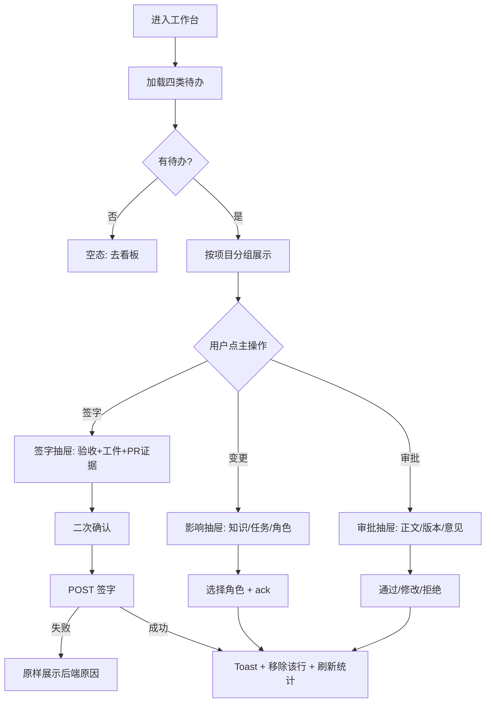

# 工作台与需求详情页 · 交互方案 v0.1

> 状态：核心路径已实现；已按方案 2 收敛到现有数据模型，以下方「实现边界」为准。
> 后续：实施范围、读模型与视觉系统已收敛到 [webui-refresh-plan.md](webui-refresh-plan.md)。
> 范围：Web 端新增「工作台（我的待办）」与「需求详情页」，并补齐签字/变更确认/PRD 审批三个关键动作。
> 目标不是"再加两个页面"，而是把 Web 从"数据管理后台"改成"人关门的工作台"。

## 0. v0.1 实现边界（方案 2 收敛）

> 本节是 2026-11-02 的实现口径。**如与后文冲突，以本节和实际 API 为准**；后文保留为原始交互设想，不代表已实现。

v0.1 不新增数据库字段，不新增审批/追溯模型。以下条目从 v0.1 移出，等数据模型升级后再做：

| 原方案条目                           | v0.1 处理                                                              | 原因                                                              |
| ------------------------------------ | ---------------------------------------------------------------------- | ----------------------------------------------------------------- |
| 需求优先级、用户故事、验收标准、依赖 | 不做；编辑抽屉只改标题/描述                                            | `Requirement` 只有 title/description/version/phase/workStatus     |
| 任务级签字 + 手填 PR 编号            | 改为「评审决定」：ReviewRequest 的验收、工件、PR 证据 + 批准/修改/驳回 | 后端没有 `POST /tasks/:id/sign-off`，签字由评审请求与决定记录承载 |
| `PrdApproval` 独立审批               | 改为「PRD 发布评审」：复用 ReviewRequest 槽位与决定                    | 没有 PrdApproval 表                                               |
| 追溯 API 返回 commit/PR 链接         | 用交付物里的 `commitSha` / `repoPath`、评审、变更拼本地时间线          | 没有 `GET /traces/requirement/:id`                                |
| 全局搜索 `⌘K`                        | 不做                                                                   | 没有跨需求/PRD/项目的搜索接口                                     |
| 需求级归档按钮                       | 不做；只做 `CANCELLED` 需求只读                                        | 没有需求归档 API，项目归档是另一动作                              |

现有模型能表达的等价物：

- 验收标准：评审请求的 `acceptance` 快照，在决定抽屉/决定页展示，不在需求编辑抽屉编辑；
- PR 证据：Agent/CLI 交付的 artifact 指针与评审请求证据，不在 Web 手填；
- PRD 审批：`PRD_PUBLICATION` 等 ReviewRequest 的槽位决定；
- 门禁：由任务 `executionStatus` / `workStatus` 推导的 7 段，不写回后端 phase；
- 追溯：工件、评审决定、变更事件按时间倒序。

### 0.1 实现状态

- 已落地：工作台聚合、四类待办、评审/变更抽屉、需求详情 7 段门禁与 7 个 Tab、活动流、站内通知、批量确认变更、项目待办计数。
- 本轮已补齐：角色偏好持久化、按项目排序/单项目不分组、行点击需求详情、可开工“查看上下文/复制 CLI”、错误重试与保留旧数据、无项目空态、复制编号/更多菜单、门禁点击切 Tab、交付物分组/缺失占位、变更确认状态、PRD 版本列表、追溯类型筛选与 commit 文本、取消需求只读、Tab URL、旧 `?req=` 兼容。
- 明确不做：上表移出项。

---

## 1. 设计目标

| 原则           | 落地方式                                                                  |
| -------------- | ------------------------------------------------------------------------- |
| **待办优先**   | 首页回答"现在有什么在等我"，而不是"系统里有多少数据"                      |
| **证据可见**   | 每个待办都能看到需求、验收标准、工件指针、校验结果、PR 证据，再决定签不签 |
| **一门一动作** | 一道门禁只给一个主操作：签字、确认变更、审批 PRD、开始任务                |
| **可追溯**     | 任何待办都能点回需求详情，任何签字都能看到依据                            |
| **不越权**     | Agent 不出现签字按钮；Web 只展示人类可执行的动作                          |

非目标：

- 不做新的数据模型；
- 不做拖拽式看板（状态由签字推导，拖拽会误导）；
- 不把知识正文搬进 Web。

---

## 2. 信息架构调整

### 2.1 导航

```text
工作台（新，默认首页 /）
项目
需求
看板
PRD
知识库
追溯
────────
项目总览（原“控制台”，管理视角）
用户中心
```

- 「工作台」置顶，菜单项右侧显示待办总数徽标；
- 原「控制台」改名「项目总览」，避免和工作台抢"首页"语义；
- 项目切换器固定在工作台/需求/看板/知识库/追溯的页面头部，位置统一。

### 2.2 新路由

| 路由                  | 页面     | 说明                                             |
| --------------------- | -------- | ------------------------------------------------ |
| `/`                   | 工作台   | 跨项目待办聚合                                   |
| `/requirements/:code` | 需求详情 | 用需求编号作为深链，例如 `/requirements/YFF-012` |
| `/requirements`       | 需求列表 | 保留，行点击进入详情                             |

兼容旧链接：`/requirements?req=<id>` 自动解析为对应 `/requirements/<code>`。

### 2.3 入口关系

```text
工作台待办 ──┬─→ 需求详情（定位到对应 Tab / 打开签字抽屉）
             ├─→ 看板（按需求定位）
             └─→ PRD（按 PRD 定位）
看板卡片 ─────→ 需求详情
全局搜索 ─────→ 需求详情 / PRD / 项目
需求列表行 ───→ 需求详情
```

---

## 3. 工作台

### 3.1 页面布局

```text
┌──────────────────────────────────────────────────────────────────────┐
│ WorkMesh   工作台   项目▾   需求   看板   PRD   知识库   追溯   [⌘K]  │
├──────────────────────────────────────────────────────────────────────┤
│ 早上好，李明                                    项目范围 [全部项目▾]  │
│ 今天有 7 件事等你关门                                                │
│                                                                      │
│ ┌────────────┐ ┌────────────┐ ┌────────────┐ ┌────────────┐          │
│ │ 待我签字 3 │ │ 待确认变更 │ │ 待我审批   │ │ 可开工任务 │          │
│ │ 2 个需求   │ │ 2          │ │ 1          │ │ 5          │          │
│ └────────────┘ └────────────┘ └────────────┘ └────────────┘          │
│                                                                      │
│ [全部 7] [签字 3] [变更 2] [审批 1] [任务 5]   角色 [全部▾]  排序▾   │
│                                                                      │
│ ── YFF 项目 ────────────────────────────────────────────────────────  │
│ ┌──────────────────────────────────────────────────────────────────┐ │
│ │ [签字]  YFF-012  登录页改版                                    │ │
│ │         任务 YFF-012/impl · 后端实现 · 等待 3 天 · 证据 2 件     │ │
│ │                                    [查看证据]  [签字并关门]        │ │
│ └──────────────────────────────────────────────────────────────────┘ │
│ ┌──────────────────────────────────────────────────────────────────┐ │
│ │ [变更]  YFF-008  订单取消规则调整                               │ │
│ │         版本 v4 · 影响 BACKEND / QA 的知识与任务 · 等待 2 天       │ │
│ │                                    [查看影响]  [确认已处理]        │ │
│ └──────────────────────────────────────────────────────────────────┘ │
│ ┌──────────────────────────────────────────────────────────────────┐ │
│ │ [审批]  YFF-005  PRD v3 待你审批                                │ │
│ │         审批人：你 · 提交于 昨天 17:20                             │ │
│ │                                    [查看 PRD]  [去审批]            │ │
│ └──────────────────────────────────────────────────────────────────┘ │
│ ┌──────────────────────────────────────────────────────────────────┐ │
│ │ [任务]  YFF-009/impl  支付回调重试 · OPEN · 无阻塞               │ │
│ │                                    [查看上下文]  [开始处理]        │ │
│ └──────────────────────────────────────────────────────────────────┘ │
│                                                                      │
│ ── 其它项目 ────────────────────────────────────────────────────────  │
│ …                                                                    │
├──────────────────────────────────────────────────────────────────────┤
│ 右栏（宽屏）：最近活动 / 我参与的项目 / 规范提示                      │
└──────────────────────────────────────────────────────────────────────┘
```

窄屏（< 900px）：

- 四张统计卡改为 2×2；
- 右栏折叠到页面底部；
- 行内按钮改为整行底部两个等宽按钮；
- 筛选项改为横向可滚动 chips。

### 3.2 四类待办的定义

| 分类             | 判定规则                                                                            | 数据来源                                              | 主操作                |
| ---------------- | ----------------------------------------------------------------------------------- | ----------------------------------------------------- | --------------------- |
| **待我签字**     | 我是 `TASK_ACCEPTANCE` / `RELEASE_ACCEPTANCE` 评审请求的当前槽位审批人，且请求 OPEN | 工作台聚合的 `reviews`（签字类）                      | 打开评审决定抽屉      |
| **待确认变更**   | 我所在项目中，`ChangeEvent` 仍有未 `ack` 的角色                                     | `GET /changes/pending?role=&projectId=`；跨项目需聚合 | 打开变更影响抽屉      |
| **待我审批 PRD** | 我是 `PRD_PUBLICATION` 等 ReviewRequest 的当前槽位审批人，且请求 OPEN               | 工作台聚合的 `reviews`（非签字类）                    | 打开评审决定抽屉      |
| **可开工任务**   | 任务 `OPEN`，且所有 `blockedBy` 任务均已 `DONE`                                     | `GET /tasks/ready?role=`；按角色聚合                  | 查看上下文 / 开始处理 |

补充说明：

- 人类账号目前没有"业务角色"字段，因此工作台**不假设"我的角色"**；默认展示全部角色，顶部提供角色筛选（可记住偏好）。
- "待我签字"不绑定角色：后端允许项目成员签任意任务。UI 显示任务所属角色，便于人类判断该由谁签；是否收紧为"只能签自己角色"是产品决策（见第 9 节）。
- "待确认变更"以角色为粒度；一行可能同时欠 BACKEND 和 QA 两个角色的确认，操作时让用户选择要确认的角色。

### 3.3 列表交互

**行内容（固定五段）**

1. 类型徽标：签字 / 变更 / 审批 / 任务；
2. 需求标题（主信息）；
3. 需求编号 + 任务编号 / 变更版本 / PRD 版本；
4. 上下文信息：项目名、等待时长、证据数量、阻塞原因；
5. 主操作 + 次操作。

**排序（默认"最久未处理"）**

| 选项       | 规则                      |
| ---------- | ------------------------- |
| 最久未处理 | `updatedAt` 升序          |
| 最近更新   | `updatedAt` 降序          |
| 按项目     | 项目分组，组内按等待时长  |
| 按类型     | 签字 → 变更 → 审批 → 任务 |

**筛选**

- 类型 Tab：全部 / 签字 / 变更 / 审批 / 任务；
- 项目：全部项目 / 单项目；
- 角色：全部 / PRODUCT / UI / FRONTEND / BACKEND / QA / OPS；
- 搜索框：按需求编号、标题过滤（本地过滤，数据量已受项目范围限制）。

**分组**

- 默认按项目分组，组头显示项目名 + 待办数量；
- 单项目范围下取消分组。

**行点击**

- 点击标题或整行 → 进入需求详情，并定位到对应 Tab：
  - 签字 → 任务 Tab，自动打开该任务签字抽屉；
  - 变更 → 变更 Tab，自动打开该变更抽屉；
  - 审批 → PRD Tab，自动打开审批抽屉；
  - 任务 → 概览 Tab，显示"下一步"卡片。
- 主操作按钮点击时**不跳页**，直接在抽屉内完成（减少上下文丢失）。

### 3.4 快捷操作抽屉

#### A. 评审决定抽屉（原“签字抽屉”）

```text
┌────────────────────────────────────────────┐
│ 签字并关门                            [×] │
│ YFF-012/impl · 后端实现                  │
│ 需求 YFF-012 登录页改版                 │
├────────────────────────────────────────────┤
│ 为什么需要你签                            │
│ 任务已交付并进入 REVIEW_PENDING；          │
│ 后端任务需 PR 评审证据。                   │
│                                            │
│ 验收标准                                   │
│ ☑ 登录失败 3 次锁定 10 分钟                │
│ ☑ 支持记住登录状态 7 天                    │
│                                            │
│ 交付物（2）                                │
│ ┌────────────────────────────────────────┐ │
│ │ IMPL · src/auth/login.ts               │ │
│ │ 校验：exists ✓ fileType ✓ anchor ✓     │ │
│ │ hash：a1b2… · 交付于 3 天前            │ │
│ └────────────────────────────────────────┘ │
│ ┌────────────────────────────────────────┐ │
│ │ CASES · tests/login.spec.ts            │ │
│ └────────────────────────────────────────┘ │
│                                            │
│ PR 证据（后端任务必填）                    │
│ provider [github▾]  PR 编号 [  42  ]       │
│ 提示：PR 必须已合并、有 APPROVED review，  │
│ 且标题/正文包含 YFF-012                 │
│                                            │
│ 签字意见（可选，≤2000 字）                 │
│ [                                        ] │
├────────────────────────────────────────────┤
│ 签字后任务变为 DONE，需求状态按门禁自动推进 │
│                        [取消] [确认签字]    │
└────────────────────────────────────────────┘
```

交互细节：

- 工件卡片可展开查看 `validation.checks` 的完整 JSON 与 `contentHash`；`uri` 支持复制。
- **v0.1 不提供手填 PR 编号**：PR 证据由 Agent/CLI 交付的工件与评审请求载荷携带，Web 只读展示；没有就不展示输入框。
- 点击「确认签字」先弹二次确认："签字不可撤销，确认吗？"。
- 提交失败时把后端原因原样展示：
  - PR 未合并 → "PR #42 尚未合并"；
  - 无 APPROVED review；
  - 未建立追溯（标题/正文缺需求编号）；
  - 任务未进入 REVIEW_PENDING。
- 成功后：
  - 抽屉关闭；
  - Toast："已签字，任务 DONE；需求推进到 CODE_LINKED"（用响应中的 `requirement.status`）；
  - 列表行淡出并移除，统计卡 -1。

#### B. 变更影响抽屉

```text
┌────────────────────────────────────────────┐
│ 需求变更 · 需要确认                   [×] │
│ YFF-008 订单取消规则调整 · v4            │
├────────────────────────────────────────────┤
│ 变更字段：规则说明 / 验收标准               │
│                                            │
│ 影响的知识（2）                            │
│ · BACKEND  docs/order/cancel.md            │
│ · QA       docs/test/cancel-cases.md       │
│ 影响的任务（2）                            │
│ · BACKEND  YFF-008-T02 已 DONE           │
│ · QA       YFF-008-T04 进行中            │
│                                            │
│ 待确认角色：BACKEND / QA                    │
│ 确认角色 [BACKEND ▾]                       │
│ 处理说明（可选）                           │
│ [                                        ] │
├────────────────────────────────────────────┤
│                        [取消] [确认已处理]  │
└────────────────────────────────────────────┘
```

- 一个事件可能欠多个角色，确认后抽屉保持打开并刷新剩余角色；
- 全部角色确认后，行从工作台移除；
- 同时提供「打开需求详情」链接。

#### C. PRD 发布评审抽屉

```text
┌────────────────────────────────────────────┐
│ PRD 审批 · v3                         [×] │
│ YFF-005 结算页优惠券叠加                 │
├────────────────────────────────────────────┤
│ 提交人：王芳 · 昨天 17:20                  │
│ [正文预览  |  版本对比]                    │
│ 变更摘要：新增叠加规则、补充异常场景       │
├────────────────────────────────────────────┤
│ 审批意见（可选）                           │
│ [                                        ] │
│                                            │
│ [拒绝]  [要求修改]  [通过]                  │
└────────────────────────────────────────────┘
```

- 审批动作三选一，都需要二次确认；
- 通过后提示"审批完成；全部审批人通过后才会触发发布"；
- 「要求修改」要求填写意见（必填）。

#### D. 可开工任务

不弹抽屉，直接进入需求详情；

- 主按钮「查看上下文」→ 需求详情概览；
- 次按钮「复制 CLI 命令」→ `workmesh context <code>`，方便 Agent 在本机开工。

### 3.5 状态设计

| 状态          | 表现                                                              |
| ------------- | ----------------------------------------------------------------- |
| 首次加载      | 4 个统计卡骨架 + 5 行列表骨架，不显示"暂无待办"                   |
| 局部加载      | 统计卡先出，列表区显示骨架                                        |
| 空（全部）    | 插画/图标 + "今天没有待办。可以去看板了解整体进度。" + [打开看板] |
| 空（单 Tab）  | "没有待签字的任务。" + 切换到其它 Tab 的提示                      |
| 错误          | 顶部内联错误条："部分待办加载失败" + [重试]；其余分类仍可用       |
| 无项目权限    | 整页空态："你还不是任何项目的成员" + [联系管理员]                 |
| 数据过期      | 右上角"更新于 2 分钟前" + [刷新]；签字成功后局部刷新              |
| 离线/网络失败 | 保留上次数据 + 顶部"网络异常，显示上次结果"                       |

### 3.6 交互流程



### 3.7 数据映射与接口缺口

| 区域       | 字段                             | 现有接口                      | 缺口                      |
| ---------- | -------------------------------- | ----------------------------- | ------------------------- |
| 统计卡     | 四类数量                         | 无聚合                        | 需要 `GET /api/workbench` |
| 待签字     | 任务、需求、角色、工件数         | Board 可推导，但跨项目需 N 次 | 聚合                      |
| 待确认变更 | 事件、版本、受影响角色/知识/任务 | `GET /changes/pending?role=`  | 需跨角色/项目聚合         |
| 待审批 PRD | PRD、版本、提交人、提交时间      | 仅 `GET /prds/:id/approvals`  | 需按 approver 聚合        |
| 可开工任务 | 任务、需求、角色、阻塞           | `GET /tasks/ready?role=`      | 需跨项目/角色聚合         |
| 最近活动   | 签字/变更/交付                   | 无                            | 可后置，P2                |

建议新增一个聚合端点，而不是前端发 6×N 个请求：

```http
GET /api/workbench?projectId=<optional>
Authorization: Bearer <token>

200
{
  "data": {
    "counts": { "signOffs": 3, "changes": 2, "reviews": 1, "readyTasks": 5 },
    "signOffs": [{
      "taskId": "...", "taskCode": "YFF-012/impl", "taskTitle": "后端实现",
      "role": "BACKEND", "requirementId": "...", "requirementCode": "YFF-012",
      "requirementTitle": "登录页改版", "projectId": "...", "projectName": "YFF",
      "artifactCount": 2, "requiredKind": "PR_REVIEW", "updatedAt": "..."
    }],
    "changes": [{ "eventId": "...", "version": 4, "pendingRoles": ["BACKEND","QA"], "targets": {...} }],
    "reviews": [{ "prdId": "...", "prdVersion": 3, "approvalId": "...", "submittedBy": "...", "submittedAt": "..." }],
    "readyTasks": [{ "taskId": "...", "code": "...", "role": "...", "requirementCode": "...", "projectId": "..." }]
  },
  "meta": { "requestId": "..." }
}
```

后端约束：

- 只返回当前用户是成员的项目；
- 签字项必须 `REVIEW_PENDING` 且 `SignOff` 为空；
- 审批项必须 `approverId = 当前用户` 且 `status = PENDING`；
- 变更项返回未 ack 角色，不按用户角色过滤。

### 3.8 验收标准

- 首页默认进入工作台，不再进入控制台；
- 四类待办数量与列表内容一致，点击可完成对应动作；
- 签字全流程在抽屉内完成，最多 2 次点击 + 1 次确认；
- 签字失败时显示后端原始原因，不显示泛化"操作失败"；
- 空态、加载态、错误态互不混淆；
- 窄屏下无需横向滚动即可完成签字/确认；
- 工作台只列当前用户有权限的项目，越权项目不出现。

---

## 4. 需求详情页

### 4.1 页面布局

```text
┌──────────────────────────────────────────────────────────────────────┐
│ 项目 / YFF  /  YFF-012                            [编辑] [更多▾]  │
│ YFF-012  登录页改版            [PRD_READY] [P1]                   │
│ YFF 项目 · 创建于 10-20 · 更新于 3 天前 · PRD v3                     │
├──────────────────────────────────────────────────────────────────────┤
│ 草稿 ✓ ─ PRD 就绪 ✓ ─ 设计就绪 ● ─ 开发中 ○ ─ 代码关联 ○ ─ 测试 ○ ─ 发布 ○ │
│           PRODUCT 已签        UI 待签   BACKEND/FRONTEND             │
├──────────────────────────────────────────────────────────────────────┤
│ 概览 | 交付物 4 | 任务 5 | 变更 2 | PRD 3 | 追溯 6                   │
├──────────────────────────────────────────────────────────────────────┤
│ 左（2/3）                                  右（1/3）                 │
│ 需求描述                                   ┌──────────────────────┐ │
│ ……                                         │ 下一步               │ │
│                                            │ 等待 UI 设计签字      │ │
│ 用户故事                                   │ [查看任务] [去签字]  │ │
│ · 作为访客，我希望……                       ├──────────────────────┤ │
│                                            │ 门禁清单             │ │
│ 验收标准                                   │ PRD  ✓ 已签         │ │
│ ☑ 登录失败 3 次锁定                        │ 设计 ● 待签          │ │
│ ☑ 记住登录 7 天                            │ 开发 ○ 未开始        │ │
│                                            │ 测试 ○ 未开始        │ │
│ 依赖                                        │ 发布 ○ 未开始        │ │
│ · 依赖 YFF-003（已完成）                 └──────────────────────┘ │
└──────────────────────────────────────────────────────────────────────┘
```

### 4.2 头部

| 元素     | 规则                                                       |
| -------- | ---------------------------------------------------------- |
| 编号     | 等宽字体，可复制；点击复制显示 Toast                       |
| 标题     | 主标题，最多两行，超出省略                                 |
| 状态徽标 | 中文标签 + 颜色；hover 显示"由哪些签字推导"                |
| 优先级   | P0/P1/P2，缺失显示"未设置"                                 |
| 元信息   | 项目、创建时间、更新时间、最新 PRD 版本                    |
| 编辑     | 打开编辑抽屉；不影响门禁与签字                             |
| 更多     | 归档、复制链接、复制 CLI 命令（`workmesh context <code>`） |

### 4.3 门禁进度条

七个节点，固定顺序：

```text
草稿 → PRD 就绪 → 设计就绪 → 开发中 → 代码已关联 → 已测试 → 已发布
```

每个节点展示三行：

1. 阶段名；
2. 负责角色；
3. 状态：`已满足 / 进行中 / 未开始 / 不适用 / 阻塞`。

规则（与后端 `GATES` 对齐）：

| 目标状态     | 负责角色           | 满足条件              |
| ------------ | ------------------ | --------------------- |
| PRD_READY    | PRODUCT            | PRODUCT 任务全部 DONE |
| DESIGN_READY | UI                 | UI 任务全部 DONE      |
| IN_DEV       | BACKEND / FRONTEND | 任一开发任务不是 OPEN |
| CODE_LINKED  | BACKEND / FRONTEND | 开发任务全部 DONE     |
| TESTED       | QA                 | QA 任务全部 DONE      |
| RELEASED     | OPS                | OPS 任务全部 DONE     |

- 没有任务的角色显示"不适用"，不阻塞；
- 当前状态之前的节点显示"已满足"；
- 当前状态之后的第一个未满足节点显示"进行中"或"阻塞"，并成为"下一步"；
- 点击节点滚动到对应任务分组。

### 4.4 Tab 设计

#### 概览

- 需求描述（只读，换行保留；超过 12 行折叠）；
- 用户故事、验收标准以列表只读展示，支持复制；
- 依赖：需求级依赖 + 任务级阻塞，显示状态；
- 右侧"下一步"卡片：根据门禁推导出一句话 + 主按钮；
- 右侧门禁清单：每行状态 + 负责人 + 签字时间；
- 底部"最近变更"3 条，点击进入变更 Tab。

#### 交付物

按 `kind` 分组：`PRD / DESIGN / IMPL / CASES / RELEASE`。

```text
┌──────────────────────────────────────────────┐
│ IMPL · 2 件                          [筛选▾] │
│ ┌──────────────────────────────────────────┐ │
│ │ src/auth/login.ts        BACKEND         │ │
│ │ hash a1b2…  · 交付 3 天前                │ │
│ │ 校验 exists ✓ fileType ✓ anchor ✓        │ │
│ │ [复制路径] [查看校验详情]                 │ │
│ └──────────────────────────────────────────┘ │
│ ┌──────────────────────────────────────────┐ │
│ │ tests/login.spec.ts      QA              │ │
│ │ …                                        │ │
│ └──────────────────────────────────────────┘ │
│ 缺失：DESIGN（UI 尚未交付）                  │
└──────────────────────────────────────────────┘
```

- **v0.1 只展示现有 API 返回的字段**：kind / mediaType / byteLength / sha256 / commitSha / repoPath / summary / 时间；没有 `validation.checks` 就不渲染校验区块；
- 按 kind 分组，缺失的 kind 显示虚线占位；
- 支持按 kind 分组展示；按角色/类型过滤留到 API 补字段之后；
- 仓库路径可复制，不强行在 Web 打开。

#### 任务

按角色分组，行内展示：

| 列     | 内容                            |
| ------ | ------------------------------- |
| 编号   | `YFF-012/impl`                  |
| 标题   | 任务标题                        |
| 角色   | 中文角色标签                    |
| 状态   | OPEN / 进行中 / 待签字 / 已完成 |
| 阻塞   | `blockedBy` 编号，可点击        |
| 交付物 | 数量                            |
| 签字   | 已签 / 待签 / 不适用            |
| 操作   | 待签 → [签字]；其它 → [查看]    |

- 待签字任务行高亮，并在顶部显示"有 2 个任务等待签字"；
- 点击 [签字] 打开 3.4-A 抽屉；
- 已完成任务显示签字人、签字时间、PR 链接。

#### 变更

时间线倒序：

```text
v4  10-28 10:12   变更：验收标准 / 规则说明
    影响：BACKEND docs/order/cancel.md；QA 测试用例
    确认：BACKEND ✓   QA 待确认            [确认]
v3  10-21 09:30   变更：优先级 P2 → P1
    确认：全部角色已确认
```

- 顶部提示"有 2 条变更等待你确认"；
- 点击 [确认] 打开 3.4-B 抽屉；
- 变更内容支持"字段级 diff"（旧值 → 新值），至少展示变更字段名。

#### PRD

- 最新版本摘要：文档名称、当前文档版本、已发布修订、候选修订数；
- 修订列表：版本/状态/标题/提交时间（现有 document API 返回的 revisions）；
- 评审记录：链接到对应 `PRD_PUBLICATION` 评审请求；
- 主操作：**不存在**“新建 PRD/提交新版本/提交审批”的 Web 入口；正文与候选由 Agent/CLI 提交；
- 链接到完整 PRD 工作台；
- **v0.1 不实现审批记录表**：审批人/意见/时间到评审决定页看，不在 PRD Tab 复制一份。

#### 追溯

- **v0.1 用现有工件拼时间线**：工件 kind、`commitSha`、`repoPath`、评审、变更；
- commit/PR 不保证有可点击 URL：只有工件里有 `commitSha` / `repoPath` 时展示文本，不构造 GitHub 链接；
- 按类型筛选：交付物 / 评审 / 决定 / 变更（本地过滤）；
- 空态："还没有可追溯的事件。开发任务交付工件后会出现在这里。"

### 4.5 编辑抽屉

- **v0.1 只编辑标题、描述**；优先级、用户故事、验收标准、依赖没有数据字段，不伪造；
- **不提供状态下拉**：状态只由签字/任务推导；
- 保存后局部刷新头部与概览，不整页刷新；
- 离开未保存时确认（标题/描述任一变化）。

### 4.6 状态设计

| 状态         | 表现                                                     |
| ------------ | -------------------------------------------------------- |
| 加载         | 头部骨架 + 进度条骨架 + Tab 骨架                         |
| 需求不存在   | "需求不存在或已删除" + [返回需求列表]                    |
| 无权限       | 403 页，不显示为"空需求"                                 |
| 已归档       | 顶部只读横幅；隐藏签字/编辑/确认按钮                     |
| 部分接口失败 | 对应 Tab 内错误条 + [重试]，其它 Tab 可用                |
| 空 Tab       | 针对每个 Tab 给下一步引导，例如"还没有交付物 → 查看任务" |

### 4.7 数据映射

> 下表保留原始方案设想。v0.1 实际只使用已存在的 requirements / reviews / documents / changes / workbench 接口；`PrdApproval`、`dependencies`、`traces` 没有对应后端。

| 区域      | 接口                                                                                           |
| --------- | ---------------------------------------------------------------------------------------------- |
| 头部/概览 | `GET /requirements/:id`、`GET /context/:code`                                                  |
| 任务      | `GET /requirements/:id/tasks`、`GET /context/:code`（含 signOffs/blockedBy）                   |
| 交付物    | `GET /requirements/:id/artifacts`（含 hash/validation）、按任务补充                            |
| 变更      | `GET /requirements/:id/changes`、`POST /changes/:id/ack`                                       |
| PRD       | `GET /requirements/:id/prds`、`GET /prds/:id/versions`、`GET /prds/:id/approvals`              |
| 审批决定  | `PATCH /prd-approvals/:id`                                                                     |
| 追溯      | `GET /traces/requirement/:id`（Web 客户端需补）                                                |
| 依赖      | `GET /requirements/:requirementId/dependencies`                                                |
| 签字      | `POST /tasks/:taskId/sign-off`、`GET /tasks/:taskId/artifacts`、`GET /tasks/:taskId/sign-offs` |

前端 API 客户端需要新增：`requirementApi.detail`、`taskApi`（list/ready/detail/status）、`artifactApi`、`signOffApi`、`changeApi`、`traceApi.requirement`。

### 4.8 验收标准

- 任一需求可通过 URL 直接打开，刷新不丢上下文；
- 门禁进度与后端签字推导一致；
- 每个阶段能点进对应任务与签字记录；
- 交付物能看到指针、hash、校验项，缺失项明确提示；
- 待签字任务可在详情页完成签字，无需跳回工作台；
- 归档需求所有写操作不可见；
- 小屏下进度条横向滚动，Tab 可滑动，正文单列。

---

## 5. 共用组件

| 组件             | 用途         | 关键点                                              |
| ---------------- | ------------ | --------------------------------------------------- |
| `TodoRow`        | 工作台待办行 | 类型徽标、主信息、上下文、主/次操作；整行可键盘聚焦 |
| `SignOffDrawer`  | 签字         | 证据分组、PR 证据、二次确认、错误原样展示           |
| `ChangeDrawer`   | 变更确认     | 多角色确认、影响面、部分完成刷新                    |
| `ApprovalDrawer` | PRD 审批     | 正文/版本对比、三选一决定                           |
| `GateProgress`   | 门禁条       | 7 节点、状态色、点击定位                            |
| `EvidenceCard`   | 工件证据     | uri/hash/checks、缺失态                             |
| `StatusBadge`    | 状态         | 中文 + 颜色 + tooltip 推导依据                      |
| `EmptyState`     | 空态         | 标题、说明、下一步按钮                              |
| `ErrorBanner`    | 局部错误     | 原因 + 重试，不遮挡页面                             |
| `RoleTag`        | 角色         | 中文标签，颜色区分                                  |

交互约束：

- 抽屉打开后焦点进入标题，Esc 关闭，关闭后焦点回到触发按钮；
- 抽屉内不因父组件重渲染而重置焦点；
- 所有危险动作（签字、拒绝、归档）二次确认；
- 表格/列表行支持 Enter 打开。

---

## 6. 文案与术语

| 系统术语          | Web 文案                               |
| ----------------- | -------------------------------------- |
| REVIEW_PENDING    | 待签字                                 |
| DONE              | 已完成                                 |
| PLATFORM 签字     | 平台确认                               |
| PR_REVIEW 签字    | PR 评审通过                            |
| ChangeEvent / ack | 需求变更 / 已确认                      |
| Artifact          | 交付物（副标题：仅记录位置与校验结果） |
| Gate              | 门禁（hover：这一阶段需要谁完成什么）  |
| blockedBy         | 被 … 阻塞                              |

角色统一中文：产品、设计、前端、后端、测试、运维。

---

## 7. 权限与边界：人机操作清单

> 本节回答一个问题：**哪些动作必须由人做，哪些不该以“人类操作”出现在 Web。**
> 判断标准只有两条：是否改变权威事实；是否承担角色责任。
> 实现形态以 [webui-refresh-plan.md](webui-refresh-plan.md) 为准：决定动作在 `/reviews/:reviewId` 全屏页完成；本文的“抽屉”保留为快捷确认形态。

### 7.1 通用规则

- 工作台和详情页只对项目成员开放；
- 人类可以签字；Agent 身份不提供 Web 入口，也不显示签字按钮；
- 是否可签以服务端派生的 `viewerCanDecide` 为准，前端不在本地推断；后端收紧前，UI 显示任务角色供人判断；
- PRD 审批只对 `approverId` 本人显示“去审批”，其他人只读；
- 归档需求只读；
- 所有写操作失败都展示后端具体原因，不吞错。

### 7.2 判断标准

| 问题                                                    | 是 → 谁做             |
| ------------------------------------------------------- | --------------------- |
| 动作是否转移 / 承担“谁负责”？                           | 人，且不可代理        |
| 动作是否产生 / 改变权威事实（批准、发布、权限、凭据）？ | 人 + 一次性票据       |
| 动作是否在生产或执行工作？                              | Agent / CLI，不进 Web |
| 状态是否可由其他事实推导？                              | 系统派生，不给人按钮  |
| 只是读取 / 导航？                                       | Web 只读              |

### 7.3 必须由人做（Human-only）

| 类别 | 操作                             | 位置                | 验证强度            |
| ---- | -------------------------------- | ------------------- | ------------------- |
| 签字 | 评审决定：批准 / 要求修改 / 驳回 | 需求详情 · 签字抽屉 | 票据 + 密码         |
| 签字 | 撤销批准                         | 评审详情            | 票据 + 密码         |
| 签字 | 撤销发布（PRD / 知识）           | PRD / 知识库        | 票据 + 密码         |
| 权限 | 角色授予 / 撤销                  | 角色 / ACL          | 票据 + 密码         |
| 权限 | 知识库 ACL 替换                  | 角色 / ACL          | 票据 + 密码         |
| 安全 | 设备授权批准 / 拒绝              | 设备授权            | 建议 step-up / 票据 |
| 安全 | 撤销 Agent 凭据                  | 用户中心            | 确认；建议票据      |
| 管理 | 项目归档                         | 项目列表            | 二次确认；建议票据  |
| 责任 | 变更确认（ack）                  | 工作台              | 版本校验            |
| 意图 | 创建需求                         | 需求列表            | 二次确认            |

共同点：它们都在改变“谁负责、什么算数”，而不是在生产交付物。

### 7.4 可以保留，但只读 / 简化

- 看板、文档 / PRD 正文、成员与角色列表、Agent 凭据列表、项目列表、评审历史：只读。
- 项目切换、筛选、排序、搜索、刷新：只读上下文，不产生事实。
- 工作台统计与“更新于”：只读。

### 7.5 不应以“人类操作”出现在 Web

| 操作                                                     | 现状                                                                     | 建议                                                             |
| -------------------------------------------------------- | ------------------------------------------------------------------------ | ---------------------------------------------------------------- |
| 创建流程实例                                             | 需求页表单，需逐项绑定责任人与审批人                                     | 保留为管理员初始化，普通成员不可见；同角色审批人不得与责任人相同 |
| 任务认领                                                 | 看板卡片“认领”                                                           | 移出 Web；Agent 用 CLI 认领；人工接管放异常处理                  |
| 文档候选提交 / 恢复 / 新建                               | 页面无按钮，但 Web 客户端仍保留 `proposeRevision` / `restore` / `create` | 从 Web bundle 移除，只留 Agent / CLI                             |
| 创建评审请求                                             | 页面无入口                                                               | 保持无入口；由交付触发                                           |
| 发布                                                     | 页面无按钮                                                               | 不要加；全槽位批准后服务端自动发布                               |
| 状态 / 阶段修改                                          | 页面无入口                                                               | 不要加；由签字与门禁推导                                         |
| 批量批准                                                 | 无                                                                       | 永远不加；一张票据只绑定一个决定                                 |
| 代签 / 管理员强制通过                                    | 无                                                                       | 永远不加；审批人不在就改绑槽位并留审计                           |
| 手工输入 UUID（评审 ID / 知识库 ID / 用户 ID / 角色 ID） | 工作台、角色 / ACL 仍存在                                                | 用收件箱、选择器、深链替代                                       |

> “移出 Web”不等于删除能力：能力仍然存在，只是入口在 CLI、管理员或系统派生。

### 7.6 技术保障

- 服务端只接受 HUMAN Web 会话执行上述动作；Agent 凭据没有批准路径。
- 高风险动作要求一次性票据，绑定 `action + target + expectedVersion + payload digest`。
- 决定记录追加式；撤销是新增记录，不改写历史。
- 槽位可签性由 `viewerCanDecide` 派生；前端只渲染，不推断。
- 每个动作返回 `requestId`；回执可复制；失败原样展示 `code / message / details / requestId`。

### 7.7 四个不要

1. 不要加“发布”按钮——发布是批准的结果，不是另一个动作。
2. 不要加“批量批准”——会让一张票据覆盖多个决定，审计上说不清。
3. 不要加“管理员代签”——问责链断裂；正确做法是改绑审批人并留审计。
4. 不要把“任务认领”放在主界面——Web 会重新变成执行控制台。

### 7.8 待确认

1. **流程实例创建**：已定：保留为管理员操作，强制显式绑定责任人与审批人；后续再评估移出。
2. **任务认领**：已定：移出 Web，看板只读；Agent 用 CLI 认领。
3. **设备授权 / 凭据撤销**：是否升级为票据级？建议是，但需要后端支持。

---

## 8. 落地分期

### P0（本次方案的核心）

1. `GET /api/workbench` 聚合接口；
2. 工作台四类待办 + 签字/变更/审批抽屉；
3. 需求详情页：头部、门禁条、概览、交付物、任务、签字；
4. 前端 API 客户端补齐 task/artifact/signoff/change；
5. 统一状态/角色中文常量；
6. 操作边界收敛：任务认领移出 Web；创建流程实例收进管理员并强制显式绑定；Web 客户端删除文档候选 / 恢复 / 新建方法。

### P1

1. 变更 Tab、PRD Tab、追溯 Tab；
2. 审批人改为项目成员选择；
3. 需求详情编辑抽屉；
4. 工作台筛选与角色偏好；
5. 行级键盘操作与焦点管理。

### P2

1. 最近活动流；
2. 站内通知/邮件提醒；
3. 批量确认变更；
4. 项目总览与工作台联动（点击统计跳筛选）；
5. 移动端专用布局打磨。

---

## 9. 待确认问题

1. **人类角色模型**：是否给用户增加"业务角色"偏好，用于默认筛选工作台？还是始终展示全部角色？
2. **签字权限**：当前任意成员可签任意角色任务。是否收紧为"仅该角色成员/指定审批人"？收紧会影响工作台"待我签字"的口径。
3. **工作台默认范围**：跨全部项目，还是默认当前项目 + "查看全部"？
4. **聚合接口归属**：新增 `/workbench`，还是允许前端按项目并发聚合现有接口？建议前者。
5. **需求详情路由**：用 `code` 作为路径参数（推荐）还是继续用 UUID？
6. **PR 证据**：是否允许在签字抽屉内直接"从已关联 PR 选择"，而不是手填编号？需要追溯接口返回 PR 列表。
7. **变更确认主体**：确认的是"角色已处理"还是"具体人已处理"？当前数据模型是角色粒度。
8. **操作边界**：任务认领已移出 Web；流程实例创建已收进管理员并强制显式绑定；设备授权 / 凭据撤销是否升级为票据级——见 §7.8。

---

## 10. 与现有页面的关系

| 现有               | 处理                                                         |
| ------------------ | ------------------------------------------------------------ |
| 控制台 `Dashboard` | 当前代码已无 `Dashboard`；以工作台为首页，项目总览后置       |
| 需求列表           | 保留；行点击进入详情；创建保留；编辑后置（P1）               |
| 看板               | 保留只读；卡片可点击进入详情；认领移出 Web（CLI / 异常处理） |
| PRD 页             | 只读查看 + 评审入口；不提供正文编辑；撤销发布保留            |
| 知识库/追溯        | 保留只读 + 撤销发布；追溯补 commit/PR 链接                   |

---

## 11. 一页总结

**工作台 = "现在轮到我做什么"；需求详情 = "我凭什么做这个决定"。**

**人只做两类事：改变权威事实、承担角色责任；生产交给 Agent，执行交给 CLI，派生状态交给系统。**

先把这两页做成，Web 才真正承接"AI 生产，人关门"的最后一公里；在此之前，加再多表格页面都只是把后端能力摆出来。
