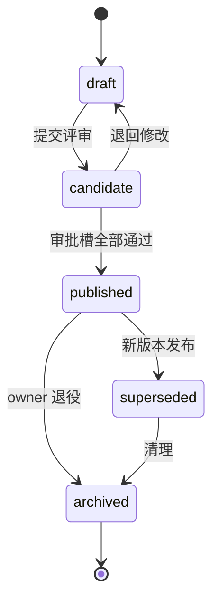
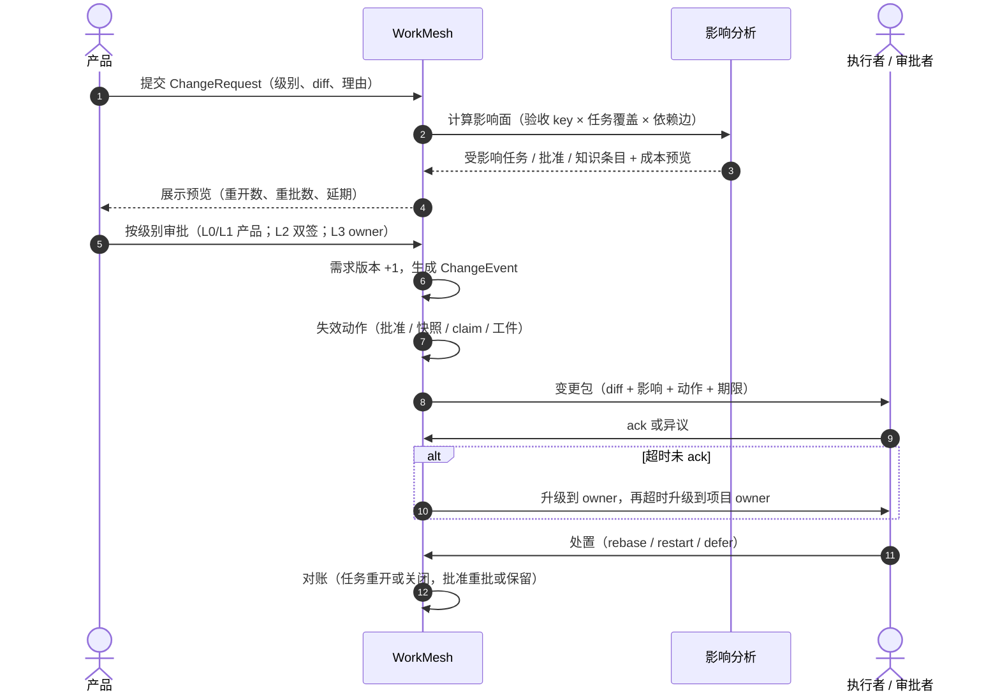

# WorkMesh 知识与变更架构（设计稿 v0.1）

> 状态：设计稿，未实施。日期：2026-11-02。
> 范围：三类知识库、五态生命周期、四个闭环、上下文装配、验收标准契约、项目开发规范、需求变更与通知。
> 依据：现有 schema 与 API + 成熟实践（KCS、Diátaxis、Backstage TechDocs、ADR、Team Topologies、Parallel Change、OpenGitOps），文末列出处。
> 本文只定义模型与规则，不含迁移与实现。

---

## 1. 设计原则

1. **单一归属**：一条知识只存在于一个库，其他库放指针，避免三处同步。
2. **按需捕获**：知识在任务里产生，不在任务外补写（KCS「Capture in the Moment」）。
3. **使用即评审**：用的时候发现过期，就地改，不设额外评审会（KCS「Reuse is Review」）。
4. **可降级**：三类库都有一等模型，但项目可按模板只启用其中几类。
5. **变更即追加**：版本、批准、撤销都用新记录表达，不改写历史（现有模型已如此）。

## 2. 三类知识库

|          | 业务事实库 `BUSINESS`          | 系统事实库 `SYSTEM`                  | 角色实践库 `PRACTICE`          |
| -------- | ------------------------------ | ------------------------------------ | ------------------------------ |
| 回答     | 为什么做、给谁做、规则是什么   | 系统长什么样、怎么连、怎么跑         | 这个角色怎么干活               |
| 粒度     | 业务能力 / 领域                | 工作单元（服务、应用、数据集）       | 角色                           |
| 典型文档 | 术语、业务规则、流程、合规约束 | 单元卡、接口契约、ADR、runbook、环境 | SOP、模板、DoD、检查表、评测集 |
| 主写     | 产品                           | 后端 / 运维                          | 各角色                         |
| 评审     | 产品负责人 + 业务方            | 技术负责人                           | 角色负责人                     |
| 时效     | 180 天                         | 90 天（契约随 CI 刷新）              | 180 天                         |
| 失效触发 | 业务规则变、需求变             | 代码 / 契约 / 部署变                 | 工具 / 流程变                  |
| 消费     | 全员                           | 前端、测试、运维、产品               | 本角色 Agent                   |

**边界规则**：需求（PRD、UNDERSTANDING、DECISION）是**工作产物**，不是长期知识库；需求关闭时将其中的可复用结论抽取到三类库，原文归档。

## 3. 五态生命周期



| 状态         | 含义                   | 谁推进 | 进上下文       |
| ------------ | ---------------------- | ------ | -------------- |
| `draft`      | 个人或 Agent 草稿      | 作者   | 否             |
| `candidate`  | 已提交候选，待评审     | 作者   | 可配（默认否） |
| `published`  | 正式版本               | 评审人 | 是             |
| `superseded` | 被新版本取代，保留历史 | 系统   | 否（可查）     |
| `archived`   | 退役                   | owner  | 否             |

对应 KCS 的 Article State：状态要同时表达**受众、置信度与治理**。

## 4. 四个闭环

| 环   | 触发点                                        | 动作                                             | 产出                  | 现状                       |
| ---- | --------------------------------------------- | ------------------------------------------------ | --------------------- | -------------------------- |
| 捕获 | `deliver` 成功、评审通过                      | 问「这次产生了哪些新知识」→ 生成 draft（带证据） | 知识候选              | 缺                         |
| 复用 | `context` 装配                                | 记录用了哪几条；未命中即缺口信号                 | 命中率、缺口清单      | 部分（快照有引用，无统计） |
| 改进 | 使用中发现过期或矛盾                          | 「Flag it or Fix it」→ 提修订候选 → owner 批     | 新修订                | 缺                         |
| 退役 | 需求 / 契约 / 单元变更，或 `reviewDueAt` 到期 | 沿挂靠与依赖边标 stale → owner 处置              | superseded / archived | 缺                         |

**度量环**（Evolve Loop）：复用率、命中率、过期率、回问率、缺口数，按月复盘。

## 5. 上下文装配

| 库   | 装配规则                            | 门槛                               |
| ---- | ----------------------------------- | ---------------------------------- |
| 业务 | 项目术语表必读 + 本需求所属领域规则 | `published`                        |
| 系统 | 本任务单元卡 + 上下游契约（双向）   | `published` 且 confidence ≥ MEDIUM |
| 实践 | 按角色取 SOP / 检查表               | `published`                        |

过期条目**不删除**，标注 `stale` 后仍可进上下文（项目可配置为阻断）。装配结果写入 `SnapshotResourceRef`，作为复用统计的依据。

## 6. 治理

| 项     | 规则                                                                   |
| ------ | ---------------------------------------------------------------------- |
| 归属   | 每篇文档必须有 `ownerUserId`；无 owner 的文档不得发布                  |
| 评审   | 三类库各自的负责人；高风险（业务规则、契约）需双人                     |
| 时效   | `reviewDueAt` 到期 → 标 stale → 通知 owner → 超期降级                  |
| 置信度 | `verified-by-test` > `verified-by-code` > `inferred-by-ai` > `unknown` |
| 权限   | 库级 ACL（现有 `KnowledgeBase` 可见性 + grant）；正文按发布版可见      |

## 7. 需求变更

### 7.1 分级

边界：**是否改变验收标准的可判定内容**。

| 级别               | 例子                       | 版本 | 审批            | 典型处置                  |
| ------------------ | -------------------------- | ---- | --------------- | ------------------------- |
| `L0` 澄清          | 补背景、统一术语、明确边界 | 不变 | 产品            | 写澄清记录，任务继续      |
| `L1` 微调          | 验收条目补充、优先级调整   | 升   | 产品            | 局部重验、局部重批        |
| `L2` 范围/契约变更 | 新增场景、接口字段变化     | 升   | 产品 + 技术双签 | 受影响车道 rebase/restart |
| `L3` 取消/重定义   | 需求取消、目标替换         | 终止 | 项目 owner      | 归档实例；另开新需求      |

### 7.2 变更单

`ChangeEvent` 是**结果**，缺的是请求实体：

```
ChangeRequest {
  requirementId
  level          // L0..L3
  diff           // 结构化：验收 added / changed / removed
  reason
  proposedBy
  impactPreview  // 影响分析输出与成本
  decision       // ACCEPTED | REJECTED | DEFERRED
  decidedBy
}
```

没有变更单的口头修改不生效。

### 7.3 影响分析

```
变更点（验收 key / PRD 段落 / 契约字段）
  → 反向遍历：任务覆盖 → 工件与快照 → 代码证据 → 挂靠知识条目 → 用例
  → 按任务状态分桶
  → 输出：受影响清单 + 成本预览（重开数、重批数、延期）
```

**当前缺口**：`Task` 只记到 `stepKey`，不记「覆盖哪几条验收」（[schema.prisma](../apps/api/prisma/schema.prisma#L454)），导致影响分析只能到实例级，最终表现为「全量重走」。需要补 `Task.acceptanceKeys`（或关联表）。

### 7.4 处置策略

| 策略    | 适用                             | 代价               |
| ------- | -------------------------------- | ------------------ |
| Rebase  | 完成度 30–80%，未触及核心验收    | 改一部分，重交增量 |
| Restart | 完成度 < 30%，或变更触及核心验收 | 作废重来           |
| Defer   | 不紧急，当前版本要发             | 进下一版           |
| Cancel  | 需求取消                         | 归档               |

经验线：完成度 > 80% 又被要求大改，先怀疑需求本身。

### 7.5 冻结线与平行变更

- 进入发布候选后，变更默认进下一版；P0 事故走独立 hotfix 通道并复盘。
- 契约类变更采用 Parallel Change（expand → migrate → contract），新旧两版并存，下游分批迁移后再下线（[Fowler](https://martinfowler.com/bliki/ParallelChange.html)）。

### 7.6 变更时序



## 8. 变更通知包

通知的最小单位是「收件人 + 动作」，不是事件。

| 收件人 | 判据                           | 动作                        |
| ------ | ------------------------------ | --------------------------- |
| 执行者 | 受影响任务的 claim 人 / 责任人 | `RERUN` / `REBASE` / `STOP` |
| 审批者 | 相关批准已失效的审批槽         | `REVIEW`（只重批被改部分）  |
| 关注者 | 受影响单元 / 领域的 owner      | `ACK_ONLY`                  |

字段：`changeRequestId`、`diff`、`affectedTasks`、`invalidatedApprovals`、`action`、`dueAt`、`escalatedAt`。

规则：

1. **分级打扰**：L0/L1 进每日摘要；L2 即时；L3 即时 + 拉会。
2. **ack ≠ 同意**：ack 表示「已读并接受处置」；异议走反向变更单。
3. **超时升级**：未 ack → owner → 项目 owner。
4. **持续暴露**：未 ack 的变更在看板与 `workmesh changes` 中一直可见，直到关闭。

渠道：站内为主，CLI 轮询，IM 只推 L2/L3 摘要并回链平台；IM 点击不算 ack。

## 9. 失效规则

| 绑定                             | 版本变化后                      | 现状                        |
| -------------------------------- | ------------------------------- | --------------------------- |
| 批准 ↔ 动作 / 目标 / 版本 / 摘要 | 票据失效，需重批                | 已有（确认票据）            |
| 快照 ↔ 发布版                    | 旧快照 stale，交付被拒          | 已有（基线校验）            |
| claim ↔ task version             | 旧 claim 失效                   | 已有（代次）                |
| 工件 ↔ 快照                      | 旧工件不能用于新基线            | 已有                        |
| 批准 ↔ 验收 key 集合             | 只失效被改 key 的批准，其余保留 | **缺**（需 key + 哈希绑定） |

## 10. 数据模型改动

| 改动                                           | 位置                                                                 | 说明                                                      |
| ---------------------------------------------- | -------------------------------------------------------------------- | --------------------------------------------------------- |
| `KnowledgeBase.kind`                           | [KnowledgeBase](../apps/api/prisma/schema.prisma#L220)               | `BUSINESS \| SYSTEM \| PRACTICE`                          |
| 文档 kind 改为模板注册                         | [KnowledgeDocument](../apps/api/prisma/schema.prisma#L264)           | 不再用闭枚举                                              |
| `scopeKind` + `scopeId`                        | KnowledgeDocument                                                    | `PROJECT \| UNIT \| ROLE`                                 |
| `ownerUserId`、`reviewDueAt`、`supersededById` | KnowledgeDocument                                                    | 治理与退役                                                |
| `confidence`、`evidenceRefs`                   | [DocumentRevision](../apps/api/prisma/schema.prisma#L286)            | 老项目重建必需                                            |
| `lastUsedAt`、`reuseCount`                     | 文档或 [SnapshotResourceRef](../apps/api/prisma/schema.prisma#L1034) | 复用统计                                                  |
| `Task.acceptanceKeys`                          | [Task](../apps/api/prisma/schema.prisma#L454)                        | 影响分析精确到验收                                        |
| `ChangeRequest`（新）                          | —                                                                    | 变更请求与决策                                            |
| `ChangeRecipient.action / dueAt / escalatedAt` | [ChangeRecipient](../apps/api/prisma/schema.prisma#L696)             | 通知可执行、可升级                                        |
| `Requirement.frozenAt`                         | [Requirement](../apps/api/prisma/schema.prisma#L332)                 | 发布候选冻结（按版本，非按时间）                          |
| `StepBinding.acceptanceKeys`                   | 实例化 DTO                                                           | 验收与任务映射                                            |
| `UNCOVERED_ACCEPTANCE`                         | shared 错误码                                                        | 验收未覆盖时拒绝建实例                                    |
| `ProjectChangePolicy`（新）                    | —                                                                    | 变更级别 → 审批槽                                         |
| `ReviewRequest` 主体增加 `CHANGE_REQUEST`      | review 模型                                                          | 变更单复用评审槽                                          |
| 文档模板 `freshnessPolicy`                     | 模板                                                                 | `BLOCK \| WARN \| ALLOW`                                  |
| 验收 `acceptance[]` 结构                       | PRD revision JSON                                                    | key / text / verification / category / criticality / hash |

> 迁移分批、执行纪律与回滚方式见 [migration-plan.md](migration-plan.md)。

## 11. 分期与验收

| 期  | 交付                                | 验收                                            |
| --- | ----------------------------------- | ----------------------------------------------- |
| P0  | 三类库 + 五态 + 治理字段 + 验收契约 | 三类库能建能发布能装配；验收 key 可校验、可覆盖 |
| P1  | 捕获环 + 复用环                     | 交付时能沉淀；上下文能统计命中                  |
| P2  | 变更单 + 影响分析 + 通知包          | 改一条验收只影响相关任务与批准                  |
| P3  | 改进环 + 退役环 + 度量              | 使用中可 flag；变更触发 stale；指标可视         |

## 12. 反模式

1. 三类库混成一个「大知识库」。
2. 需求关闭后不抽取结论，知识随需求一起归档。
3. 变更只发「PRD 更新了」，不带 diff 与动作。
4. 批准绑整份文档，任何修改都全量重批。
5. 没有验收与任务的映射，影响分析退化为「全部下游」。
6. ack 当同意，逼出「知道了」式应付。
7. 无冻结线，版本永远发不出去。
8. 只统计文档数量，不统计复用与过期。

## 13. 外部参照

| 实践                   | 借用点                                                | 出处                                                                                                                                                      |
| ---------------------- | ----------------------------------------------------- | --------------------------------------------------------------------------------------------------------------------------------------------------------- |
| KCS                    | Solve / Evolve 两个环、按需捕获、使用即评审、文章状态 | [KCS Practices Guide](https://library.serviceinnovation.org/KCS/Knowledge-Centered_Success_Practices_Guide/402-Purpose_Behind_the_Practices)              |
| Diátaxis               | 四种文档类型分开写                                    | [diataxis.fr](https://diataxis.fr/start-here/)                                                                                                            |
| Backstage TechDocs     | 文档挂在单元上、从单元页发现、Trust Score 与维护提醒  | [TechDocs](https://backstage.io/docs/next/features/techdocs/)                                                                                             |
| ADR                    | 决策日志 + superseded 状态                            | [adr.github.io](https://adr.github.io/)                                                                                                                   |
| Team Topologies        | 认知负荷上限，按角色给最小充分集                      | [认知负荷](https://teamtopologies.com/news-blogs-newsletters/2024/7/23/newsletter-july-mastering-team-effectiveness-the-power-of-managing-cognitive-load) |
| Parallel Change        | 契约变更的 expand / migrate / contract                | [Fowler](https://martinfowler.com/bliki/ParallelChange.html)                                                                                              |
| OpenGitOps             | 期望态与实际态持续对账                                | [opengitops.dev](http://opengitops.dev/)                                                                                                                  |
| Keep a Changelog       | 变更通知的 diff 结构                                  | [keepachangelog.com](https://keepachangelog.com/)                                                                                                         |
| Change Impact Analysis | 反向遍历依赖图、ripple effect                         | [arXiv 2501.11778](https://arxiv.org/abs/2501.11778)                                                                                                      |

> 验收标准与项目规范的来源见 [references.md](references.md)：INVEST、Three Amigos、Example Mapping、AGENTS.md、ESLint/Prettier/commitlint。

## 14. 已定决策（2026-11-02 确认）

> 以下为已确认的决策，实施时以其为准；模型改动已同步到第 10 节。

| #   | 问题                        | 决定                                                           | 理由                           |
| --- | --------------------------- | -------------------------------------------------------------- | ------------------------------ |
| 1   | `acceptanceKeys` 与任务映射 | 自动提议 + 实例化时人工确认；未覆盖则拒绝建实例                | 纯自动会静默出错，纯手工太重   |
| 2   | L2 双签人                   | 写进项目变更策略；默认产品 + 技术负责人，可按领域覆盖          | 通用系统不能写死角色           |
| 3   | 冻结线                      | 按版本（发布候选创建即冻结），时间只做提醒                     | 版本是系统事实，时间是外部约定 |
| 4   | 变更单审批                  | 复用评审槽，新增 `CHANGE_REQUEST` 主体                         | 避免第二套审批路径             |
| 5   | 过期知识                    | 按文档类型分级：契约/规则阻断，其余标注 stale                  | 全阻断伤流动，全放行伤信任     |
| 6   | 验收标准结构                | key/text/verification/category/criticality；key 稳定、哈希失效 | 契约的原子单位                 |

### 14.1 acceptanceKeys：自动提议 + 人工确认

- 实例化 DTO 的 `stepBindings` 增加 `acceptanceKeys`。
- 默认按 `acceptance.verification` 提议：`TEST` → 测试/开发任务；`INSPECTION`、`DEMO` → 产品或对应角色；再按 `deliveryScope.requiredOutputKinds` 过滤。
- 校验：每个验收 key 至少被一个任务覆盖，未覆盖返回 `UNCOVERED_ACCEPTANCE` 并列出缺失项，拒绝建实例。
- 后续修改只能走变更单（L1 及以上），不允许静默改。

理由：影响分析的精度完全取决于这张映射；「没有被任何任务覆盖的验收」本身就是缺陷，应该在实例化时暴露，而不是上线时才发现。

### 14.2 L2 双签：配置化，默认产品 + 技术负责人

- 新增 `ProjectChangePolicy`：`level → slots[{ roleKey | userId }]`。
- 默认值：L1 = 产品；L2 = 产品 + 技术负责人（`backend` 或 `ops` 角色负责人）；L3 = 项目 owner。
- 审批人解析顺序：显式 `userId` → 角色的当前负责人 → 项目 owner。
- 解析不到人时**升级**，不允许默认通过。

理由：工作流已有 `roleSlotBindings` 的身份解析，变更策略沿用同一套，不另造权限体系。

### 14.3 冻结线：按版本，时间只提醒

- 冻结由动作置位：交付发布候选工件、或创建发布评审时，需求进入 `FROZEN`。
- 冻结后普通变更自动 `DEFERRED` 到下一版；hotfix 变更需 owner 批准，并在发布说明中单列。
- 时间只做提醒（如发布前 48 小时提示「即将冻结」），不自动冻结。

理由：时间冻结会诱发「为了赶冻结提前封版」的博弈；版本事实无法争辩。

### 14.4 变更单审批：复用评审槽

- `ReviewRequest` 增加主体类型 `CHANGE_REQUEST`；槽位由 `ProjectChangePolicy` 派生。
- L0 不走评审（产品内联确认 + 审计记录）；L1 单槽；L2 双槽；L3 owner 槽。
- 决定与副作用在同一事务完成：需求版本 +1、失效动作、生成 `ChangeEvent`、生成通知。

理由：现有确认票据、审批槽、评审收件箱已覆盖这套语义；再造一个审批表会让审计分裂成两条链。

### 14.5 过期知识：按类型分级

| 文档类型                          | 策略    | 行为                                                         |
| --------------------------------- | ------- | ------------------------------------------------------------ |
| `CONTRACT`、`RULE`                | `BLOCK` | 过期不进上下文；任务标记「输入不完整」，看板提示等待知识更新 |
| `UNIT_CARD`、`RUNBOOK`、`PROCESS` | `WARN`  | 进上下文但标注 stale                                         |
| `TERM`、`PRACTICE`                | `ALLOW` | 进上下文，仅计入过期统计                                     |

- 策略随文档模板配置，不写死在代码里。
- stale 超过两个 `reviewDue` 周期 → 自动 `archived`，owner 可恢复。

理由：契约和规则错了会让 Agent 写错代码，必须阻断；说明性内容阻断只会拖慢任务。这也是 KCS Content Health 的降级思路。

## 15. 验收标准契约（已定）

验收标准是 PRD 的出口、任务的入口、Evals 的源头、变更的最小单位。它和测试用例是两件事：**验收说「什么算完成」，用例说「怎么证明」**。

### 15.1 结构

```json
{
  "key": "A1",
  "text": "无 API key 时，设置页显示「未配置模型」提示，保存按钮禁用",
  "verification": "TEST",
  "category": "FUNCTIONAL",
  "criticality": "HIGH"
}
```

| 字段           | 必填 | 取值                                                                       | 说明                                        |
| -------------- | ---- | -------------------------------------------------------------------------- | ------------------------------------------- |
| `key`          | 是   | `A1`…                                                                      | 稳定、永不复用；影响分析、批准、diff 的锚点 |
| `text`         | 是   | 一句话                                                                     | 只写可观测结果，不写实现                    |
| `verification` | 是   | `TEST` / `INSPECTION` / `DEMO`                                             | 决定证据形态与 Evals 类型                   |
| `category`     | 否   | `FUNCTIONAL` / `PERFORMANCE` / `SECURITY` / `ACCESSIBILITY` / `COMPLIANCE` | 默认 `FUNCTIONAL`                           |
| `criticality`  | 否   | `HIGH` / `MEDIUM` / `LOW`                                                  | 默认 `MEDIUM`，驱动风险分级                 |
| `hash`         | 系统 | `sha256(text + verification + category)`                                   | 变更检测与批准失效                          |

证据（用例 ID、截图）不在 PRD 里写死，由任务交付时回填。

### 15.2 三种验证方式

| 类型         | 判据                         | 证据形态             | 谁执行          |
| ------------ | ---------------------------- | -------------------- | --------------- |
| `TEST`       | 有明确输入输出，可自动化     | 用例 / Evals 结果    | QA + CI         |
| `INSPECTION` | 需要人看（界面、文案、配置） | 截图 / 链接 / 检查表 | 产品 / UI / QA  |
| `DEMO`       | 需按步骤演示才能判断         | 演示脚本 + 观察记录  | 产品 + 相关角色 |

边界：**能用 TEST 就不用 INSPECTION，能用 INSPECTION 就不用 DEMO**。性能类仍用 `TEST`，阈值写进 text（如「列表首屏 P95 < 800ms」），不新造类型。

### 15.3 五条硬规则

1. **可判定**：能写出一个会失败的检查。
2. **单一结果**：出现「并且 / 同时」就拆。
3. **不绑实现**：写行为，不写内部调用。
4. **可观测**：描述用户或系统能看到的状态。
5. **可失败**：永远为真的句子是背景，不是验收。

黑名单：`友好`、`快速`、`合理`、`尽量`、`优化`、`完善`；`支持` 后必须跟可观测结果。

### 15.4 粒度

- 每条需求 3–8 条验收；超过 15 条说明需求太大，该拆。
- 一条验收对应一个可观测结果，不是一步操作。

### 15.5 与任务

多对多，两条硬约束：

- 每条验收至少被一个任务覆盖，否则拒绝建实例（`UNCOVERED_ACCEPTANCE`）。
- 每个任务至少覆盖一条验收，否则该任务缺少验收对象。

### 15.6 与 Evals

| verification | 生成物                             |
| ------------ | ---------------------------------- |
| `TEST`       | given/when/then + 断言，进自动回归 |
| `INSPECTION` | 检查项 + 证据要求                  |
| `DEMO`       | 演示步骤 + 预期观察                |

QA 的角色从「写用例」转为「确认评测集」。

### 15.7 变更

- `key` 稳定；`text`、`verification`、`category` 任一变化 → `hash` 变 → 只失效该条的批准。
- 删除条目 → 墓碑标记，key 不复用，覆盖它的任务需显式处置。
- 新增条目 → 新 key，触发受影响任务重评。

### 15.8 谁写谁批

推荐：**产品写，QA 做可测性签核**；项目里 qa 角色有人时强制，无人时用 lint 兜底。代价是 PRD 发布慢半天，收益是把返工前置。

### 15.9 反模式

1. 验收写实现，重构即废。
2. 一条验收塞三件事，过一半算不算过。
3. 永远为真（「系统应稳定运行」）。
4. 事后补写，等于自证。
5. 把用例当验收。

### 15.10 与现状差距

当前 PRD 的 `acceptance` 只校验「是数组」与 `verification` 枚举（[prd.schema.md](../spec/artifacts/prd.schema.md)、[docs/api.md](api.md)），没有 key 唯一性、`category`、`criticality`、`hash`，也没有与任务的映射。需要补齐结构化 schema、lint 规则和覆盖校验。

## 16. 项目开发规范（已定）

项目开发规范是三层里最容易被漏掉的一层：

| 层           | 回答什么                 | 归属       | 换项目是否复用 |
| ------------ | ------------------------ | ---------- | -------------- |
| 角色包       | 这个角色**怎么干活**     | 跨项目复用 | 复用           |
| **项目规范** | 这个项目**必须遵守什么** | 项目级     | 不复用         |
| 需求         | 这次**做什么**           | 需求级     | 不复用         |

把「注释怎么写」塞进角色包是错的——换个项目就得 fork 一份包。

### 16.1 存放

`SYSTEM` 知识库下的一类文档：

```
KnowledgeBase(kind=SYSTEM)
└── KnowledgeDocument(kind=CONVENTIONS, scopeKind=PROJECT | UNIT)
    ├── conventions.md      # 人读：原则 + 好/坏例子，一页以内
    └── conventions.yaml    # 机器读：规则 + 强制方式
```

为什么两份：`conventions.md` 讲清「为什么」和例子；`conventions.yaml` 每条规则带强制方式，能被校验。只写散文的规范三个月后没人看。

模板见 [project-templates/software/](../project-templates/software/)。

### 16.2 规则结构

```yaml
- id: comment-why-not-what
  statement: 注释只解释「为什么」，不复述代码
  scope: [frontend, backend]
  enforcement: REVIEW # LINT | CI | REVIEW | PROSE
  example:
    good: // 兼容 2.x 客户端，3.0 全量后删除（zhang，2026-03）
    bad: // 设置 name
```

| 字段          | 必填 | 说明                                       |
| ------------- | ---- | ------------------------------------------ |
| `id`          | 是   | 稳定、可引用；变更后不复用                 |
| `statement`   | 是   | 一句话可判定的规则                         |
| `scope`       | 是   | 适用角色或单元；同一规则不必对所有角色生效 |
| `enforcement` | 是   | `LINT` / `CI` / `REVIEW` / `PROSE`         |
| `check`       | 否   | 对应的 lint 规则或 CI 检查标识             |
| `example`     | 否   | 好/坏例子，降低理解成本                    |

### 16.3 强制分层

| 层       | 手段             | 例子                          | 谁执行    |
| -------- | ---------------- | ----------------------------- | --------- |
| `LINT`   | lint / 格式化    | 注释格式、TODO 格式、导入顺序 | 本地 + CI |
| `CI`     | 构建、测试、类型 | 类型检查、迁移回滚、单测      | CI        |
| `REVIEW` | 评审清单         | 命名达意、错误处理完整        | 人        |
| `PROSE`  | 原则与示例       | 分层边界、取舍理由            | 判断      |

原则：**能自动的不要写进评审，能评审的不要只写文字**。

平台只**记录证据**，不负责跑 lint：`enforcement: CI` 的规则，要求交付时 `checks[]` 里有对应结果（`code / passed / message`）。跑不跑由 CI 决定，平台只认证据。

### 16.4 怎么送到 Agent

1. **绑定**：`ProjectKnowledgeBinding` 把规范绑到编码角色（frontend / backend / qa / ops），`required=true`。
2. **快照**：编码任务快照必带这份文档（一页，成本可控）。
3. **入口**：宿主入口文件写指针——`AGENTS.md` / `CLAUDE.md` 注明「项目规范见 `.workmesh/conventions.md`，快照已带」。
4. **引用**：角色包 `references.json` 加 `conventions` 指针，包本身不复制正文。

四步走完，Agent 开工时一定看得到规范，不靠人提醒。

### 16.5 老项目：抽取再确认

新项目从模板起步；老项目必须先抽取：

1. 扫代码统计主导模式：注释语言、命名风格、错误处理、日志、测试框架。
2. 读工具配置：eslint、prettier、tsconfig、commitlint、editorconfig——这些已经是事实上的规范。
3. 生成 `conventions.md` 草稿，标注「从代码推断，置信度中」。
4. 技术负责人确认；冲突处二选一：改代码，或改规范。
5. 确认后发布，绑定到角色。

先描述现状，再决定要不要改。上来就发理想规范，代码和规范会立刻分叉。

### 16.6 变更

- 规范变更产生**项目级** `ChangeEvent(sourceKind=CONVENTIONS)`，`requirementId` 为空，收件人是所有编码角色。
- 在途任务**不失效**，下次交付按新规范校验。
- 只有会让旧证据失效的变更（例如新增必过 lint 规则）才要求重新交付，并说明原因。
- 规范变更不走 L0–L3 需求变更单——它不是需求变更，但必须有 owner 与审计记录。

### 16.7 反模式

1. 规范写 50 页，Agent 不读，人也不读。
2. 规范与工具配置矛盾（文档说中文注释，eslint 没配）。
3. 每个项目 fork 一份角色包来放规范。
4. 只有文字，没有 `enforcement`。
5. 老项目直接套理想规范，代码当场违规。

### 16.8 与现状差距

当前 `DocumentKind` 没有 `CONVENTIONS`（[schema.prisma](../apps/api/prisma/schema.prisma#L264) 附近的枚举），也没有规范的结构化校验；`ProjectKnowledgeBinding` 能绑定，但快照装配还没有「编码角色必带规范」的规则；交付 `checks[]` 已经能承载 `enforcement: CI` 的证据。

需要补：`DocumentKind.CONVENTIONS`、`conventions.yaml` 的结构校验、装配必带规则，以及 [project-templates/software/](../project-templates/software/) 的初始模板。
